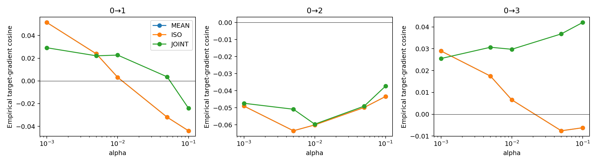
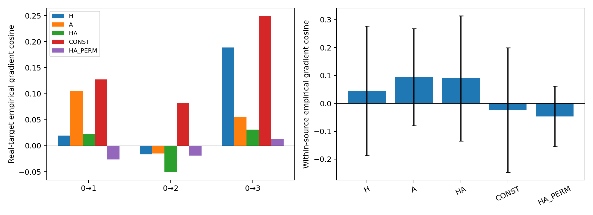
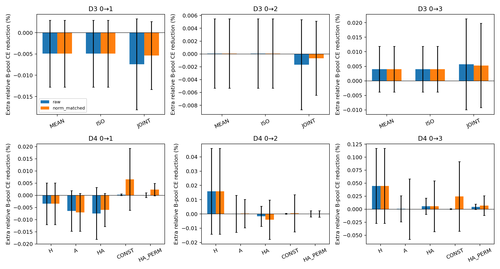

# D3校准对照与D4相似度诊断：结果解读

**D3：未通过；D4：未通过。** 复杂校准没有稳定增量，当前加入响应相似度也没有稳定优于只看表示。这里的“未通过”指冻结方案的研究门槛；主比较均已正常执行且收敛，不是工程崩溃。

## 统一设置与阅读方法

- Mutagenicity，SEGA边数规模域0→1/2/3，非官方自然域。源fit779、query196、validation109；fit每块16，目标A每块16，B池完整271。
- 复用P0的45个任务×种子×快照引用、实际35个文件，以及360份无标签几何缓存；不新增预训练或连续适配。
- 五模型种子3405—3409；快照为fit best、源SGD50/200步。先平均种子内快照／块，再汇总五种子；源内两折也不算额外模型种子。
- 全部FP64、普通SGD单步η0.0003、β0.1。每个临时更新从同一原θ开始，原模型／buffer不变。
- 余弦越接近1越同向，接近0说明接近正交；相对误差越小越好。表中“额外降CE（%）”=相对源SGD多降低的B池CE／更新前CE×100，**不是balanced accuracy百分点**。没有最终测试集分数。

## D3：先公平比较复杂校准和简单核回归

每个α∈{0.001,0.005,0.01,0.05,0.1}比较MEAN λ=α、ISO λ=2α、JOINT λ=2α。ISO是固定Ω=I/r的条件解，与MEAN代数等价。共360×15=5400逻辑配置；主α固定0.005，其他只作敏感性分析。

| 任务 | MEAN／ISO余弦 | JOINT余弦 | JOINT−ISO | 同幅单步额外降CE（%） | D3 |
|---|---:|---:|---:|---:|---|
| 0→1 | 0.0238 | 0.0221 | -0.0017 | -0.000421 | 未通过 |
| 0→2 | -0.0635 | -0.0509 | 0.0126 | -0.000734 | 未通过 |
| 0→3 | 0.0175 | 0.0307 | 0.0132 | 0.001299 | 未通过 |

预设要求：至少2/3任务的余弦增量≥0.03、各至少3/5种子为正、同范数独立B池增益为正、覆盖≥80%。本轮三个任务均未达完整门槛。ISO/MEAN最大相对W误差为1.038e-11，说明正则匹配对照算对了。

**不是“最大方向项没有生效”。** Ω在主配置几乎集中到一个方向，JOINT与匹配MEAN的反馈平均余弦约0.89—0.92，方向确实改变；但这个变化没有带来预定的真实任务增益。结构代理的最坏方向不自动等于标签任务需要的方向。

| 指标 | 0→1 | 0→2 | 0→3 |
|---|---:|---:|---:|
| JOINT对匹配MEAN的反馈余弦 | 0.8935 | 0.8963 | 0.9224 |
| Ω偏离均匀权重的Frobenius范数 | 0.9682 | 0.9682 | 0.9682 |

正则曲线显示，更强正则通常降低相对误差／反馈幅度，但余弦没有跨任务稳定转好；不能把“缩小错误反馈”称为成功恢复监督。所有α都公开，不挑事后最优值替换主比较。MEAN更简单，但当前HA+MEAN也未被证明能work。

## D4：表示相近、响应相近，到底有没有用

- H：只比较图表示h。
- A：只比较当前目标方向上的响应A。
- HA：原版两种距离合并。
- CONST：源query核值全为1，不按query图选择权重；目标Jacobian仍照常构造。
- HA_PERM：把源签名重新分配给源ID，标签和残差保持原ID；同时置换源源核两轴和源目标核源行，保证完整Gram一致。

五核都固定joint λ0.01。本轮不根据D3结果临时给不同核换读取器。

| 相似度核 | 0→1余弦 | 0→2余弦 | 0→3余弦 | 源内留出余弦 |
|---|---:|---:|---:|---:|
| H | 0.0192 | -0.0168 | 0.1885 | 0.0453 |
| A | 0.1051 | -0.0151 | 0.0558 | 0.0938 |
| HA | 0.0221 | -0.0509 | 0.0307 | 0.0896 |
| CONST | 0.1274 | 0.0824 | 0.2494 | -0.0237 |
| HA_PERM | -0.0264 | -0.0192 | 0.0132 | -0.0466 |

主比较是HA对H。真实目标三个任务的同幅单步均未超过H；特别在0→3，加入响应后的平均方向余弦从0.1885降到0.0307。

| 任务 | H原幅度 | HA原幅度 | H等范数 | HA等范数 | D4 |
|---|---:|---:|---:|---:|---|
| 0→1 | -0.003482 | -0.007446 | -0.003482 | -0.006026 | 未通过 |
| 0→2 | 0.015808 | -0.001677 | 0.015808 | -0.004047 | 未通过 |
| 0→3 | 0.044686 | 0.005664 | 0.044686 | 0.005761 | 未通过 |

H等范数列与原幅度相同，因为H本身就是参考幅度。HA缩放到同块H范数后仍未获得增量，因而不能只用“HA反馈变小了”解释差别。三个任务均未达到D4预定门槛：余弦增量≥0.03、至少3/5种子为正、同幅B池改善为正、覆盖≥80%。

## 源内正对照也不强

源query196按输入ID哈希分98/98，两折交换bank与audit；audit内每块A16、B82。5种子×3快照×2折×4块=120块，模型只用原fit监督，query未用于这些快照的反馈训练。

源内H余弦0.0453、HA为0.0896；HA角度有弱增量，但同幅独立B池效果几乎持平，平均差约−2.89×10⁻⁸（相对CE量），没有形成强正对照。经验标签梯度含噪声；不能因此宣称条件期望梯度也必然不可恢复。

近邻标签一致率说明相似度并非完全无信息：源内H约62.5%、HA约62.8%，对应类比例基线约49.6%；真实源bank的HA约66%，基线约49.8%。**“邻居标签常相同”没有自动变成可靠的残差／梯度读取。** 图的标签、当前模型误差以及它们的跨域关系是不同问题。

源内bank98与真实bank196数量不同，源内和目标的差别只作机制定位，不构成严格匹配样本量的域因果比较。

## 常数核对照带来的提醒

CONST的真实目标余弦比HA高，但在本轮追加读取阶段，它只使用源query标签总体比例与源预测总体偏差。二分类时，令u=目标响应平均、n=源bank大小，最优读出为W=c·u·1ᵀ，c=(r+1)/(n(r+1)+λ)。因此它读取的是源残差的总和；**只打乱固定query池中的query标签对应关系，不会改变这个总和**。源fit预训练仍已使用图与标签的对应；这里仅说明，CONST的追加反馈不能被解释为利用了query逐图标签关系。

CONST的原幅度单步收益很小；不能只看较好余弦就宣称分类有效。它提示后续需要区分“全局平均残差校准”与“逐图监督信息”各自的作用。

2400个D4逻辑求解中有68个CONST控制未达容差（67次迭代上限、1次回溯上限），均为真实目标组；H/A/HA/HA_PERM及D3主比较全部收敛。未收敛记录和标志完整保留，没有改写为成功。

补充的**无标签、二分类解析数值审计**显示，CONST读出相对精确解最大误差为2.251e-05，最小矩阵余弦为0.999999999999981。该检查不更换正式结果或收敛状态，也不影响主H/HA结论。

## 下一步建议

1. 优先把H-only作为一个独立候选，按原D1/D2补齐真实／打乱标签／等范数随机及Oracle，而不是直接长期训练。H的单步更好不等于已经证明源监督有效。
2. 做D8已知条件规律的正负对照，分开“经验标签噪声很大”与“读取器在友好条件下也估不准”。目前源内诊断不足以充当强正对照。
3. 后续另登记一次全局／逐图残差分解：r_i=平均残差＋中心化残差，比较两部分的方向和独立单步。先确认逐图标签关系提供额外价值，再考虑D5局部bank／门控。
4. 暂不把最大方向项当作已证实贡献；需要保留时应提供增量证据。简化读取可减少复杂度，但不是修复迁移失配的保证。

本轮仅完成D3/D4，不自动运行上述后续项目，不读取final。结果属于已观察开发集上的探索性机制证据，不是新盲测、一般不可行证明或投稿就绪结论。
