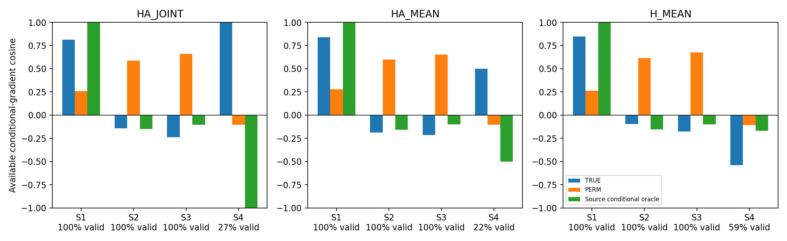
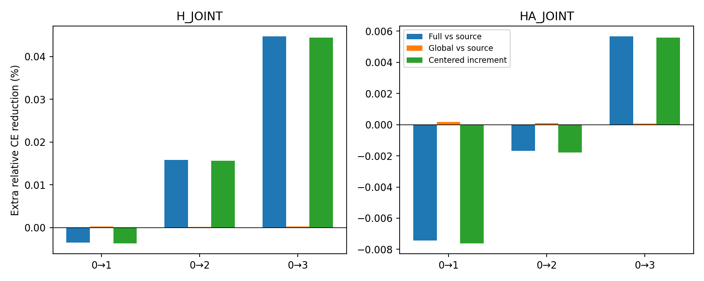

# D8与残差分解：结果解读

D8共享规律S1获支持方法：**['HA_JOINT', 'HA_MEAN', 'H_MEAN']**；真实数据逐图残差联合门槛获支持候选：**[]**。这两组是机制诊断，不是完整适配分类结果。

## 这轮最重要的结论

**在规定的友好合成图上，反馈方向可以恢复；真实数据的部分收益主要来自逐图残差，而不是平均残差。但“稳定利用逐图标签对应关系”仍未过门槛。**

### 1．友好条件下，基本机制能成立；幅度仍明显受源标签噪声影响

S1共享标签规律、特征捷径未反转、源目标部分重叠，三个预定读取器都通过了S1门槛。±是五模型种子标准差；source conditional只把源Y换成生成器给出的真实概率η_S，属于不可用于真实UDA的Oracle。

| 方法 | 抽样源标签方向余弦 | 乱标签余弦 | 真实源概率Oracle余弦 | 抽样标签相对梯度误差 | 源概率Oracle相对误差 | 满足完整种子阈值 |
|---|---:|---:|---:|---:|---:|---:|
| HA_JOINT | 0.8135 ± 0.1239 | 0.2594 | 1.0000 | 1.534 | 0.0054 | 3/5 |
| HA_MEAN | 0.8414 ± 0.1313 | 0.2797 | 0.9998 | 1.416 | 0.0090 | 4/5 |
| H_MEAN | 0.8477 ± 0.1385 | 0.2636 | 0.9997 | 1.294 | 0.0143 | 4/5 |

方向通过并不等于恢复了准确幅度：抽样标签相对误差仍大于1，源概率Oracle的误差则很小。D8中的H版本按原方案为H-MEAN；真实数据分解的H版本为H-JOINT，不能将其称为完全相同配置的跨数据复现。

线性高斯组更明显：HA-JOINT抽样源标签平均余弦−0.1241，换真实源概率后为0.9988。其归一化源标签噪声平方项中位数7.179，合并失配项0.04359。说明在这组已知规律下，查询源标签噪声经读出后会被明显放大；不能据此直接量化真实Mutagenicity的噪声，那里没有η真值。中位数只描述尺度，不把中位数项硬加为总误差。

### 2．关系失配时，给真实源概率仍不能修复

S2反转特征捷径后，三个方法的抽样源标签平均方向均为负，换真实源概率后的平均方向也仍为负。因此在本轮固定源样本和读取器下，仅去掉源标签抽样噪声仍不能修复；当前签名下存在源目标关系或覆盖／近似失配。增大源查询量是否改变该结果尚未检验，不能据此断言更多样本永远无效。

S3只翻转目标标签规律，输入和S1逐个相同，360对读出完全一致，平均方向转负。这是方法所需迁移假设的边界；无标签输入本身不能辨别两个标签规律。

### 3．支持分离不等于已经学会可靠退让

S4的可比覆盖不足80%。主表的余弦只对可定义部分平均，特别HA-JOINT的约0.9997不能代表整体成功。精确零反馈为浮点计算结果，不当成RBF数学上严格无支持。

| 方法 | 成对有效覆盖 | 精确数值零反馈 | 平均H_ST范数 | 平均反馈范数 |
|---|---:|---:|---:|---:|
| HA_JOINT | 26.7% | 13.3% | 0.0917 | 0.5084 |
| HA_MEAN | 21.7% | 13.3% | 0.0917 | 0.2484 |
| H_MEAN | 59.2% | 0.0% | 5.8002 | 3.6364 |

H_ST通常减小，但H-MEAN的平均反馈范数反而高于S1；没有证明当前算法能自动、稳定地在弱支持时停止反馈。还需看每块支持与幅度，而不能只看原始特征加10或一个较高的有效子集余弦。

### 4．真实H-only的正收益并非主要来自平均残差

以下是完整独立单步相对CE百分比，非BA百分点。逐图增量严格用“完整更新减去只加平均项的更新”评价，而不是将两次单独CE收益强行相加。

| 任务 | 完整反馈相对源SGD | 平均反馈相对源SGD | 追加逐图项的增量 | 逐图项胜过等幅乱标签的种子 |
|---|---:|---:|---:|---:|
| 0→1 | -0.003482 | 0.000238 | -0.003720 | 1/5 |
| 0→2 | 0.015808 | 0.000182 | 0.015626 | 2/5 |
| 0→3 | 0.044686 | 0.000244 | 0.044441 | 3/5 |

这修正了此前“收益可能主要来自平均残差”的猜测：本轮H-only在0→2、0→3的收益大部分保留在逐图项中。HA仍弱，去掉平均项并未恢复它。

不过，“逐图残差有用”仍不等于“逐图标签对应关系稳定有用”：中心化残差=(Y_i−平均Y)−(p_i−平均p)，仍包含各图预测差异；打乱Y不会删除这些预测差异。逐图方向门槛六个任务／候选组合均未过，H的两个正任务仅通过单步增量门槛。0→2对逐图乱标签仅2/5种子胜出，0→3为3/5。

### 下一步建议

- 保留H简化路线，暂不进入真实完整适配。S1方向成立是机制正对照，不是Mutagenicity效果证明。
- 优先研究查询源监督的方差：更充分查询、独立源留出验证、避免将小样本噪声读成强反馈；不能直接用未知η替代真实标签。
- 把中心化标签项与中心化预测项再分开做匹配对照，定位真实增益是否依赖源图与标签对应。
- 捷径反转、支持分离需要关系可靠性／支持门控证据；单纯加源样本不能保证修复S2/S3。

以上是后续建议，本轮未自动执行这些新实验。

## 先看实验在问什么

D8自己规定每张图属于类别1的概率η，因此可以计算没有随机标签噪声的条件梯度。真实源标签是按η抽取的一次0/1结果，方法只读这些抽样源标签，不读η。额外给读取器真实源η只作Oracle，区分源标签波动与函数近似／覆盖／跨域失配。

真实数据把源残差写成r_i=平均残差+(r_i−平均残差)。同一个V和W分别读取，完整反馈=平均反馈+逐图反馈。平均项对固定query池的标签置乱不变；源fit预训练仍使用过图与标签对应，不能把这个不变性外推成整个模型没用标签。

## D8设置和结果

- 五个配对生成／模型种子3405—3409；输入生成seed7300+(seed−3405)，角色偏移11/12/13/14/20/21，标签另加1000。
- cycle图含可选三角形；节点(1,u)，源u近似类别符号，η=sigmoid(4(2t−1))。源fit512／query196／validation128／audit256；目标构造1024、独立评价1024。
- 两层GINE hidden32 mean，固定200个Adam更新、batch32、lr0.003；保存0/50/200，共五个源模型复用于四情形。没有按目标结果选择快照。
- S1共享规则且部分重叠；S2特征捷径反转但标签仍由三角形决定；S3输入与S1相同、η翻转；S4目标u加10，不预先假定签名空间一定分离。
- 480个图块，每块目标16；三个原定读取器：HA-JOINT λ0.01、HA-MEAN λ0.005、H-MEAN λ0.005。各做真实／三次乱标签／三次同空间等范数随机、条件Oracle、经验Oracle、源条件读出。
- 首要比较当前A块条件梯度；独立目标池只用于辅助条件CE。前4块附加η0.0003、β0.1独立临时步，不迭代轨迹。
- 另有二维高斯线性组120块，θ=(0,0)/(1,1)/(0.5,−0.5)，真实w=(1,−1)。该组目标全池1024包含A，只作解析与噪声诊断，不宣称独立B泛化。

| 情形 | 方法 | 真实标签余弦 | 乱标签余弦 | 随机余弦 | 换成真实源概率的余弦（Oracle） | 满足S1阈值种子 | S1判断 |
|---|---|---:|---:|---:|---:|---:|---|
| S1 | HA_JOINT | 0.813537222589536 | 0.2593820981272913 | -0.0021382202397645456 | 0.9999551505261337 | 3/5 | 通过 |
| S1 | HA_MEAN | 0.8413772335784913 | 0.2796664227561275 | -0.002138220239764547 | 0.9998357421215561 | 4/5 | 通过 |
| S1 | H_MEAN | 0.8476626099875221 | 0.26356894235219014 | -0.002138220239764546 | 0.9996775433748262 | 4/5 | 通过 |
| S2 | HA_JOINT | -0.14175975016275671 | 0.5872950863195465 | -0.016891704200606015 | -0.1490002123176599 | 0/5 | 边界描述 |
| S2 | HA_MEAN | -0.18611496935235805 | 0.598415987591631 | -0.016891704200606008 | -0.15634389679172672 | 0/5 | 边界描述 |
| S2 | H_MEAN | -0.09485075233026345 | 0.6146610729626558 | -0.016891704200606008 | -0.1528069982625558 | 0/5 | 边界描述 |
| S3 | HA_JOINT | -0.2379429812621122 | 0.6593680629079972 | 0.012696356716905924 | -0.10333702021627424 | 0/5 | 边界描述 |
| S3 | HA_MEAN | -0.21389328897930904 | 0.6517467018871232 | 0.012696356716905926 | -0.10138469027745373 | 0/5 | 边界描述 |
| S3 | H_MEAN | -0.17765060376968267 | 0.6762714979437278 | 0.012696356716905919 | -0.09894620472560607 | 0/5 | 边界描述 |
| S4 | HA_JOINT | 0.9997190169513472 | -0.10423808499581858 | -0.1151719896346799 | -0.9998369450029347 | 0/5 | 边界描述 |
| S4 | HA_MEAN | 0.4999984280537012 | -0.10416720572349496 | -0.1583186092822395 | -0.500038432175657 | 0/5 | 边界描述 |
| S4 | H_MEAN | -0.5401907747786145 | -0.10808454536695941 | -0.041808258966605186 | -0.168840863635042 | 1/5 | 边界描述 |

S1判据在执行前固定：平均c>0.2，对两类null优势各≥0.05，至少3/5种子自身同时满足这三个阈值，可比覆盖≥80%。三个方法分别报告，不事后选择某个快照或生成器。其余情形只检验边界，不用S1门槛冒充成功率。

源标签噪声项(g_hat−g_read_source_cond)与合并失配项(g_read_source_cond−g_cond)相加为总误差。平方误差必须加交叉项；原始、归一化两项和交叉项全部在error_decomposition.csv，不把失配项单称为域偏移。S4同时公开K_ST、H_ST、E、反馈范数和精确数值零率；RBF下溢为0与数学支持严格为0不同。

## 真实Mutagenicity：平均项与逐图项

沿用0→1/2/3、五种子、0/50/200快照、源query196、fit16、A16、B271。H-JOINT和HA-JOINT各360个方向块；前4块共180×2×13=4680次临时步。β0.1、η0.0003，FP64。

完整、平均、逐图原幅度均公开；另将平均／逐图匹配完整反馈范数。关键受控比较：保持同一个源梯度和平均反馈，追加真实逐图反馈或同幅乱标签逐图／同空间随机逐图反馈。乱标签保留每图p，不把整个残差直接置乱。

下表都是**相对基准CE的额外降低百分比，不是准确率百分点**。完整／平均列相对源SGD；逐图增量=完整相对平均；最后两项为真实逐图相对两类等幅逐图null。

| 方法 | 任务 | 完整反馈 | 平均反馈 | 逐图增量 | 对乱标签优势 | 对随机优势 | 对乱标签胜种子 | 联合门槛 |
|---|---|---:|---:|---:|---:|---:|---:|---|
| H_JOINT | 0→1 | -0.003482 | 0.000238 | -0.003720 | -0.003919 | -0.003542 | 1/5 | 未通过 |
| H_JOINT | 0→2 | 0.015808 | 0.000182 | 0.015626 | 0.012461 | 0.015066 | 2/5 | 未通过 |
| H_JOINT | 0→3 | 0.044686 | 0.000244 | 0.044441 | 0.021227 | 0.041491 | 3/5 | 未通过 |
| HA_JOINT | 0→1 | -0.007446 | 0.000177 | -0.007622 | -0.006884 | -0.007251 | 1/5 | 未通过 |
| HA_JOINT | 0→2 | -0.001677 | 0.000107 | -0.001784 | -0.005655 | -0.002278 | 0/5 | 未通过 |
| HA_JOINT | 0→3 | 0.005664 | 0.000073 | 0.005591 | -0.000696 | 0.005228 | 3/5 | 未通过 |

逐图方向门槛：c_A>0、对乱标签逐图／随机逐图各余弦优势≥0.05、各≥3/5种子为正、覆盖≥80%。增量单步门槛：追加逐图相对平均反馈收益≥1e-4、≥3/5种子为正、相对两类等幅逐图null均值优势均>0、覆盖≥80%。一个候选至少2/3任务两项均过才支持“稳定逐图监督增量”；不是显著性检验。

向量可相互抵消，平均／逐图反馈的范数比例不是贡献百分比；CE也有曲率，不能将两次单独更新收益无条件相加。分种子和快照CSV完整公开，不根据总体均值隐藏反转。

## 完整性、范围和复现

- 正式记录数：{'linear_gradient_blocks': 3960, 'graph_gradient_blocks': 15840, 'error_decomposition': 1800, 'synthetic_step_blocks': 2880, 'real_gradient_blocks': 6480, 'real_step_blocks': 4680, 'real_residual_components': 720, 'synthetic_baseline': 60}。
- FULL与旧H/P0最大梯度指标误差3.331e-16；S1/S3的360组读出哈希相同。
- 最大残差加法误差1.283e-14；误差平方分解恒等式误差3.199e-12。
- 合成校准非收敛配置3，全部保留状态与近似解。目标真相访问先封存W后显式记录；真实final读取0，不保存Oracle轨迹为模型。
- 旧原方案不修改；本轮未规定的块种子、附加条件CE步与逐图门槛等显式登记在execution_protocol.md。D8合成不能替代真实任务效果，开发集反复观察后的真实分解属于探索性诊断。
- git_commit=81d0703cba59047fff4e5ef607978fd7d2475295；plan_sha256=cd67ab90d1bcad45bd0dfdfdca4ae07833ecbc905b90e858b19f1859cd709c35；execution_protocol_sha256=1cae76e7b974cea0d56c6217a4ea301d621759d1dff129979d40172aefe46c05。
- 入口mechanism_experiment.py，prepare→pilot→run；汇总mechanism_summarize.py。详见复现命令及原始日志。数据／checkpoint／代码与角色种子按manifest保存。
