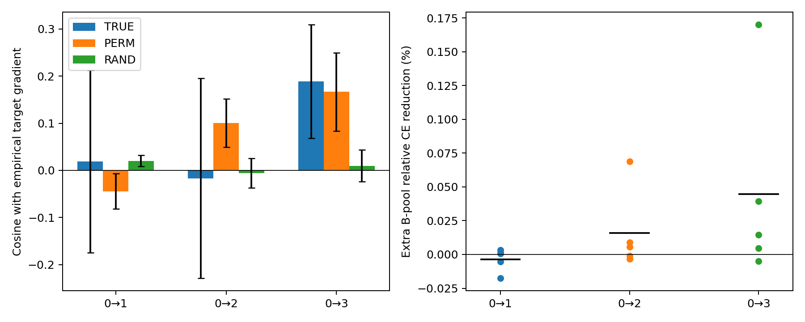

# H-only：真实标签能否超过乱标签与随机反馈

**D1：未通过；D2：通过；不建议进入完整训练。**

本轮只把相似度从HA改为H（图表示），仍保留目标Jacobian探测、源响应读出和JOINT校准λ=0.01。H不使用响应距离，不代表删除目标探测或源响应。

## 设置

- Mutagenicity，SEGA按边数构造的规模域0→1/2/3，非官方自然域。
- 五模型种子3405—3409，源fit779／query196／验证109；每块fit16、目标A16、独立B完整271。
- 同一45个任务×种子×快照引用（35个不同checkpoint）；快照为fit best、源SGD50／200步。
- D1共360块；D2用每快照前4块，共180块、6480次独立临时更新。不新增预训练、不连续适配。
- β=0.1，步长0.0001／0.0003／0.001；主结果固定0.0003，不事后挑选。FP64、CPU。
- 先对每个模型种子内各块、快照等权平均，再对五种子汇总。块、快照和三次null重复不当作新增种子。
- 相同θ、目标方向V、核与W下，PERM只打乱query标签，保留各图预测p；RAND在同一V空间随机取向。各用预定三次重复，不挑选。
- D1保留各臂原始幅度误差；D2将乱标签、随机、Oracle反馈匹配到真实反馈范数，源梯度保持相同。
- 所有W在开发标签读取前固定；目标A标签仅用于梯度诊断／Oracle，B标签仅作独立评价。最终测试标签未读取。

## D1：方向是否有真正的监督信息

余弦比较反馈与目标A真实经验梯度；越大越同向。乱标签／随机各先平均三次。最后一列为冻结门槛。

| 任务 | 真实标签余弦 | 乱标签余弦 | 随机余弦 | 对乱标签优势 | 对随机优势 | 配对种子胜数（乱／随机） | 门槛 |
|---|---:|---:|---:|---:|---:|---:|---|
| 0→1 | 0.0192 | -0.0445 | 0.0199 | 0.0637 | -0.0008 | 3/5、3/5 | 未通过 |
| 0→2 | -0.0168 | 0.1005 | -0.0058 | -0.1173 | -0.0109 | 1/5、2/5 | 未通过 |
| 0→3 | 0.1885 | 0.1668 | 0.0095 | 0.0217 | 0.1790 | 4/5、5/5 | 未通过 |

要求至少2/3任务同时满足：真实标签余弦>0，对两类null各至少0.05优势，各至少3/5种子为正，成对非零覆盖≥80%。结果有0/3任务通过。幅度误差及分快照、分种子结果见原始CSV，角度好不等于幅度准确。

## D2：迈一步，另一批图是否真的变好

所有数值为**额外降低B池CE的相对百分比**，正数为真实反馈更好，**不是balanced accuracy百分点**。“相对源训练”即S+Q对S；Oracle在同一A批取真实梯度并匹配反馈范数，仅作诊断上限参照。

| 任务 | 相对源训练 | 相对等幅乱标签 | 相对等幅随机 | 等幅Oracle相对源训练 | 真实反馈正收益种子 | 门槛 |
|---|---:|---:|---:|---:|---:|---|
| 0→1 | -0.003482 | -0.003858 | -0.003307 | 0.005088 | 3/5 | 未通过 |
| 0→2 | 0.015808 | 0.012554 | 0.015261 | 0.018173 | 3/5 | 通过 |
| 0→3 | 0.044686 | 0.021304 | 0.041725 | 0.068078 | 4/5 | 通过 |

要求至少2/3任务同时满足：相对源训练收益≥0.01%（R_Q≥1e-4），至少3/5种子收益>0，对乱标签／随机均值均有正优势，覆盖≥80%。结果有2/3任务通过。

## 进一步看“稳定”：单步过门槛，但不能只看均值

D2在0→2、0→3通过了原筛选门槛，这是相对原HA版本的积极结果：在这批冻结位置，真实源标签能够提供平均独立单步收益。**D1仍为0/3；D2为2/3。不能把本轮概括成“完全没有有用信号”，也不能说“稳定超过两类null已经成立”。**

D2原判据要求源训练之外的收益至少3/5种子为正，但对两类null只要求跨种子平均优势为正。额外公开下面的配对种子胜数作稳定性描述，不事后改门槛：

| 任务 | 胜过源训练 | 胜过等幅乱标签 | 胜过等幅随机 |
|---|---:|---:|---:|
| 0→1 | 3/5 | 1/5 | 3/5 |
| 0→2 | 3/5 | 2/5 | 3/5 |
| 0→3 | 4/5 | 3/5 | 4/5 |

0→2虽然平均优于乱标签，但只有2/5种子胜出，且种子3405贡献较大；0→3为3/5种子胜过乱标签、4/5胜过随机，仍不是普遍有效。0→3方向余弦真实0.1885、乱标签0.1668：逐图标签对应带来的优势仅0.0217，未达预设0.05。这里不是说两者严格等价。

### 分快照检查

以下每行是五个模型种子的平均，快照0代表fit best，50/200为源训练步。最后两列仍为相对CE百分比，主η=0.0003。D1每快照8块，D2每快照前4块，二者不逐块混作同一指标。

| 任务 | 快照 | 真实c_A | 乱标签c_A | 真实c_B | 对源训练额外降CE（%） | 对乱标签额外降CE（%） |
|---|---:|---:|---:|---:|---:|---:|
| 0→1 | 0 | 0.0433 | -0.0071 | -0.0776 | -0.001996 | -0.002562 |
| 0→1 | 50 | 0.0784 | 0.0247 | -0.0319 | -0.002483 | -0.002058 |
| 0→1 | 200 | -0.0641 | -0.1511 | -0.1027 | -0.005967 | -0.006953 |
| 0→2 | 0 | -0.0536 | 0.0258 | 0.1625 | 0.009024 | 0.010831 |
| 0→2 | 50 | -0.0223 | 0.1999 | 0.2449 | 0.016784 | 0.020665 |
| 0→2 | 200 | 0.0255 | 0.0759 | 0.2928 | 0.021617 | 0.006166 |
| 0→3 | 0 | 0.1813 | 0.1174 | 0.2660 | 0.057300 | 0.059089 |
| 0→3 | 50 | 0.1907 | 0.2019 | 0.2633 | 0.041465 | 0.019406 |
| 0→3 | 200 | 0.1935 | 0.1811 | 0.2275 | 0.035291 | -0.014584 |

0→2的c_A偏弱而c_B为正，提示有限A批梯度与全B池方向可能不同；这是观察到的现象，不能仅凭这张表判定其唯一原因。0→3在200步快照上，对乱标签的单步优势变负，不能挑初始快照替代总体结果。

主步长下，等幅Oracle相对源训练在三个任务平均均有正收益，特别0→1实际反馈负、Oracle正，说明这个位置并非“任何额外目标反馈都无效”。Oracle仍依赖A标签，不能作为无监督训练结果。

综合：保留H-only作为较有希望的简化候选，暂不进入长期完整训练；先做D8已知条件规律控制，以及源平均残差／中心化残差分解，检查逐图监督关系是否提供稳定增量。

## 如何理解、下一步怎么做

H-only的D2单步收益得到两任务支持，但D1未通过，且对乱标签的种子稳定性不足。暂停完整训练，同时保留这个局部积极结果；不能仅凭它在D4优于HA就宣布修复成功。

H-only是看过D4后选出的候选，开发标签也已被反复观察；这轮是固定判据下的探索性复核，不是新盲测或显著性证明。源标签均值／残差总体偏差可能带来全局校准，不能把小幅结果直接归于逐图标签关系。Oracle取有限A批，能否推广到B也受批次噪声影响。

建议后续用D8已知条件规律检查读取器在友好条件下能否恢复正确方向；再分解源平均残差与中心化残差，确认逐图信息的增量，不先增加训练轮数。

## 完整性与复现

- 与D4 H臂360块逐项重放，最大梯度指标差0.000e+00。
- 非收敛校准块：0；原θ与buffer不变；临时步不保存为训练起点。
- 原方案及D1/D2门槛不改写；独立候选说明见candidate_protocol.md。
- 原始记录、TensorBoard、种子／快照汇总、代码快照与哈希随归档保存；数据和高维几何缓存留本机。
