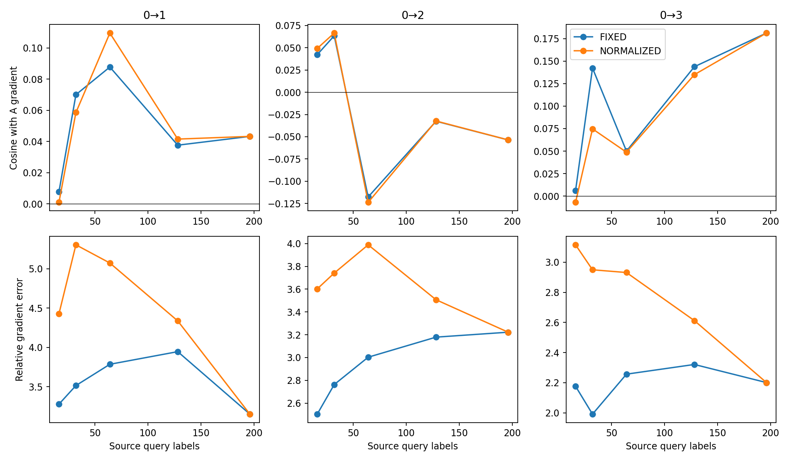
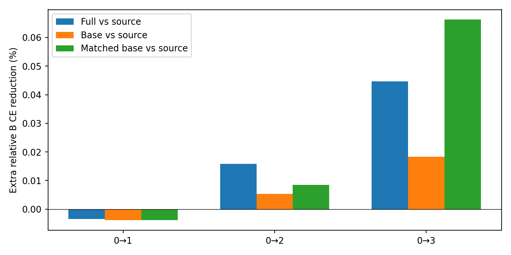

# H-only标签项／预测项与query数量：结果解读

**稳定标签增量获支持：False；query数量瓶颈判据获支持：False。** 两组为冻结快照诊断，不是完整适配效果。

## 核心结论：两组总体门槛都未通过，但不是“所有因素都没作用”

### 1．逐图标签对应关系仍未稳定贡献增量

三个任务的标签归因方向门槛和新的严格单步门槛均未通过。完整H反馈的两个正收益任务仍在，但“追加标签项胜过预测基线”仅各2/5种子为正。不能只用跨种子平均增益称稳定标签迁移。

下表是相对源SGD的额外B池CE降低百分比，非BA百分点。BASE=平均项＋预测差异，仍保留query标签比例和源fit训练；BASE-M将该反馈匹配完整FULL范数。

| 任务 | FULL | BASE | BASE-M | FULL胜BASE的种子 |
|---|---:|---:|---:|---:|
| 0→1 | -0.00348 | -0.00389 | -0.00387 | 2/5 |
| 0→2 | 0.01581 | 0.00534 | 0.00845 | 2/5 |
| 0→3 | 0.04469 | 0.01831 | 0.06626 | 2/5 |

特别0→3，BASE的方向余弦0.4485高于FULL的0.1885；匹配范数后的BASE-M单步平均收益约0.06626%，高于FULL的0.04469%。该比较有4/5种子支持，但仍是开发集上的描述性结果，未把BASE-M选成新主方法，也没有测试其长期效果。0→1没有由此得到修复，不能称预测项普遍解释全部收益。

B胜A也可能来自不同幅度或标签／预测项的抵消，因此同时保留单独项、复合null和完整等幅null，不凭某一较差基线宣布贡献。BASE依赖模型预训练，不能外推为整个系统完全不需要源标签。

### 2．query数有局部作用，但不支持“主要只是源标签数量不够”

- NORMALIZED约定下，0→1和0→3同时通过方向／误差门槛；FIXED约定下0/3通过，所以两种约定共同支持的总体门槛未过。
- 0→3从16到196的平均方向余弦明显提高：FIXED为0.0059→0.1813，NORMALIZED为−0.0070→0.1813。但FIXED相对梯度误差反而增加约1.1%；NORMALIZED误差降低约29.3%。不能只看角度，也不能把两种正则曲线混为同一证据。
- 0→2的平均方向随查询增加反而变差：FIXED为0.0423→−0.0536，NORMALIZED为0.0493→−0.0536。更多标签并不保证当前读取器更接近目标任务需要的方向。
- n196已经读取整个既有池。重复排列得到同一估计，抽样离散度为数值零是没有剩余子集选择的结果，**不意味着这个估计没有统计噪声或已经正确**。
- 196之外更多独立监督是否有帮助没有测试；源标签量还会改变带标签覆盖，本轮也没有测到纯粹的标签噪声强度。

### 当前决定

暂不进入完整适配，不再将“逐图源标签迁移已成立”或“失败主要因为query太少”作为结论。若继续研究，应明确选择新假设：把预测校准作为独立候选，或针对更可靠的跨域条件关系设计新读取器；它们都需要新登记的对照，不能用本轮开发结果直接宣称成功。本轮不自动启动这些后续实验。

## 标签项与预测项：实验如何拆开

每图残差(Y_i−p_i)Q分为GLOBAL=(平均Y−平均p)Q、LABEL=(Y_i−平均Y)Q、PRED=−(p_i−平均p)Q。沿同一V和W分别读取。BASE=GLOBAL+PRED，对固定query标签的对应置乱不变；FULL=BASE+LABEL恰好还原原H-only反馈。BASE仍使用query标签比例，骨干也经源fit预训练，不能称完全无监督模型。

- A：源梯度＋BASE；B：源梯度＋FULL；C/D：保留BASE，只将LABEL换成等幅三次乱标签／同V空间随机LABEL。
- 再把C/D的完整反馈匹配到FULL范数，辅助检查大项抵消与步长的影响；该辅助组会缩放BASE，故不能与主组混称同一个控制。
- 另报单独LABEL、PRED、匹配FULL范数的BASE与Oracle。每次从同一原θ开始，19臂×180块=3420独立临时更新。
- 标签项和预测项可能很大、互相抵消。B胜A可能只是抵消了有害基线；必须同时看B胜源SGD及两类完整等幅null，不把抵消当作新目标监督。

Mutagenicity 0→1/2/3，五模型种子，源fit779／query196／validation109；每块fit16、A16、B完整271。沿用0/50/200源监督快照、每快照8块，方向共360块，单步取前4块。β0.1、η0.0003、FP64、H-JOINT λ0.01。

下表为相对基准CE降低百分比，非准确率百分点。正数更好；FULL／BASE相对源SGD；TOTAL-M表示完整反馈等幅null。

| 任务 | FULL方向余弦 | FULL单步收益 | BASE单步收益 | FULL对乱标签TOTAL-M优势 | 配对胜种子 | 联合门槛 |
|---|---:|---:|---:|---:|---:|---|
| 0→1 | 0.0192 | -0.003482 | -0.003892 | -0.002109 | 1/5 | 未通过 |
| 0→2 | -0.0168 | 0.015808 | 0.005336 | 0.013645 | 2/5 | 未通过 |
| 0→3 | 0.1885 | 0.044686 | 0.018307 | 0.027776 | 4/5 | 未通过 |

执行前判据：方向FULL c_A>0，对两类保留BASE的null各优势≥0.05、各≥3/5种子正、覆盖≥80%；单步FULL相对源SGD收益≥1e-4，FULL对BASE、主乱／随机及TOTAL-M乱／随机均值优势>0，所有比较各≥3/5种子为正、覆盖≥80%。至少2/3任务两项均过才称稳定标签增量。不修改旧D1/D2判据，不作显著性声明。LABEL/PRED范数、夹角、抵消比例及分种子／快照结果全部保留。

## D7-H：源query变多是否更稳定

本轮是原D7-A/B的H-only候选版本：核由原主HA改为H，范围明确登记，不能称已完成原HA版D7。仅五个初始fit模型×三个任务×八块=120目标块；不混入50/200快照。

196个query输入均可用于固定带宽和签名；每模型种子五个输入无关SHA256(D7|seed|rep|source_id)排列，嵌套取16/32/64/128/196张标签，核用196全池公共带宽。改变的是读取的监督数，输入信息范围及目标V固定。query不混入已预训练的fit图。源标签数也改变带标签覆盖，不能把曲线直接解释为纯标签噪声。

FIXED λ=0.01；NORMALIZED λ=0.01·n/196。两条都报告，不宣称后者最优。五次排列先在同一目标块内平均，再按模型种子平均；196的排列／正则完全等价，共用一次物理解，不当作十次独立证据。6000个逻辑配置对应4920个物理解，首4目标块的3000条逻辑单步对应2460次实际独立更新。

| 任务 | 正则约定 | n16方向余弦 | n196方向余弦 | 余弦提升 | 相对梯度误差降低 | 同向种子 | 门槛 |
|---|---|---:|---:|---:|---:|---:|---|
| 0→1 | FIXED | 0.0077 | 0.0433 | 0.0356 | 3.9% | 3/5 | 未通过 |
| 0→1 | NORMALIZED | 0.0010 | 0.0433 | 0.0423 | 28.8% | 3/5 | 通过 |
| 0→2 | FIXED | 0.0423 | -0.0536 | -0.0959 | -28.7% | 0/5 | 未通过 |
| 0→2 | NORMALIZED | 0.0493 | -0.0536 | -0.1028 | 10.6% | 1/5 | 未通过 |
| 0→3 | FIXED | 0.0059 | 0.1813 | 0.1753 | -1.1% | 2/5 | 未通过 |
| 0→3 | NORMALIZED | -0.0070 | 0.1813 | 0.1883 | 29.3% | 3/5 | 通过 |

query判据：196相对16，平均余弦提升≥0.03、相对误差降低≥10%、至少3/5种子两项同向、有效覆盖≥80%；至少2/3任务在两种正则约定均满足才支持监督数量是主要瓶颈。达到196仍差不证明总体数据规模无关。子样本波动、对全196估计的向量离散度、类计数、W与核谱、校准状态和单步CE公开。

D7-B合成多类别PSD案例及三个真实固定签名的复制恒等式通过=True。固定λ复制两份等价于原λ/2；复制λ变2λ后按原图合并列恢复原W，误差阈值1e-8。该项用单列高精度工程配置，不改变正式曲线超参数。D7-C新增训练复用审计未执行。

## 完整性与范围

- 所有逻辑记录数：{'label_gradient_blocks': 6120, 'label_step_blocks': 3420, 'label_components': 360, 'query_size_blocks': 6000, 'query_step_blocks': 3000, 'label_blocks': 360, 'query_blocks': 120, 'query_physical_solves': 4920, 'query_physical_steps': 2460}。旧H FULL和n196最大指标差3.331e-16；标签分解最大加法误差1.767e-14。
- query校准未收敛逻辑配置0，全部保留。真实final标签读取0、新训练0，临时参数不作为后续起点。
- 已观察的开发集作探索性诊断，三次null、五次query排列、快照／块均不当独立模型种子。
- 原方案不覆盖；新增标签判据和H-only D7修订见execution_protocol.md；原始日志、readout seals、样本ID、TensorBoard、代码及SHA均归档。
- 执行代码0ff562783afe0be9cea331d604da6ed844633b72；原方案SHA cd67ab90d1bcad45bd0dfdfdca4ae07833ecbc905b90e858b19f1859cd709c35；补充协议SHA b92d9114dab1e9ea5d0173d03264736ddeb588ac9c33350d1f062e5f61120d44。
- 复现入口label_query_experiment.py prepare→d0→pilot→run，然后label_query_summarize.py。具体参数见reproduction_commands.sh。

## 后处理与执行记录

正式五种子一次完成，耗时约117.05秒，CPU五worker、GPU时0；无运行错误，无校准非收敛配置。初始模型D7与所有快照标签归因分开聚合。input-only derived_query_kernel_spectra.json补充105个唯一源子核谱，不读取标签或改变已完成实验。主结果、门槛和冻结执行代码未更改，后处理源码SHA单列。
