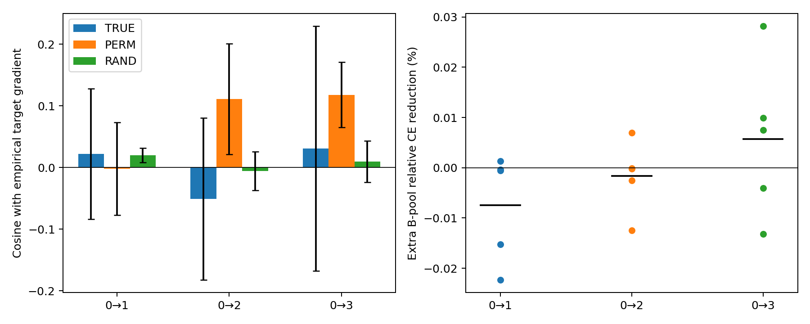

# P0实验结果白话解读

本轮D0：通过；D1：未通过；D2：未通过。当前真实源标签没有在至少两个任务上同时达到对打乱／随机反馈的预定方向优势。不能据此把旧实验的小幅分类变化归因于稳定的监督迁移，也不能从这次有限批次诊断直接推论所有TQG变体无效。

## 做了什么

- Mutagenicity的SEGA边数规模域0→1/2/3，非官方自然域。源fit779、query196、source validation109；源fit每步16，目标查询16。
- 复用5个fit预训练模型及配对源SGD的50/200步快照，共45个任务×种子×快照引用，实际35个不同文件。不重新预训练，不连续适配。
- 每个目标域原542个development ID按无标签哈希分A/B各271；A每次抽16，B每次完整评价271。B仍属于已观察的开发集，不是新盲测。final标签全程未取值。
- D1共360块；每块用同一θ/V/W对比真实源标签、3次只置乱标签、3次同空间等范数随机反馈、零反馈、Oracle和源梯度。
- D2取前4块，共180块；每块12种更新×3个学习率，共6480个独立临时单步。每臂从原θ开始，原模型及buffer不变。
- 以下按模型种子内先平均快照／块／置乱，再汇总5种子。±为模型种子样本SD，不把多个块当成独立种子。

## D0：先确认不是新诊断脚本算错

50项代数／状态检查通过，9次权限负测试拒绝；真实任务的CE梯度重构相对误差约1.3—1.4×10⁻¹⁵。实际普通SGD增量、源JVP、辅助梯度、固定Ω与KRR等价、无支持零反馈和统一缩放不变性均通过容差。工程通过只允许解释后续结果，不证明跨域迁移。

## D1：源标签给出的方向是否更有用

余弦越接近1越同向，0表示接近正交，负值意味着局部一阶上可能反向。打乱只改变Y与图的对应，预测p、V、核和W都不变；没有把整个残差乱排。

| 任务 | TRUE余弦（均值±SD） | 打乱标签余弦 | 随机反馈余弦 | TRUE−打乱 | TRUE−随机 | D1 |
|---|---:|---:|---:|---:|---:|---|
| 0→1 | 0.0221 ± 0.1058 | -0.0019 | 0.0199 | 0.0240 | 0.0022 | 未通过 |
| 0→2 | -0.0509 ± 0.1316 | 0.1108 | -0.0058 | -0.1616 | -0.0450 | 未通过 |
| 0→3 | 0.0307 ± 0.1986 | 0.1179 | 0.0095 | -0.0872 | 0.0212 | 未通过 |

预定门槛：至少2/3任务同时满足TRUE平均余弦>0、对两种null的余弦优势各≥0.05、两个比较各≥3/5种子为正、有效覆盖≥80%。正余弦本身不足以说明源标签比无关反馈有额外价值。

| 任务 | t=0 TRUE余弦 | 源SGD50步 TRUE余弦 | 源SGD200步 TRUE余弦 |
|---|---:|---:|---:|
| 0→1 | 0.0467 | 0.0475 | -0.0279 |
| 0→2 | -0.0632 | -0.1082 | 0.0188 |
| 0→3 | 0.0352 | -0.0295 | 0.0863 |

以上分阶段表仅用于解释，主判据仍等权使用三个快照，不事后只挑较好阶段。

## D2：实际迈一步，另一批目标是否改善

主学习率0.0003，反馈β0.1。这里“额外降CE”是相对同块源SGD多降低的B池CE，再除以更新前CE，乘100；**不是balanced accuracy百分点**。正数有帮助，负数拖后腿。Oracle用A标签的真实CE梯度，并缩放到与实际反馈同范数，只作诊断参考。

| 任务 | 真实反馈额外降CE（%） | 五种子正增益数 | 等幅度Oracle额外降CE（%） | 有害更新率（%） | D2 |
|---|---:|---:|---:|---:|---|
| 0→1 | -0.007446 | 1/5 | 0.005949 | 51.67 | 未通过 |
| 0→2 | -0.001677 | 1/5 | 0.007218 | 41.67 | 未通过 |
| 0→3 | 0.005664 | 3/5 | 0.021887 | 46.67 | 未通过 |

预定门槛为R_Q≥0.0001，即表中额外降CE≥0.01%，至少2/3任务、各≥3/5种子为正，且真实反馈优于等幅度打乱和随机对照，覆盖≥80%。有害指比匹配源SGD的B池CE高超过1e-8；同时保存连续数值，不能只看这个二元事件。

同范数Oracle不是B池真实梯度，它来自A的16张图；其不改善B不能直接证明没有目标改进空间。0.0001／0.001学习率结果和所有逐块数值都在原始表中，不能用其中较好者替换主学习率。

## 进一步定位

- 加权反馈范数β||g_hat||/||g_S||在三个任务平均约31.4%／28.1%／27.1%，并非反馈几乎为零。源标签估计梯度的平均相对误差为2.407／1.846／1.429；零估计在非零真实梯度上的相对误差为1。因此不能只看执行了反馈或范数不小就认为监督有效。
- 单独反馈Q在0→1、0→2同样平均有害；同范数Oracle单独及混合更新平均都改善B。源损失混合未表现为本轮的首要解释。
- 使用已保存数据补充描述性检查：主学习率180个块的实际增量与一阶预测同号，三个任务中位相对余项约1.44%／0.45%／0.39%。这支持优先检查估计方向；不是对所有步长、模型和执行错误的排除。
- 结构代理误差与真实梯度相对误差的种子内Spearman相关没有稳定正向关系（见secondary_diagnostics.json），不能把代理目标当作已校准置信度。相关性只作描述，无独立样本显著性主张。

## 下一步

下一步优先D3：先匹配有效正则，比较mean/ISO/joint；再用D4分开检查h、A、h+A签名。若源内模拟仍差，再执行D8已知条件梯度的合成实验。暂不扩batch、epoch或完整适配网格。

这是开发集上的探索性机制诊断；经验标签梯度含噪声，一步普通CE变化不能替代完整训练的balanced accuracy结果。没有新增的最终集分数。

左图：真实标签、打乱标签与随机反馈的平均余弦，误差线为五种子样本SD；右图：每个种子的额外B池相对CE改善，黑线为平均值。
