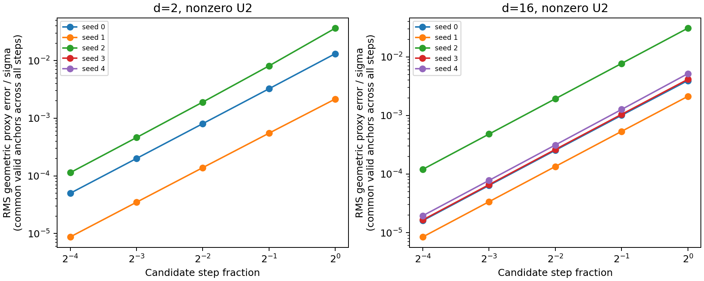
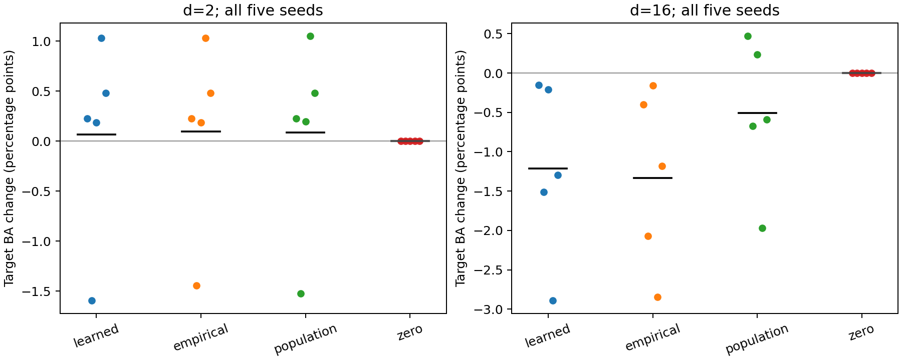
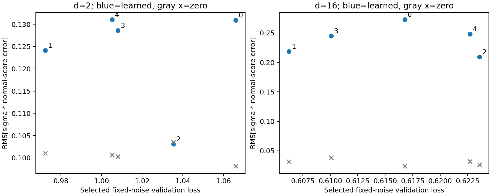

# TSBA E1/E2 合成验证结果（2026-11-09）

> 后续：[完整补充对照已发布](../e2-controls-20261109/report.md)。16维总体真实score相对零请求几何控制在5个种子上均有小幅正增量；learned请求则均有负增量。以下保留首轮的证据范围与局限，归因请结合补充报告。

> 固定表示上的机制实验；没有训练图编码器，没有读取真实图任务的目标标签。

## 主要判断

本轮没有得到当前默认 TSBA 配置具有稳定分类收益的证据。learned score 在2维的平均ΔBA为 **+0.066±0.986个百分点**（4胜1负），在16维为 **−1.211±1.122个百分点**（5个种子全部下降）；16维平均NLL同时上升0.07365。每个非零score臂的30次更新都通过验收，因此“每轮被接受”不能作为分类有效性的证据。

H2在本设置下不获支持：跨种子平均的边界法向误差比零score更大；辅助双面符号平衡一致率仅为2维9.90%、16维2.21%。empirical oracle也有明显总体误差，不能只归因于网络训练。population oracle在16维平均ΔBA仍为−0.505个百分点（2胜3负），说明准确score并不足以保证完整适配获益。

首个活动轮的固定参考分解显示源CE响应大于请求响应；但本轮没有完整的Source-CE-GGN轨迹，不能据此认定源继续训练就是全部收益或损害的原因。应先区分score拟合、有限池密度误差和源目标冲突，再考虑扩大真实图实验。既定E3/E4控制保留，未在本轮执行。

## 执行与证据范围

执行代码：[`f10262a`](https://github.com/chx739/TQG-GDA/tree/f10262a5ff90f773cc8c29e754944571593f6a7e)。方案和代码在运行前冻结；2个维度×5个种子×4臂，每臂30轮。全部预测封存后统一读取合成评价标签；不按标签选epoch、轮次或种子。

本地原始档案：`/home/hxchen/experiments/tsba/20261109-mechanisms/run-001`。文件校验通过 476 项；执行失败记录 0 项。原始checkpoint、逐轮记录、完整日志在本地持久保留；GitHub发布代码、报告、表格和校验清单，不包含模型运行二进制。

生成先验为等权二分类GMM；每域512个表示向量样本，独立评价10,000点。源均值整体右移0.5，使用解析源Bayes线性头及生产坐标/残差初始化，U2=0。这里的样本是表示向量，不是真实图。score使用100 epochs，适配使用默认Config、CPU单线程、float64。全矩阵耗时1207秒（约20.1分钟），进程峰值RSS约580 MiB。38项工程测试通过；40个最终分类器、10个score和1200轮参数状态链重载复核通过，预测要求逐位一致。合成标签由生成器写入独立文件；这一隔离不构成真实世界盲测。

## E1：方向与风险反例

| 场景（完整局部请求） | Δlog density | Δ错误率（百分点） |
| --- | ---: | ---: |
| compatible | -0.011438 | -0.198509 |
| high_density_correct_boundary | -0.000347 | 0.056852 |
| semantics_permutation | -0.011438 | 0.198509 |

线性固定斜率几何恒等式的绝对误差为 2.24e-10，低于1e-8。源监督与密度请求的固定斜率、总体积分专例得到局部平衡根 b=0.492245；源阈值为0.5，目标密度谷为0。这个专例不能证明非线性生产算法的固定点。

非零U2探针的误差曲线如下。曲线使用五种步长均能重定位的共同锚点；全量有效/缺失计数仍在CSV中保留。网格括根可能漏掉切触根，多根不强行选择。

| 维度 | 种子0–4的有效初始锚点数 | 五种步长共同可测数 | α=1/16时可测数 | α=1时可测数 |
| --- | --- | --- | --- | --- |
| 2 | 11 / 2 / 6 / 6 / 7 | 10 / 2 / 1 / **0 / 0** | 11 / 2 / 6 / 6 / 7 | 10 / 2 / 1 / 0 / 0 |
| 16 | 128 / 128 / 128 / 128 / 128 | 128 / 128 / 117 / 128 / 127 | 128 / 128 / 128 / 128 / 128 | 128 / 128 / 117 / 128 / 127 |

**2维种子3、4没有共同可测的整条曲线**：大步候选在固定搜索区间内没有括根，不能被解读为零误差。图中的趋势只支持可追踪局部分支的小步近似。这里的α=1是未经过生产回溯的候选，不等同于被接受的实际更新。

## E2：全部固定预算轨迹

| 维度 | score臂 | 完成 | ΔBA均值±样本SD（百分点） | 胜/平/负 | ΔNLL均值 | 平均接受轮数 |
| --- | --- | ---: | ---: | --- | ---: | ---: |
| 2 | learned | 5/5 | 0.0662 ± 0.9862 | 4/0/1 | -0.001504 | 30.0 |
| 2 | empirical | 5/5 | 0.0963 ± 0.9234 | 4/0/1 | -0.002408 | 30.0 |
| 2 | population | 5/5 | 0.0861 ± 0.9620 | 4/0/1 | -0.001969 | 30.0 |
| 2 | zero | 5/5 | 0.0000 ± 0.0000 | 0/5/0 | 0.000000 | 0.0 |
| 16 | learned | 5/5 | -1.2106 ± 1.1220 | 0/0/5 | 0.073647 | 30.0 |
| 16 | empirical | 5/5 | -1.3316 ± 1.1311 | 0/0/5 | 0.074508 | 30.0 |
| 16 | population | 5/5 | -0.5050 ± 0.9599 | 2/0/3 | 0.047572 | 30.0 |
| 16 | zero | 5/5 | 0.0000 ± 0.0000 | 0/5/0 | 0.000000 | 0.0 |

Δ均相对同种子的源初始化；BA越大越好，NLL越小越好。五种子是重复单元，锚点与轮次不充当独立样本。失败轨迹不混入正常完成均值；完整逐种子数值见[evaluation.csv](evaluation.csv)。

## score可靠性与可达覆盖

| 维度 | 初始边界 learned→population 法向RMSE | 初始边界 zero→population RMSE | 辅助双面 learned 符号平衡一致率 | 辅助双面 empirical 符号平衡一致率 |
| --- | ---: | ---: | ---: | ---: |
| 2 | 0.1236 | 0.1008 | 0.0990 | 0.5604 |
| 16 | 0.2386 | 0.0304 | 0.0221 | 0.4213 |

法向误差均乘σ；表中先按每个种子的共同查询点计算，再跨种子等权。实际初始边界只有一种总体score方向，因此其平衡符号一致率为NA；双方向值来自原坐标b=±0.5两张辅助查询面，不是主模型的真实边界。完整拟合/统计/总体误差在[score_queries.csv](score_queries.csv)；轨迹查询按来源臂/轮次回放，见本地observations.json。

| 维度 | 原坐标σ范围 | learned有效锚点/输入 | learned裁剪比例（先按轮再按种子平均） |
| --- | ---: | ---: | ---: |
| 2 | 0.05368–0.05674 | 0.0425 | 0.0000 |
| 16 | 0.75765–0.77741 | 0.9997 | 0.0000 |

覆盖不足或零请求按原定义记录，不调整带宽/半径补齐。E2几何每轮固定取前8个有效锚点；全部锚点均有score和margin响应记录。重定位只是观察，不参与验收。E2实际更新的固定子样本共尝试7908次重定位，7908次可测（包含零更新臂）；learned臂按轮、种子平均的归一化几何误差E_geom约为2维2.62e−4、16维2.10e−4，说明这些被测局部位移的近似误差较小。该结论只覆盖预定每轮前8个有效锚点，不能扩展为全局几何保证。

图中每点对应一个种子所选score checkpoint；灰叉为同点零score误差。这里只展示配对诊断，不声称五点建立了可靠相关关系。16维五个种子的score均选中最后一个epoch（索引99）；没有证据证明100个epoch已充分收敛，本轮也没有依据结果追加训练。

## 固定参考的源监督与请求分解

| 维度 | score臂 | source响应RMS均值 | request响应RMS均值 |
| --- | --- | ---: | ---: |
| 2 | learned | 0.039606 | 0.000054 |
| 2 | empirical | 0.039606 | 0.000463 |
| 2 | population | 0.039606 | 0.000209 |
| 16 | learned | 0.099449 | 0.008018 |
| 16 | empirical | 0.099449 | 0.012871 |
| 16 | population | 0.099449 | 0.001224 |

每条轨迹只在第一个活动轮的同一A下计算δS=−A⁻¹gS和δT=A⁻¹(λB/M)Dᵀζ，表中为DδS、DδT的RMS。它解释该轮候选的来源，不能当作跨轮风险改善的因果分解。固定参考ζ=0保留DᵀD，并单独验收；它不是生产zero-score臂，后者跳过更新。

## 限制与档案入口

- E2没有完整的源继续训练轨迹，因此任何相对Source-initial的收益都不能单独归因于密度信息。E3/E4方案已补充固定参考ζ=0、源GGN与尝试轮掩码控制。
- E3/E4真实图实验尚未执行；真实表示可读性H1没有在本轮检验。PL/entropy的700步面板已预先登记，但没有在本轮运行。
- 维度变化同时按生产默认改变adapter宽度；跨维度差异不能全部归因于带宽或维数。
- 合成反例不证明所有真实任务失败；局部几何近似通过也不证明最终分类有效。
- 原始日志、checkpoint、输入生成参数、逐轮批次/锚点/状态、逐样本logits（softmax可得概率）、封存、标签访问与完整文件SHA256见本地run目录；归档路径和校验信息见[archive-index.json](archive-index.json)。
- 发布的[summary.json](summary.json)保留全量种子结果与主要过程统计；[checkpoint-audit.json](checkpoint-audit.json)给出重载复核结果。
