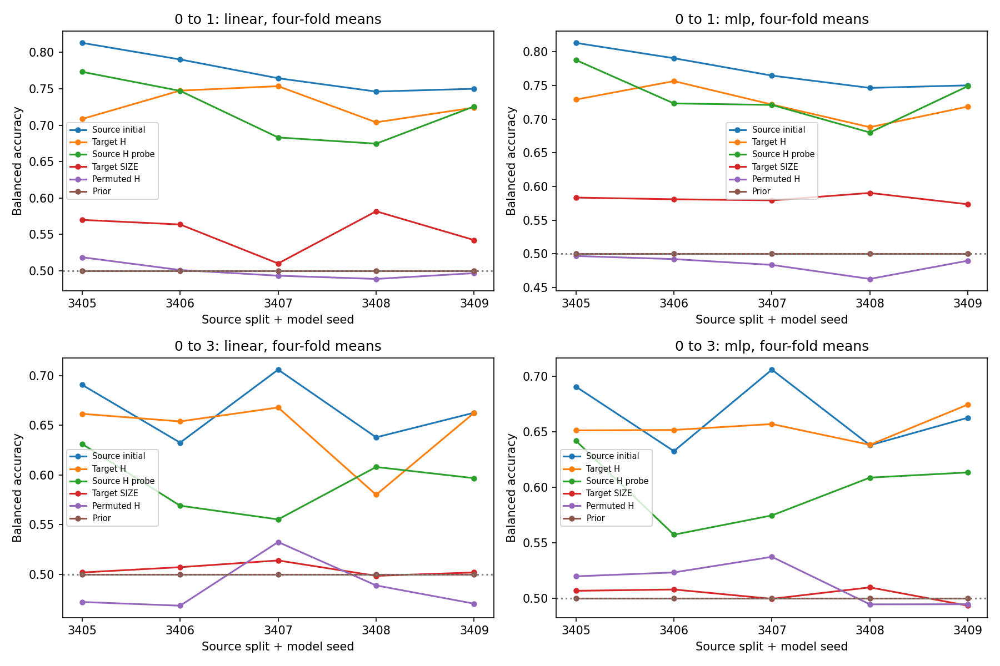

# Mutagenicity R1：表示可读，但当前局部密度诊断缺少支持

日期：2026-11-11。协议：`tsba-mutagenicity-r1-v4-20261111`。训练和固定观测实现：`c6f6be7`；仅评价绘图修复：`b8218ed`。

**本轮完成5个真实源GNN、480个探针对照、10个任务×种子的几何/密度单元。结果支持“表示中有目标分类信息”，但没有显示参考头稳定超越实际源分类器的BA空间；当前邻域与带宽下也无法可靠判断类别相关的低密度结构或有用移动方向。不进入学习score或闭环适配。**

## 1. 完成情况与运行中断

源模型各100 epochs，保存500份epoch权重/Adam；480个探针全部完成800步，共384,000次更新，保存19,200份每20步权重/Adam。10个几何单元均正常完成，参考头和失败投影没有筛掉或替换。源坐标只用对应779张训练图拟合，源模型/坐标同seed跨两个目标任务复用。

5个源模型和2,400组“探针终点×评价池”预测从checkpoint重载，最大概率误差为0，核验在开放B前完成。[重载记录](prediction-replay.json)；[源模型选模与角色摘要](source-summary.json)。工程验收86项通过，独立上下文代码review发现的问题在执行前修正；另有独立角色/随机流审计。[工程日志](R0-tests.txt)；[解释与核查口径](interpretation-notes.md)。

`attempt-001`在所有标量评价计算完成后，绘图因Wilson区间端点的浮点舍入导致极小负误差条而中断。原目录完整保留并归档。`attempt-002`复制并核验已封存的S1/S2依赖，只修复误差条显示后重做评价，没有重新训练、选模、找邻域或计算密度。11份已有标量JSON逐字节相同，22,310个复用文件哈希一致，S3封存完成。不能把第一次运行写成“从未出错”。[原始中断记录](original-interruption.json)；[修复核验](repair-verification.json)；[修复测试](repair-tests.txt)。

原始训练/观测/首次评价到绘图中断用时2256秒；评价修复阶段用时75.5秒。数据复制、归档与校验另计。原运行日志记录的峰值RSS约0.82GB，修复评价峰值约0.94GB，未触发预设资源上限。[完整运行日志](run.log)；[评价修复日志](evaluation-repair.log)。

## 2. 数据权限与统计单位

使用SEGA的四域图ID，未调用其算法角色函数。源域每个cfg.seed独立类别分层，均为779训练/109验证/196诊断；两类数量分别400/379、56/53、101/95。目标域1和3的A/B各271，final分别542/543。五个seed为3405–3409，目标A/B和目标折固定。

受限分配器在R0解析源域标签做分层；源训练器只取得自己的训练/验证标签。源诊断与A在S1后开放，B在S2后开放，final类别值未解析。全目标输入，包括B/final的无标签图，参与传导式KDE和几何计算。[标签访问摘要](label-access-audit.json)。

下表先对每seed四折算术平均，再报告五seed均值±样本SD。seed同时改变源划分和训练随机性；两个任务共享源模型，四折及重复查询不是独立重复。A/B是开发诊断数据，本轮没有final效果评价。

## 3. 表示可读性与实际改进空间

BA单位为%；NLL单位为nats。主结果固定采用29张内部验证图选中的探针，不按B选择200或800步。

| 分类器 | 0→1 BA | 0→1 NLL | 0→3 BA | 0→3 NLL |
|---|---:|---:|---:|---:|
| 原始779样本源头 | 77.28±2.84 | 0.4952±0.0692 | 66.59±3.21 | 0.6845±0.1001 |
| 同预算源H线性探针 | 72.08±4.19 | 0.5271±0.0414 | 59.21±3.03 | 0.7244±0.0686 |
| 同预算源H MLP | 73.22±3.96 | 0.5166±0.0377 | 59.92±3.34 | 0.7464±0.0907 |
| 目标H线性探针 | 72.76±2.24 | 0.4849±0.0337 | 64.52±3.67 | 0.6327±0.0238 |
| 目标H MLP | 72.26±2.45 | 0.5562±0.1354 | 65.45±1.31 | 0.6295±0.0169 |
| 目标SIZE线性探针 | 55.36±2.82 | 0.6097±0.0113 | 50.48±0.60 | 0.7012±0.0051 |
| 目标SIZE MLP | 58.16±0.61 | 0.5941±0.0026 | 50.35±0.69 | 0.7069±0.0022 |
| 目标置乱H线性探针 | 49.98±1.15 | 0.7220±0.0137 | 48.66±2.69 | 0.7323±0.0185 |
| 目标置乱H MLP | 48.51±1.33 | 0.7452±0.0329 | 51.39±1.88 | 0.7171±0.0248 |
| 目标标签先验 | 50.00±0.00 | 0.6563±0.0000 | 50.00±0.00 | 0.6953±0.0000 |

两任务、两架构的可读性判据均5/5通过。H较节点数/边数SIZE基线高约14–17个百分点，说明信息不只是这两个规模特征。0→3目标探针较同预算源探针高5.31/5.53个百分点，存在同标注预算下的迁移差异；但它们平均仍低于真正的适配起点。

相对原始源头的平均ΔBA：0→1线性/MLP为−4.52/−5.02个百分点，0→3为−2.07/−1.14个百分点。达到预设“≥1个百分点改进空间”的seed数量依次是0/5、0/5、1/5、2/5。因此本轮没有稳定观察到参考头优于源起点；不能据此声称源头已经最优，有限预算参考头不是性能上界。

NLL有不同信息：0→3线性和MLP均值分别比源头低0.0518和0.0550；0→1 MLP则平均高0.06095，且波动大。不能用单一BA掩盖概率质量变化。[逐seed/折指标](metrics/graph_metrics.csv)；[四折家族均值](metrics/probe_families.csv)；[配对差值](metrics/comparisons.csv)；[五seed汇总](metrics/seed_aggregates.csv)。

## 4. 边界找得到，但统计邻域过稀

全目标普查覆盖率的五seed均值±SD如下；参考头先在每seed内平均四折。源头和线性参考头的解析核验没有发现半径内的数值漏检。

| 任务 | 源头 | 线性参考头 | MLP参考头 |
|---|---:|---:|---:|
| 0→1 | 32.07±3.62% | 48.01±2.50% | 43.83±8.35% |
| 0→3 | 43.61±8.71% | 77.66±7.26% | 61.00±11.38% |

固定64查询中，源库逐seed投影成功数为0→1的`[15,30,26,21,26]`、0→3的`[16,34,34,24,32]`。参考头覆盖较高只能说明其边界更容易在预设半径内找到，不能把它解释成参考头分类更好。[按B类别和域内规模四分位的覆盖表](metrics/coverage.csv)。

90个库共有5760个预定记录，其中3177条投影成功。这些记录共享图和参考头，不是3177个独立样本。下表直接汇总封存的核值/邻居记录，没有重新寻找邻域或修改阈值；“生成图的核权重”属于解释性后续统计，不参与预设筛查。

| 面板：带宽倍数 / 肩距σ | 三点ESS≥5的记录 /3177 | 双侧无标签支持≥20 | 双侧B支持≥10 |
|---|---:|---:|---:|
| 主面板 1 / 1 | 0 | 0 | 0 |
| 0.5 / 1 | 0 | 0 | 0 |
| 2 / 1 | 325 | 0 | 0 |
| 1 / 0.5 | 0 | 0 | 0 |
| 1 / 2 | 0 | 0 | 0 |
| 主面板去除生成图 | 1 | 0 | 0 |

主尺度任一侧最多6张其他图、3张B图；双侧较少一侧最多3张图，远低于每侧20张要求。主尺度2424/3177条记录的中心核权重有超过90%来自生成该查询的原图。去除生成图后，三点ESS也仅1条达标。两倍带宽改善了部分ESS，却没有改变支持管内样本不足的问题。[ESS与支持汇总](support-ess.csv)；[预设密度判据](metrics/density_banks.csv)。

这个现象与观察尺度有关：16维原带宽`σ=最近正邻距中位数/4`，切向半径`4σ`等于该中位邻距，主肩部的所有样本距锚点至多约`1.068×中位邻距`。在这样局部的范围内要求每侧20张图，目前数据明显不够。该解释不保证扩大邻域后就会出现有用分隔；局部KDE被少数样本支配也直接削弱了当前score方案的估计基础，不能只把它视作无关的评估困难。

所有540个“库×面板/LOO”汇总的联合可评价数均为0，所以类别相反优势与密度谷的**条件联合比例为NA**。这不是“观察到0%的正确低密度边界”，也不是证明没有低密度谷。

10个源方向单元同样均为0/64可评价、0个可靠可识别密度方向，状态全部`inconclusive`。参考根共识仅在0→1的seed3406出现1个查询，无法满足支持量门槛。方向相容率和LOO翻转率为NA。[源方向统计](metrics/source_directions.csv)；固定哈希顺序前8个查询的全部剖面保存在`metrics/source-scans-seed*-domain*.png`，失败也保留展示。

## 5. 800步不等于需要继续加步数

目标真实H探针中62/80触发预设预算敏感标志：0→1线性20/20、MLP20/20；0→3线性2/20、MLP20/20。它只说明末段训练CE仍下降，不保证目标泛化随之变好。

| 任务/头 | 200步BA | 800步BA | 200步NLL | 800步NLL |
|---|---:|---:|---:|---:|
| 0→1 线性 | 74.97% | 71.67% | 0.5069 | 0.4814 |
| 0→1 MLP | 71.52% | 70.06% | 0.5087 | 1.1392 |
| 0→3 线性 | 64.85% | 63.85% | 0.6292 | 0.6460 |
| 0→3 MLP | 66.37% | 66.02% | 0.6550 | 1.4832 |

800步MLP的NLL在两个任务的全部5个seed均劣于原始源头。继续拟合训练标签明显没有带来更好的目标概率质量；应检查过拟合和参考头可靠性，不能机械增加训练预算。主参考头始终采用内部验证选中的checkpoint，200/800仅为预定敏感性结果。[训练与选模摘要](metrics/probe_fits.csv)；[学习曲线](metrics/probe-learning-curves.png)。

## 6. 对设计§1.3的判断与下一步

| 工作条件 | 本轮判断 |
|---|---|
| 整图表示含有有用目标信息 | 可读性得到支持；H明显优于规模/置乱/先验，但参考头没有稳定超过原始源头 |
| 边界—分布局部相容 | 未验证；支持量与ESS不足，无法判断低密度是否对应正确类别分隔 |
| 源类别语义能约束目标对应 | 原始源头保留了明显高于随机的分类能力；有效边界两侧的语义对应仍无法可靠核验 |
| 局部分布梯度估计可靠 | 当前经验KDE/邻域配置未达到可靠性门槛；本轮没有训练学习score，也没有总体真实score作精度真值 |

四个任务×架构组合均0/5通过进入R2的筛查。**下一步应先补诊断，不启动学习score闭环。**

1. 用现有冻结表示/头/查询登记新的支持尺度实验：将样本支持邻域与生产带宽、投影半径分开，预设有限距离上限，报告支持量、ESS和局部性随尺度的变化；不能按B挑最有利尺度。
2. 同时明确参考头的可用改进空间。当前147总诊断标签和小头不是最优目标分类器；若要增强参考头，先冻结新的训练/正则化/初始化规则。不能把延长800步当作默认解决办法。
3. 只有足够样本支撑类别相关分隔、源附近方向与参考边界相容，且存在可观察任务收益时，再登记静态score或单步验证。

这一轮没有回答“把边界移到低密度处能否提高分类准确率”，也没有产生TSBA适配后的准确率。它回答的是：表示仍有信息，但当前局部尺度的密度依据不足，且参考头未显示稳定BA改进空间。

## 7. 存档与复核

完整本地根目录为`/home/hxchen/experiments/tsba/mutagenicity-r1-v4/`。`attempt-001`保留原始中断；`attempt-002`是仅评价修复的完整S3结果。两个目录分别打包为不可覆写tar.gz，逐成员重新读取核验SHA256；路径、字节数、文件数和整包SHA见[档案索引](archive-index.json)。

GitHub发布代码、协议、报告、汇总CSV/JSON、图及日志摘要；原始图输入、逐图标签/概率、邻域ID和模型状态留在本地完整档案。公开标量已由独立agent复核混淆矩阵、四折均值、种子均值/SD和全部配对差值，未发现不一致。完整预测重载与S2/S3哈希验证提供另一层执行证据。[最终状态](completion.json)；[方法解释与审计范围](interpretation-notes.md)。
