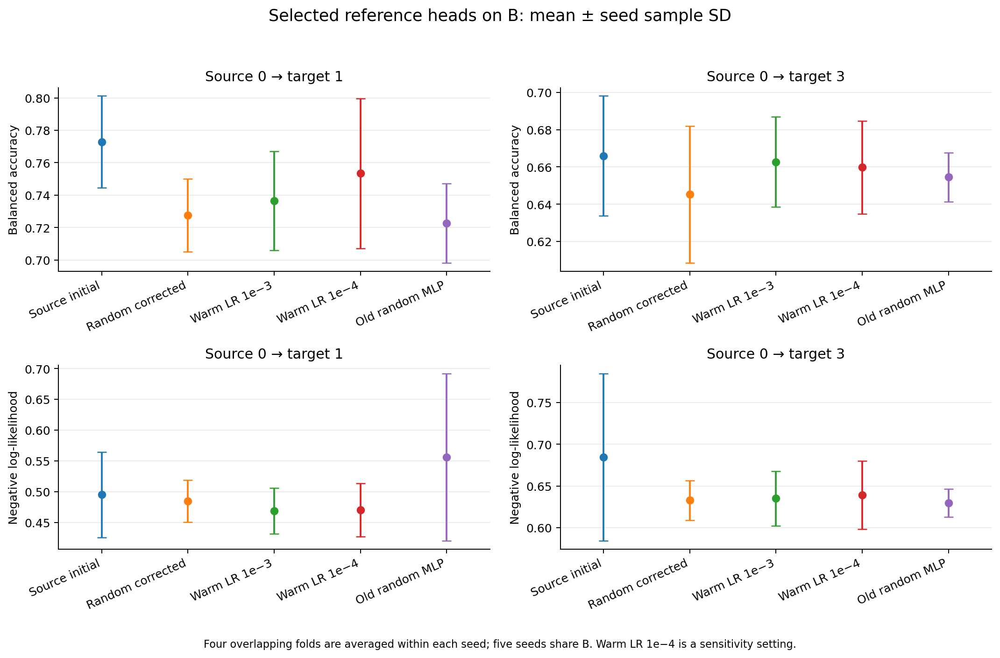
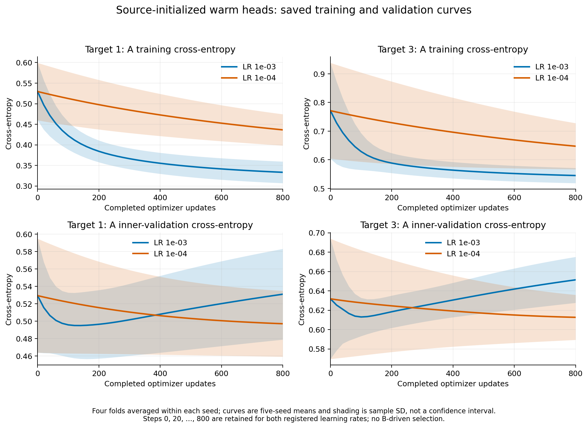
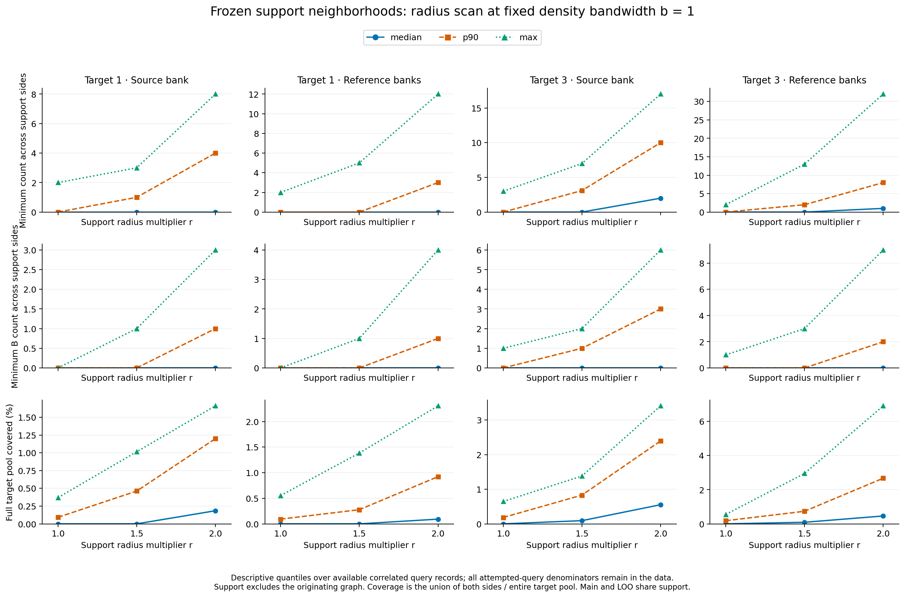
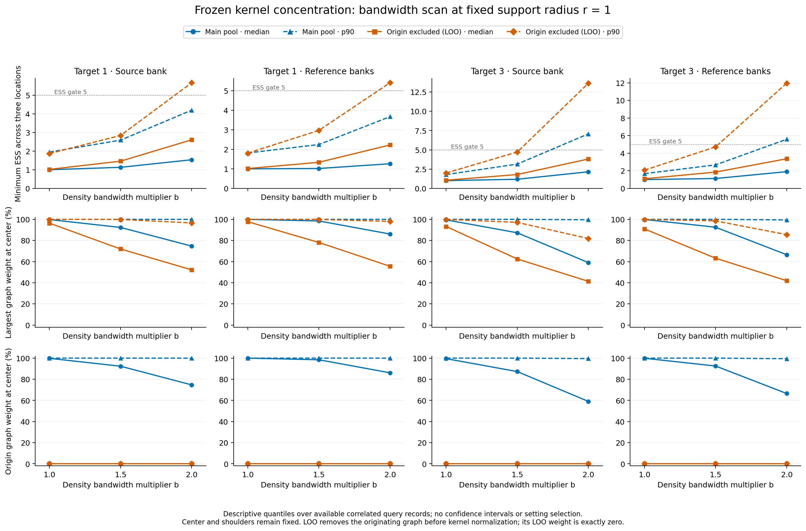
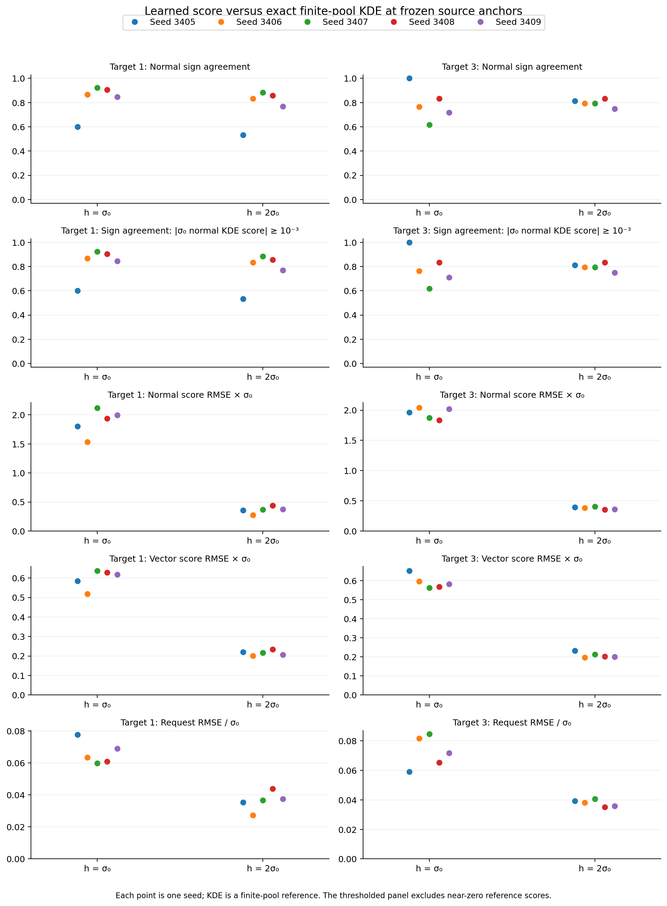
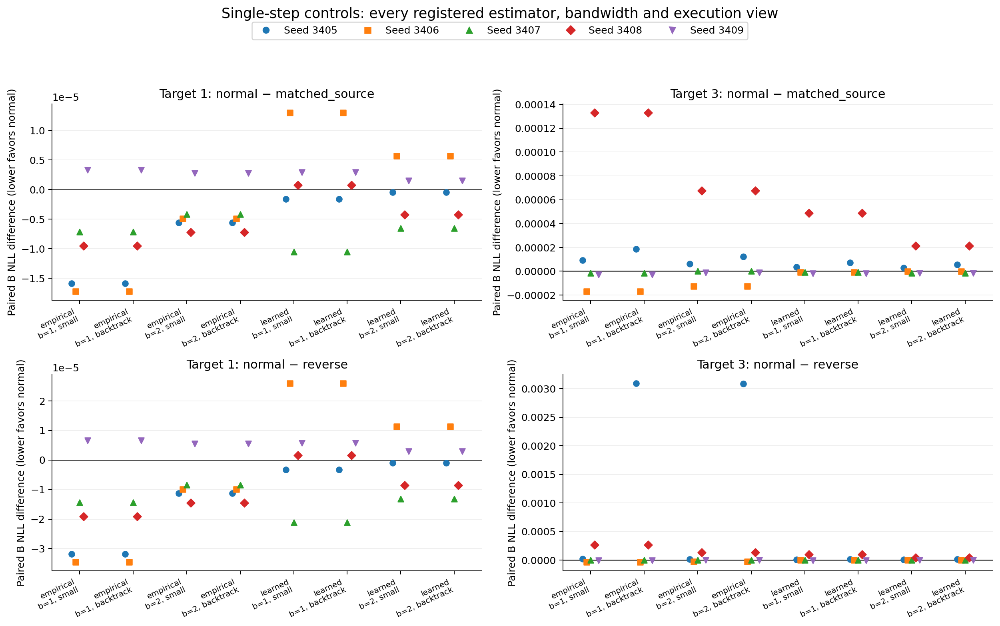

# Mutagenicity R1b：参考头、密度尺度与单步验证

日期：2026-11-11。执行代码：`64de9a991be7fd5ae46565620f02f8f0f8e5757f`。预先登记的[实验协议](../r1b-protocol.md)、[机器计划](../next-round-plan.json)和[独立运行前 review](../r1b-pre-run-review.json)。本报告接续[R1](../r1-20261111/report.md)，原始方法设计正文与生产默认值未修改。

## 结论

**本轮没有观察到 score 带来的额外分类改善。** 正常、反向、仅源驱动力三个非零对照，在每个任务/种子/带宽/估计器/执行视图下，对B给出相同的类别预测。正常请求相对仅源驱动力的NLL差别很小，方向也不跨任务一致。

三项实验分别得到：

1. **源头初始化改善了部分目标参考结果，但没有超过原始源头的平均BA。** 相对原始源头，两个任务的平均NLL下降；0→1的BA反而明显下降。这说明概率质量与均衡分类准确率必须分开判断。
2. **扩大半径和带宽确实增加了支持量和ESS，但六个面板仍没有可联合评价的位置。** 较少一侧的B标签数最多为9，未达到双侧均≥10的预定条件。因此仍不能检验“低密度谷是否分隔真实类别”。
3. **这次单步变化主要由源CE驱动力产生。** score对最终类别预测没有额外影响；学习score与经验KDE还有明显误差，但经验KDE本身也没有显示稳定的增量收益，不能把结果全归因于score训练不足。

本轮按预登记以B NLL为主、BA为辅。当前证据不支持直接进入完整闭环，也不支持仅增加score训练步数就会解决问题。下一轮优先检查源梯度、边界请求和移动上限如何共同决定实际更新；若改以BA为主，须另行预登记并匹配参考头的选模目标。

## 执行范围与完整性

| 项目 | 实际执行 |
|---|---|
| 数据/任务 | Mutagenicity，0→1、0→3，种子3405–3409 |
| GNN与表示 | 复用R1的5个GNN和16维坐标；没有重训、加深或更换pooling |
| 源角色 | 每seed保持779训练/109验证/196诊断 |
| 目标角色 | A271/B271；原四折A118优化+A29内部验证；final类别值未读取 |
| 源头初始化微调 | 80次，全部800更新；lr=1e-3、1e-4，step0参与选模 |
| 旧随机初始化对照 | 40个已有线性探针补评step0；无新增训练，选模结果均未改变 |
| 固定尺度 | 90个旧bank×64次投影尝试×6面板；main与LOO均保留 |
| 学习score | 20次，全部100epochs/900更新，原64-64 SiLU结构 |
| 单步 | 160组×2视图=320个输出；没有多轮适配 |
| 失败 | 微调、尺度观测、score与单步均无新增执行失败；旧投影失败保留 |
| 耗时/检查 | 599.8秒；112项工程测试通过；独立代码及结果review通过 |

尺度实验仍使用**旧冻结参考边界**，没有用新微调头替换查询点。单步实验始终从**原始源头**出发，新目标监督微调头只作诊断参考。

源/score训练及全部候选、预测、邻居先封存OBS，再读取B。2,200组微调端点/数据池预测和1,600组单步视图/数据池预测从保存状态重载，最大概率差为0。24次标签访问均在允许角色内，且与final ID交集为0。B是此前已观察的开发数据；五种子共用B、四折相互重叠。下文分类指标先四折平均、再报告五种子均值±样本标准差；标准差不是总体置信区间。

## E1：源头初始化是否得到更好的目标参考？

NLL越低越好，BA越高越好。所有selected均按A29验证CE选择，不按B挑设置。

| 方法 | 0→1 BA % | 0→1 NLL | 0→3 BA % | 0→3 NLL |
|---|---:|---:|---:|---:|
| 原始源头 | 77.280 ± 2.836 | 0.49521 ± 0.06920 | 66.594 ± 3.212 | 0.68451 ± 0.10007 |
| 随机线性，含step0的修正选模 | 72.757 ± 2.239 | 0.48491 ± 0.03374 | 64.520 ± 3.671 | 0.63271 ± 0.02385 |
| 源头初始化，lr=1e-3 | 73.642 ± 3.061 | 0.46906 ± 0.03725 | 66.263 ± 2.416 | 0.63498 ± 0.03294 |
| 源头初始化，lr=1e-4 | 75.337 ± 4.628 | 0.47072 ± 0.04329 | 65.972 ± 2.498 | 0.63907 ± 0.04088 |
| 旧随机MLP参考 | 72.265 ± 2.447 | 0.55616 ± 0.13543 | 65.451 ± 1.312 | 0.62951 ± 0.01694 |

共同lr=1e-3的初始化比较：0→1相对随机头，BA增加0.885个百分点、NLL下降0.01585，两个指标均有4/5种子改善。0→3的BA增加1.742个百分点，但平均NLL**增加**0.00227，不能说两个任务的NLL都优于随机初始化。lr=1e-4只作敏感性设置，不把它与旧lr=1e-3的差异全部归因于初始化。

与真实适配起点相比，0→1的lr=1e-3微调在五个种子上BA全部下降，平均下降3.638个百分点；类别1召回从72.979%降到59.149%。同时NLL下降0.02615。这支持“概率预测有可调整空间”，没有支持“已经找到BA更高的分类规则”。0→3平均NLL下降0.04953，BA基本持平但低0.331个百分点。

源域也发生退化：共同lr=1e-3微调后，完整源池NLL从0.33281增加到0.41914（目标1参考）/0.43305（目标3参考），BA从86.748%降到82.897%/82.419%。这是使用目标标签的参考诊断，不是满足源保持要求的适配结果。

step0被选中的次数：0→1两个学习率分别4/20、5/20；0→3均6/20，共21/80。所有拟合仍执行800步并存档。选中步数的均值/中位数：0→1的lr=1e-3为260/170，lr=1e-4为486/800；0→3分别为193/70、439/520。固定200/800端点也完整报告；例如共同lr=1e-3的800步BA为71.423%/64.167%，低于selected。继续训练不自动改善BA；本轮也不能把这些小预算、CE选模的头当成BA的理论上限。

[曲线与选中步数统计](warm-training-curves.json)来自封存的A118/A29历史；每20更新展示一点，先平均四折、再汇总五种子。完整逐步训练记录和每20步验证记录保存在`warm/seed{seed}/domain{domain}/fold{fold}/lr{lr}/history.json`。

数据：[完整均值与端点](evaluation/warm_summary.json)、[逐种子结果](evaluation/warm_by_seed.csv)、[配对差异](evaluation/warm_paired.json)。

## E2：尺度扩大是否解决局部观测不足？

每个面板保持同样的5,760次旧投影尝试，其中3,177条成功边界记录。`r`只扩大切向支持半径，轴向肩部区间不变；`b`只改变KDE带宽，三个查询坐标不变。

下表是重复、相关的bank查询记录的描述性计数，不能作为3,177个独立实验。ESS达标要求三个查询点均≥5；双侧支持要求每侧≥20张独立图、每侧≥10张B图。

| r / b | 双侧独立图达标 | 三点ESS达标 main / LOO | 所有记录中较少一侧图数最大值 | 较少一侧B图数最大值 | 联合可评价 |
|---|---:|---:|---:|---:|---:|
| 1 / 1 | 0 | 0 / 1 | 3 | 1 | 0 |
| 1.5 / 1 | 0 | 0 / 1 | 13 | 3 | 0 |
| 2 / 1 | 22 | 0 / 1 | 32 | 9 | 0 |
| 1 / 1.5 | 0 | 27 / 179 | 3 | 1 | 0 |
| 1 / 2 | 0 | 325 / 797 | 3 | 1 | 0 |
| 2 / 2 | 22 | 325 / 797 | 32 | 9 | 0 |

22条双侧独立图达标记录全部来自0→3的参考边界，源边界没有达标位置。所有面板的双侧B支持均未达标；**“既有类别分隔又有密度谷”的条件比例为NA，不能写成0%。**

半径2时，双侧邻域并集占完整目标池的最大比例：目标1源/参考边界分别1.66%/2.31%，目标3分别3.41%/6.91%。没有扩大到覆盖整个目标池，但这也不证明已找到足够局部支持。具体每侧图数、B数及覆盖分布全部保留，不只展示合格点。

加倍带宽后，去掉生成图的LOO明显提高有效支持；例如目标3源边界的三点最小ESS中位数由main的2.149变为LOO的3.808。但门槛所需的双侧类别信息仍不足。结论是**观察尺度确实构成瓶颈，扩大尺度只解决了一部分**，没有得到类别相关低密度谷的证据，也没有得到否定它的证据。

数据：[全部紧凑密度统计](density-summary.json)、[CSV](density-summary.csv)、[所有面板的评价汇总](evaluation/scales_groups.json)。完整逐bank/逐种子/查询记录和距离分布在本地档案；紧凑公开统计明确区分五种子分层均值与相关查询的描述性分位数。

## E3：密度请求是否提供增量效果？

### 学习score与经验KDE的差距

经验score是完整有限目标池Gaussian KDE的解析梯度，不是总体真实score。学习模型固定100epochs，共900更新，所有20个模型都由无标签DSM选中epoch索引99（第100轮，预算末端）。

| 目标域 / 带宽 | 法向符号一致率 | 法向RMSE × σ0 | 法向相对L2误差 | 请求RMSE / σ0 |
|---|---:|---:|---:|---:|
| 1 / σ0 | 82.813% | 1.87750 | 84.149% | 0.06613 |
| 1 / 2σ0 | 77.553% | 0.36131 | 68.902% | 0.03613 |
| 3 / σ0 | 78.689% | 1.94539 | 89.829% | 0.07256 |
| 3 / 2σ0 | 79.681% | 0.37841 | 76.416% | 0.03784 |

均为五种子均值；相对误差分母是同一查询处的**经验法向score范数**。带宽增加时经验score本身也变小，绝对RMSE下降不能单独解释为学习充分。学习score的幅值仍明显低于经验score；末epoch被选中说明当前选模落在预算末端，不证明增加步数就会改善分类。

数据：[训练与静态指标](scores/index.json)、[相对误差和机制审计](mechanism-summary.json)。

### 相同步长的机制对照

候选与验收均用完整779张源训练图的CE。三个非零候选共享同一源GGN、边界曲率和阻尼，只改变请求：正常、反向、保持同一矩阵但去掉score驱动力的`matched_source`。生产`zero`直接保留源头。

共同小步在6个单元取1/16，4个取1/32。下表为正常请求相对`matched_source`的B NLL差值，负值有利于正常请求：

| 任务 | score | 带宽 | ΔNLL，normal−matched_source | NLL改善种子数 | ΔBA |
|---|---|---|---:|---:|---:|
| 0→1 | 经验 | σ0 | −0.00000930 | 4/5 | 0 |
| 0→1 | 经验 | 2σ0 | −0.00000384 | 4/5 | 0 |
| 0→1 | 学习 | σ0 | +0.00000090 | 2/5 | 0 |
| 0→1 | 学习 | 2σ0 | −0.00000083 | 3/5 | 0 |
| 0→3 | 经验 | σ0 | +0.00002417 | 3/5 | 0 |
| 0→3 | 经验 | 2σ0 | +0.00001210 | 2/5 | 0 |
| 0→3 | 学习 | σ0 | +0.00000977 | 3/5 | 0 |
| 0→3 | 学习 | 2σ0 | +0.00000418 | 3/5 | 0 |

这不只是平均BA相同：**每个单元中，正常、反向和`matched_source`对B的逐图argmax均一致**，共同小步与生产回溯两个视图都如此。正常请求相对原始源头的BA变化为目标1的+0.113个百分点、目标3的−0.157个百分点；这些变化由`matched_source`完整复现，不能归功于score。

共同小步的正常请求相对源起点，平均NLL在目标1增加约0.00075，在目标3增加约0.00160。源fit CE则平均下降约0.00279/0.00241。这一步确实进一步拟合了源训练集，未显示稳定的目标NLL收益。

### 为什么增量效果这么小？

保存的分解满足δnormal+δreverse≈2δmatched，最大误差2.68×10⁻¹⁵。

| 任务 | 经验 σ0 | 经验 2σ0 | 学习 σ0 | 学习 2σ0 |
|---|---:|---:|---:|---:|
| 0→1，score/source参数提议范数比 | 3.93% | 2.33% | 2.11% | 1.01% |
| 0→3，score/source参数提议范数比 | 2.99% | 1.72% | 1.36% | 0.71% |

在当前固定参数坐标中，源驱动力明显更大。用边界位置的验收代理量观察也一致：正常相对`matched_source`增加的实际margin移动范数，只相当于完整裁剪请求范数的1.7%–3.7%（八组均值）。**这个比值已包含小步α，分母仍是完整请求，不能说求解器丢失了97%的α缩放请求。** 增量自身与请求方向的余弦为0.760–0.949；净正常移动与请求的余弦却约为−0.114至+0.131，因为源项占主导。

正常移动对完整请求的相对RMSE，八组均值为1.0005–1.8452，零移动基准为1；部分个别单元低于1。生产验收可以接受源CE下降足够多、但边界请求拟合没有改善的候选。这里观察到的是这种具体权衡，不是数值求解失败，也不构成删除源约束的依据。

### 生产回溯单列

120个非零候选全部通过生产回溯，40个zero输出源头；最大实际margin移动为0.09930σ0，共同小步最大为0.08617σ0。**接受率高没有转化成score增量分类收益。**

目标3的经验normal−reverse生产NLL差值约+0.000663/+0.000639，比共同小步下大得多。原因包括seed3405的反向组使用1/32，而normal/matched使用1/16；因此这两个生产差值不能单独解释为密度方向优劣。正常与`matched_source`在本次运行中步长相同，其比较没有该步长差异。

全部设置和逐种子差异：[指标汇总](evaluation/steps_summary.json)、[配对CSV](evaluation/steps_comparisons.csv)、[配对汇总](evaluation/steps_paired.json)。没有只报告接受子集或有利设置。

## 当前方法前提与下一步

| 方法需要的条件 | 这轮新增证据 | 当前判断 |
|---|---|---|
| 固定表示包含类别信息 | R1已支持；warm能改善部分概率预测 | 有信息，不等于存在BA明显更高的规则 |
| 有类别相关的低密度分隔 | 扩尺度后仍无双侧B支持达标点 | 尚不能评价；观测条件未满足 |
| 学习score准确反映所用密度方向/幅值 | 与经验KDE的法向相对误差仍约69%–90% | 当前900更新实现仍有明显差距 |
| 密度请求能产生可辨识的增量更新 | 增量方向与请求相容，但执行量小，净移动由源项主导 | 当前设置下辨识力弱，BA增量为0 |
| 密度驱动有目标任务收益 | 经验normal相对控制的NLL效应极小且跨任务不一致 | 没有获得稳定收益证据 |

建议下一轮先做两项有界诊断，再决定是否进入闭环：

1. **先研究源项与请求的实际权衡，而非仅追加score训练。** 从当前保存的分解出发，固定源头、查询与经验score，预登记少量边界权重/源梯度控制，保留正向、反向、同矩阵源对照和同等移动预算，直接测增量方向是否有价值。与此同时，当前双侧B支持不足仍需作为机制证据缺口报告，不能通过查看B后挑尺度或降低门槛制造通过。
2. **保持指标与监督参考目标一致。** 继续以本轮预登记的NLL为主时，已有目标监督改善空间，本轮score尚未利用到。若下一轮改以BA为主，须在新协议中明确，并在A内部做匹配的参考优化/选模，B仍只评价。本轮CE优化/CE选模的小预算头不能作为BA上限，不能在看过结果后把BA换成本轮主要指标。

900步学习score可以在以后补训练预算敏感性，但本次经验score也没有稳定增量收益，**增加训练步数不是目前最有依据的单一修复**。本轮不自动追加训练、改变GNN或启动闭环；这些属于下一次登记与决策。

## 存档与复现

完整实验目录：`/home/hxchen/experiments/tsba/mutagenicity-r1b/attempt-001`。

完整压缩档：`/home/hxchen/experiments/tsba/mutagenicity-r1b/attempt-001.tar.gz`，1,507,265,334字节；6,960个文件逐成员核验通过，未压缩2,103,105,750字节。

SHA256：`e4530be8b06b9d83a5d8aff74dd6d77cb37a11d8a129cf3376ee59dba12f220c`。

其中保存3,280个微调step0/每20步checkpoint、40组旧随机对照的初始/选中状态、2,000个score每epoch checkpoint及初始/选中模型、源GNN依赖、候选矩阵/分解、320个输出视图、预测、邻域、bootstrap抽样、日志、代码快照、环境和标签访问审计。源GNN的完整历史训练仍在R1档案，R1b按SHA引用并复制必要状态。

后处理只对已封存记录做统计和绘图，没有新训练、查询或密度估计。完整后处理记录另存`analysis-001`及压缩档。公开报告只含汇总与图表；详细路径、SHA、封存标识和后处理代码见[档案索引](archive-index.json)、[独立结果核验](result-review.json)、[输入哈希](input-hash-manifest.json)。
