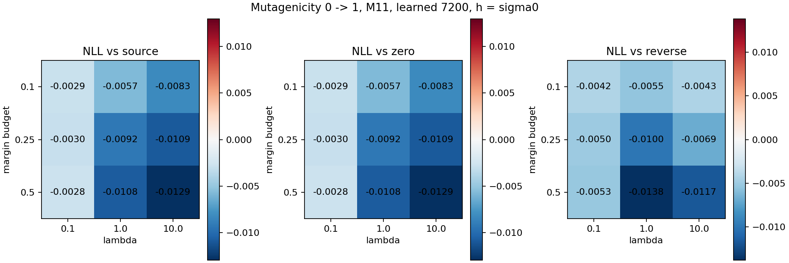
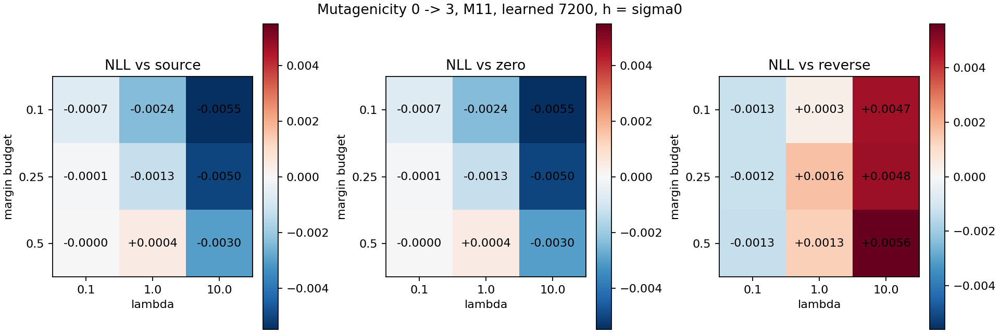

# Mutagenicity R3 完整结果

R3 共完成 520 条轨迹、15,600 次尝试。以下为第 30 次尝试的全目标域开发评价。两项迁移分别使用 1,084 和 1,085 张目标图。五个种子分别计分再汇总，目标标签在预测封存后读取。

[逐种子端点](endpoints.csv) · [正常请求配对](paired.csv) · [干预配对](interventions.csv) · [固定缩放基线](baselines.csv) · [逐轮诊断](rounds.csv) · [同状态旁路](side.csv) · [Score端点](score_endpoints.csv)

M00 的零请求对照重现了 R2 观察到的源监督退化。该对照在两个任务上都降低了源训练 NLL，却把源验证 NLL 分别推高约 0.01336 和 0.00780，把目标 NLL 推高约 0.01431 和 0.02307。M10 和 M01 各自在两项任务的四种正常请求配置上，均比对应 M00 降低了源验证和目标 NLL。M11 对 M10 的目标 NLL 改善覆盖 0→1 的 3/4 格和 0→3 的 4/4 格，对 M01 的改善分别为 0/4 和 2/4 格。

密度请求的配对收益在 0→1 更一致。M11 九格的平均目标 NLL 均同时低于源头、零请求和反向，较源头降低约 0.0028–0.0129，每格有 4–5 个种子同时改善三项比较。0→3 的三格同时改善均位于 λ=0.1，NLL 降幅小于 0.00071，BA 下降约 0.22–0.33 个百分点。

两项任务的 48 个正常请求配置，平均 NLL 都高于两个固定输出缩放基线。全网格记录 14,993 次接受、600 次驻点和 7 次回溯耗尽。7 次耗尽集中在 0→1 的 M11、λ=10、ε=0.1 格，涉及两个种子。这些尝试保留了上一个模型状态。

## 正常请求相对配对对照

| 任务 | 网格 | 正常配置 | NLL优于原始源头 | 同时优于源头、零请求和反向 | 同一配置至少3个种子同时胜过三者 | 优于两种固定缩放 |
|---|---|---:|---:|---:|---:|---:|
| 0→1 | 主实验 | 16 | 12 | 9 | 9 | 0 |
| 0→1 | M11敏感性九格 | 9 | 9 | 9 | 9 | 0 |
| 0→3 | 主实验 | 16 | 7 | 4 | 0 | 0 |
| 0→3 | M11敏感性九格 | 9 | 8 | 3 | 3 | 0 |

主实验与九格分析各包含 M11 的中心配置。配置计数用于描述网格，独立重复单位是种子。严格小于对照 NLL 才记作改善，BA 和准确率同时见完整表。

## 零请求与源泛化

下表是第 30 次减第 0 次的五种子平均差值。M00、M01 的零请求保留源 CE 推动力。M10、M11 使用固定初始逐类风险预算，零请求验证初始驻点。

| 任务 | 组 | Δ源训练NLL | Δ源验证NLL | Δ目标NLL | Δ目标BA（百分点） | Δ目标平均置信度（百分点） |
|---|---|---:|---:|---:|---:|---:|
| 0→1 | M00 | -0.028959 | +0.013364 | +0.014315 | +0.387 | +2.407 |
| 0→1 | M10 | +0.000000 | +0.000000 | +0.000000 | +0.000 | +0.000 |
| 0→1 | M01 | -0.011600 | -0.005501 | -0.012478 | +0.331 | +0.080 |
| 0→1 | M11 | +0.000000 | +0.000000 | +0.000000 | +0.000 | +0.000 |
| 0→3 | M00 | -0.029709 | +0.007795 | +0.023073 | -0.072 | +2.085 |
| 0→3 | M10 | +0.000000 | +0.000000 | +0.000000 | +0.000 | +0.000 |
| 0→3 | M01 | -0.011765 | -0.006837 | -0.000699 | +0.159 | -0.186 |
| 0→3 | M11 | +0.000000 | +0.000000 | +0.000000 | +0.000 | +0.000 |

## 干预配对

固定主网格的密度估计、带宽、正常方向与种子。下表按任务数出四种正常配置中平均差值改善的格数。M10–M00 对应源监督处理方式，M01–M00 对应置信度约束。

| 任务 | 干预减对照 | 源验证NLL降低 | 目标NLL降低 | 目标BA提高 |
|---|---|---:|---:|---:|
| 0→1 | M10–M00 | 4/4 | 4/4 | 0/4 |
| 0→1 | M01–M00 | 4/4 | 4/4 | 0/4 |
| 0→1 | M11–M00 | 4/4 | 4/4 | 0/4 |
| 0→1 | M11–M10 | 4/4 | 3/4 | 2/4 |
| 0→1 | M11–M01 | 0/4 | 0/4 | 1/4 |
| 0→3 | M10–M00 | 4/4 | 4/4 | 0/4 |
| 0→3 | M01–M00 | 4/4 | 4/4 | 4/4 |
| 0→3 | M11–M00 | 4/4 | 4/4 | 0/4 |
| 0→3 | M11–M10 | 4/4 | 4/4 | 4/4 |
| 0→3 | M11–M01 | 0/4 | 2/4 | 0/4 |

## 尝试与约束验收

以下按组统计主网格的 2,700 次尝试。置信度拒绝是实际前向回溯中触发上限的试验次数，同一次尝试可含多个回溯试验。SLSQP失败、无锚点和驻点都保留在逐轮结果中。

| 组 | 接受 | 驻点 | 回溯耗尽 | 约束求解失败 | 置信度拒绝的回溯试验 |
|---|---:|---:|---:|---:|---:|
| M00 | 2700 | 0 | 0 | 0 | 0 |
| M10 | 2400 | 300 | 0 | 0 | 0 |
| M01 | 2700 | 0 | 0 | 0 | 3415 |
| M11 | 2400 | 300 | 0 | 0 | 1750 |

全网格状态为 `{"accepted": 14993, "backtracking_exhausted": 7, "stationary": 600}`。
已重放 2,600 份主轨迹端点预测及 3,120 份旁路预测。旁路比较的可用与缺失状态为 `{"available": 1040}`。

## 同状态旁路的配对变化

限于主网格的正常轨迹。每个状态用相同可行步长计算三个候选，按相同估计器和带宽的五个种子取平均，再按四个配置计数。

| 任务 | 组 | 尝试 | 平均NLL低于零候选 | 平均NLL低于反向候选 | 同时低于两者 |
|---|---|---:|---:|---:|---:|
| 0→1 | M00 | 1 | 4/4 | 4/4 | 4/4 |
| 0→1 | M00 | 30 | 4/4 | 4/4 | 4/4 |
| 0→1 | M10 | 1 | 4/4 | 4/4 | 4/4 |
| 0→1 | M10 | 30 | 4/4 | 4/4 | 4/4 |
| 0→1 | M01 | 1 | 2/4 | 2/4 | 2/4 |
| 0→1 | M01 | 30 | 4/4 | 4/4 | 4/4 |
| 0→1 | M11 | 1 | 4/4 | 4/4 | 4/4 |
| 0→1 | M11 | 30 | 4/4 | 4/4 | 4/4 |
| 0→3 | M00 | 1 | 0/4 | 0/4 | 0/4 |
| 0→3 | M00 | 30 | 0/4 | 0/4 | 0/4 |
| 0→3 | M10 | 1 | 0/4 | 0/4 | 0/4 |
| 0→3 | M10 | 30 | 1/4 | 1/4 | 1/4 |
| 0→3 | M01 | 1 | 0/4 | 0/4 | 0/4 |
| 0→3 | M01 | 30 | 1/4 | 1/4 | 1/4 |
| 0→3 | M11 | 1 | 0/4 | 0/4 | 0/4 |
| 0→3 | M11 | 30 | 4/4 | 2/4 | 2/4 |

逐个状态的主轨迹配置、共同步长和三组候选指标见 [同状态旁路表](side.csv)。

## 边界与密度诊断

沿旧法向的有限线段重定位记录为 `{"single_root": 887826}`。位移误差仅汇总可定位的单根，所有无根、多根和近切触记录仍在逐轮存档。

| 密度带宽 | 每轮平均KDE ESS的中位数 | 每轮平均生成图权重的中位数 | 去生成图请求变化RMS的轮次中位数 |
|---|---:|---:|---:|
| 1σ0 | 1.347 | 0.8740 | 0.006975 |
| 2σ0 | 4.031 | 0.6265 | 0.002949 |

这些轮次分布描述诊断覆盖与局部支持，不用于增加统计重复数。报告的 KDE 来自有限目标池，score 的法向误差以同带宽 KDE 为参照。

## 存档与版本

- 执行代码 `ff0f6e539a294c5380efa149574910b5130023bd`。
- 输入、观察和最终封存见 [archive-index.json](archive-index.json)。
- 主档案含 17,608 个逐文件读回验证的成员，包括角色与批次、源模型、score及优化器状态、每次尝试的模型向量和诊断、日志及评价结果。

## 原始源头与输出缩放

| 任务 | 输出倍率 | NLL均值 | BA均值 |
|---|---:|---:|---:|
| 0→1 | 0.5 | 0.558756 | 0.74521 |
| 0→1 | 0.75 | 0.556494 | 0.74521 |
| 0→1 | 1.0 | 0.577563 | 0.74521 |
| 0→3 | 0.5 | 0.639150 | 0.65278 |
| 0→3 | 0.75 | 0.651898 | 0.65278 |
| 0→3 | 1.0 | 0.680125 | 0.65278 |

## 完整正常请求网格

| 任务 | 组 | 密度 | h/σ0 | λ | ε | NLL均值±SD | BA均值±SD | ΔNLL源头 | ΔNLL零 | ΔNLL反向 |
|---|---|---|---:|---:|---:|---:|---:|---:|---:|---:|
| 0→1 | M00 | kde | 1 | 1 | None | 0.591499 ± 0.082143 | 0.74908 ± 0.01568 | +0.013936 | -0.000379 | -0.000477 |
| 0→1 | M00 | kde | 2 | 1 | None | 0.591592 ± 0.082127 | 0.74908 ± 0.01568 | +0.014029 | -0.000286 | -0.000335 |
| 0→1 | M00 | learned | 1 | 1 | None | 0.591410 ± 0.082047 | 0.74908 ± 0.01568 | +0.013847 | -0.000468 | -0.000689 |
| 0→1 | M00 | learned | 2 | 1 | None | 0.591682 ± 0.081961 | 0.74894 ± 0.01573 | +0.014119 | -0.000196 | -0.000308 |
| 0→1 | M01 | kde | 1 | 1 | 0.25 | 0.565168 ± 0.065914 | 0.74824 ± 0.02171 | -0.012395 | +0.000083 | +0.000055 |
| 0→1 | M01 | kde | 2 | 1 | 0.25 | 0.565120 ± 0.065832 | 0.74824 ± 0.02151 | -0.012443 | +0.000035 | +0.000021 |
| 0→1 | M01 | learned | 1 | 1 | 0.25 | 0.564959 ± 0.065790 | 0.74824 ± 0.02151 | -0.012605 | -0.000127 | -0.000206 |
| 0→1 | M01 | learned | 2 | 1 | 0.25 | 0.565061 ± 0.065812 | 0.74838 ± 0.02185 | -0.012502 | -0.000024 | +0.000022 |
| 0→1 | M10 | kde | 1 | 1 | None | 0.572122 ± 0.074044 | 0.74701 ± 0.02079 | -0.005441 | -0.005441 | -0.011068 |
| 0→1 | M10 | kde | 2 | 1 | None | 0.573444 ± 0.072263 | 0.74687 ± 0.01993 | -0.004119 | -0.004119 | -0.008582 |
| 0→1 | M10 | learned | 1 | 1 | None | 0.568196 ± 0.070651 | 0.74728 ± 0.02234 | -0.009367 | -0.009367 | -0.019624 |
| 0→1 | M10 | learned | 2 | 1 | None | 0.573294 ± 0.073532 | 0.74742 ± 0.02284 | -0.004270 | -0.004270 | -0.009381 |
| 0→1 | M11 | kde | 1 | 1 | 0.25 | 0.570542 ± 0.072658 | 0.74825 ± 0.02275 | -0.007021 | -0.007021 | -0.003917 |
| 0→1 | M11 | kde | 2 | 1 | 0.25 | 0.572227 ± 0.071427 | 0.74659 ± 0.02207 | -0.005336 | -0.005336 | -0.004586 |
| 0→1 | M11 | learned | 1 | 0.1 | 0.1 | 0.574651 ± 0.073148 | 0.74590 ± 0.02251 | -0.002912 | -0.002912 | -0.004152 |
| 0→1 | M11 | learned | 1 | 0.1 | 0.25 | 0.574579 ± 0.072981 | 0.74576 ± 0.02248 | -0.002984 | -0.002984 | -0.004978 |
| 0→1 | M11 | learned | 1 | 0.1 | 0.5 | 0.574762 ± 0.073263 | 0.74604 ± 0.02249 | -0.002801 | -0.002801 | -0.005274 |
| 0→1 | M11 | learned | 1 | 1 | 0.1 | 0.571837 ± 0.072885 | 0.74673 ± 0.02268 | -0.005726 | -0.005726 | -0.005490 |
| 0→1 | M11 | learned | 1 | 1 | 0.25 | 0.568324 ± 0.071087 | 0.74742 ± 0.02455 | -0.009239 | -0.009239 | -0.009994 |
| 0→1 | M11 | learned | 1 | 1 | 0.5 | 0.566806 ± 0.068576 | 0.74659 ± 0.02279 | -0.010757 | -0.010757 | -0.013826 |
| 0→1 | M11 | learned | 1 | 10 | 0.1 | 0.569299 ± 0.071752 | 0.74659 ± 0.02336 | -0.008264 | -0.008264 | -0.004312 |
| 0→1 | M11 | learned | 1 | 10 | 0.25 | 0.566649 ± 0.070598 | 0.74520 ± 0.02495 | -0.010914 | -0.010914 | -0.006871 |
| 0→1 | M11 | learned | 1 | 10 | 0.5 | 0.564614 ± 0.068482 | 0.74603 ± 0.02280 | -0.012949 | -0.012949 | -0.011669 |
| 0→1 | M11 | learned | 2 | 1 | 0.25 | 0.572478 ± 0.072537 | 0.74687 ± 0.02335 | -0.005086 | -0.005086 | -0.006792 |
| 0→3 | M00 | kde | 1 | 1 | None | 0.703558 ± 0.086496 | 0.65204 ± 0.02172 | +0.023432 | +0.000359 | +0.000394 |
| 0→3 | M00 | kde | 2 | 1 | None | 0.703350 ± 0.086357 | 0.65167 ± 0.02150 | +0.023225 | +0.000152 | +0.000202 |
| 0→3 | M00 | learned | 1 | 1 | None | 0.703615 ± 0.086540 | 0.65224 ± 0.02181 | +0.023490 | +0.000416 | -0.000336 |
| 0→3 | M00 | learned | 2 | 1 | None | 0.703483 ± 0.086561 | 0.65167 ± 0.02150 | +0.023358 | +0.000285 | +0.000366 |
| 0→3 | M01 | kde | 1 | 1 | 0.25 | 0.679369 ± 0.067561 | 0.65427 ± 0.02239 | -0.000756 | -0.000057 | -0.000002 |
| 0→3 | M01 | kde | 2 | 1 | 0.25 | 0.679306 ± 0.067499 | 0.65435 ± 0.02236 | -0.000820 | -0.000121 | -0.000102 |
| 0→3 | M01 | learned | 1 | 1 | 0.25 | 0.679274 ± 0.067404 | 0.65461 ± 0.02197 | -0.000851 | -0.000152 | -0.000192 |
| 0→3 | M01 | learned | 2 | 1 | 0.25 | 0.679309 ± 0.067497 | 0.65435 ± 0.02208 | -0.000816 | -0.000117 | -0.000052 |
| 0→3 | M10 | kde | 1 | 1 | None | 0.682544 ± 0.064181 | 0.64820 ± 0.02072 | +0.002419 | +0.002419 | +0.002935 |
| 0→3 | M10 | kde | 2 | 1 | None | 0.681561 ± 0.067074 | 0.64837 ± 0.01957 | +0.001436 | +0.001436 | +0.002501 |
| 0→3 | M10 | learned | 1 | 1 | None | 0.683039 ± 0.065820 | 0.64883 ± 0.01898 | +0.002914 | +0.002914 | +0.002943 |
| 0→3 | M10 | learned | 2 | 1 | None | 0.681727 ± 0.068131 | 0.64942 ± 0.02093 | +0.001602 | +0.001602 | +0.002299 |
| 0→3 | M11 | kde | 1 | 1 | 0.25 | 0.677411 ± 0.064003 | 0.64917 ± 0.01939 | -0.002714 | -0.002714 | +0.002048 |
| 0→3 | M11 | kde | 2 | 1 | 0.25 | 0.679360 ± 0.066464 | 0.64956 ± 0.02064 | -0.000765 | -0.000765 | +0.001755 |
| 0→3 | M11 | learned | 1 | 0.1 | 0.1 | 0.679417 ± 0.068116 | 0.65055 ± 0.01966 | -0.000708 | -0.000708 | -0.001252 |
| 0→3 | M11 | learned | 1 | 0.1 | 0.25 | 0.680068 ± 0.067653 | 0.64946 ± 0.01905 | -0.000057 | -0.000057 | -0.001237 |
| 0→3 | M11 | learned | 1 | 0.1 | 0.5 | 0.680087 ± 0.067582 | 0.64963 ± 0.01927 | -0.000038 | -0.000038 | -0.001290 |
| 0→3 | M11 | learned | 1 | 1 | 0.1 | 0.677729 ± 0.066477 | 0.65115 ± 0.02056 | -0.002396 | -0.002396 | +0.000334 |
| 0→3 | M11 | learned | 1 | 1 | 0.25 | 0.678849 ± 0.066676 | 0.64901 ± 0.02017 | -0.001276 | -0.001276 | +0.001650 |
| 0→3 | M11 | learned | 1 | 1 | 0.5 | 0.680563 ± 0.065383 | 0.64829 ± 0.01945 | +0.000438 | +0.000438 | +0.001324 |
| 0→3 | M11 | learned | 1 | 10 | 0.1 | 0.674637 ± 0.065063 | 0.65036 ± 0.02027 | -0.005488 | -0.005488 | +0.004698 |
| 0→3 | M11 | learned | 1 | 10 | 0.25 | 0.675094 ± 0.064538 | 0.64975 ± 0.01964 | -0.005031 | -0.005031 | +0.004808 |
| 0→3 | M11 | learned | 1 | 10 | 0.5 | 0.677116 ± 0.064737 | 0.65098 ± 0.01865 | -0.003009 | -0.003009 | +0.005615 |
| 0→3 | M11 | learned | 2 | 1 | 0.25 | 0.680519 ± 0.068016 | 0.64960 ± 0.02105 | +0.000394 | +0.000394 | +0.001123 |

## Score与敏感性网格

| 任务 | h/σ0 | 更新 | DSM均值 | 法向RMSE×σ0 | 符号一致率 |
|---|---:|---:|---:|---:|---:|
| 0→1 | 1 | 900 | 0.712029 | 1.753355 | 0.860916 |
| 0→1 | 1 | 1800 | 0.660953 | 1.670170 | 0.871152 |
| 0→1 | 1 | 3600 | 0.613854 | 1.566469 | 0.884894 |
| 0→1 | 1 | 7200 | 0.574564 | 1.490130 | 0.894443 |
| 0→1 | 2 | 900 | 0.484285 | 0.329086 | 0.833876 |
| 0→1 | 2 | 1800 | 0.449067 | 0.309348 | 0.864840 |
| 0→1 | 2 | 3600 | 0.424593 | 0.295793 | 0.843875 |
| 0→1 | 2 | 7200 | 0.400748 | 0.278591 | 0.844994 |
| 0→3 | 1 | 900 | 0.752909 | 1.780837 | 0.824820 |
| 0→3 | 1 | 1800 | 0.694711 | 1.683558 | 0.849907 |
| 0→3 | 1 | 3600 | 0.641457 | 1.585479 | 0.884399 |
| 0→3 | 1 | 7200 | 0.594455 | 1.505797 | 0.913428 |
| 0→3 | 2 | 900 | 0.499572 | 0.322656 | 0.821870 |
| 0→3 | 2 | 1800 | 0.461227 | 0.311974 | 0.849640 |
| 0→3 | 2 | 3600 | 0.424337 | 0.289609 | 0.851890 |
| 0→3 | 2 | 7200 | 0.398937 | 0.271833 | 0.858357 |

