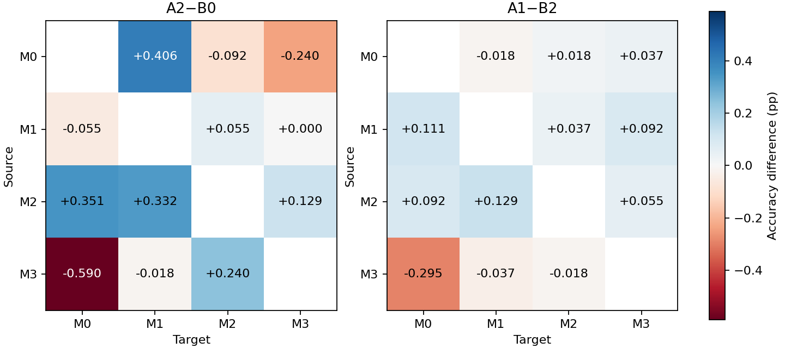
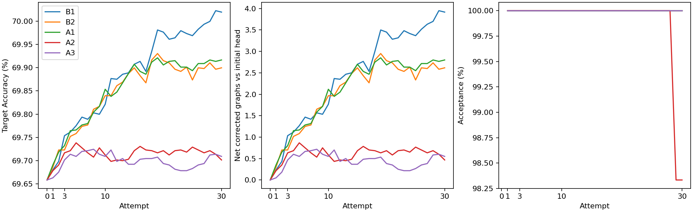

# Mutagenicity R4 固定配置全方向评估

A2 的 12 方向等权平均 Accuracy 相对原始源头变化 **+0.0431 个百分点**。方向均值有 6 个改善、1 个持平、5 个退化。主终点为第 30 次尝试，M0→M1 和 M0→M3 是历史开发方向，其余十个方向为新增覆盖。

数据使用仓库 SEGA 的有序域索引，结构和特征逐图核对至 R3。与 CoCo 原论文的划分对应关系尚未核实。实验使用完整目标域做开发计分，目标标签在所有轨迹和预测封存后按域读取。

[实验协议](../r4-protocol.md) · [固定计划](../r4-plan.json) · [逐种子端点与辅助指标](endpoints.csv) · [逐种子配对](paired.csv) · [逐轮预测指标与纠错计数](rounds.csv) · [旁路](side.csv) · [Score 诊断](score_endpoints.csv) · [源训练曲线数据](source_curves.csv) · [完整汇总](summary.csv)

## 结论

新增十个方向中，A2 相对原始源头的等权 Accuracy 变化为 +0.0350 个百分点。在全部 12 方向上，A2 相对 B1、B2 分别变化 -0.3182 和 -0.1983 个百分点。A1 相对原始源头变化 +0.2583 个百分点。

持续源监督的 B1−B0 为 +0.3613 个百分点，目标 NLL 同时升高 0.1925。加入置信度约束的 B2−B1 为 -0.1199 个百分点，目标 NLL 降低 0.2292。M01 中启用目标密度请求的 A1−B2 为 +0.0169 个百分点，五个种子的全方向均值有两个改善、三个退化。A1 相对源头的准确率提升主要来自零请求对照也具备的更新。M11 的 60 个零请求检查均为驻点，对应的起点比较为 A2−B0。

相同池与带宽下，KDE 的 A3−B0 为 +0.0507 个百分点，学习 score 相对 KDE 的 A2−A3 为 -0.0077 个百分点。学习 score 在该配对下的方向均值有 7 个较高、1 个相同、4 个较低。用经验 KDE 替换学习 score 后，平均 Accuracy 仍低于两个零请求对照。这个替换实验给出的平均改善只有 0.0077 个百分点，KDE 仍受当前目标样本池和带宽限制。

按源域平均，A2−B0 的最高和最低变化分别为 M2 的 +0.2706 与 M3 的 -0.1230 个百分点。M2 作为源域的三个方向均有正收益。按目标域平均，最高和最低分别为 M1 的 +0.2399 与 M0 的 -0.0984 个百分点。单方向中，M0→M1 提升最多（+0.4059），M3→M0 下降最多（-0.5904），各自在五个种子上方向一致。

## Accuracy 主表

百分数为五个种子的均值±样本标准差。Avg 先在每个种子内等权平均 12 方向，再计算五个种子的波动。

| 方法 | M0→M1 | M0→M2 | M0→M3 | M1→M0 | M1→M2 | M1→M3 | M2→M0 | M2→M1 | M2→M3 | M3→M0 | M3→M1 | M3→M2 | Avg |
|---|---:|---:|---:|---:|---:|---:|---:|---:|---:|---:|---:|---:|---:|
| B0 | 73.690 ± 2.862 | 66.292 ± 0.947 | 65.770 ± 2.212 | 74.041 ± 0.745 | 76.089 ± 2.216 | 67.005 ± 1.512 | 73.284 ± 1.654 | 78.967 ± 1.954 | 71.613 ± 2.906 | 59.613 ± 7.056 | 58.598 ± 5.447 | 70.941 ± 3.304 | 69.658 ± 0.990 |
| B1 | 74.428 ± 1.996 | 66.531 ± 0.765 | 65.641 ± 2.208 | 74.151 ± 1.014 | 76.384 ± 1.696 | 67.078 ± 1.223 | 73.727 ± 1.678 | 79.594 ± 1.683 | 72.147 ± 2.540 | 59.871 ± 6.892 | 59.041 ± 5.357 | 71.642 ± 3.229 | 70.020 ± 1.030 |
| B2 | 74.410 ± 2.241 | 66.568 ± 0.896 | 65.770 ± 2.308 | 74.133 ± 0.881 | 76.310 ± 1.963 | 66.912 ± 1.299 | 73.339 ± 1.678 | 79.465 ± 1.630 | 71.853 ± 2.821 | 59.871 ± 6.749 | 58.782 ± 5.197 | 71.384 ± 3.072 | 69.900 ± 1.005 |
| A1 | 74.391 ± 2.242 | 66.587 ± 0.928 | 65.806 ± 2.251 | 74.244 ± 0.944 | 76.347 ± 2.006 | 67.005 ± 1.238 | 73.432 ± 1.582 | 79.594 ± 1.474 | 71.908 ± 2.842 | 59.576 ± 6.868 | 58.745 ± 5.472 | 71.365 ± 3.175 | 69.917 ± 1.027 |
| A2 | 74.096 ± 2.966 | 66.199 ± 0.658 | 65.530 ± 2.160 | 73.985 ± 1.021 | 76.144 ± 2.247 | 67.005 ± 1.153 | 73.635 ± 1.613 | 79.299 ± 1.795 | 71.742 ± 2.782 | 59.022 ± 7.319 | 58.579 ± 5.425 | 71.181 ± 3.430 | 69.701 ± 0.991 |
| A3 | 74.004 ± 2.912 | 66.107 ± 0.372 | 65.530 ± 2.065 | 73.930 ± 1.022 | 76.292 ± 2.023 | 66.986 ± 0.998 | 73.672 ± 1.632 | 79.207 ± 1.906 | 71.816 ± 2.758 | 59.410 ± 7.364 | 58.506 ± 5.433 | 71.052 ± 3.345 | 69.709 ± 0.975 |

B0 为原始源头。B1、B2 分别为 M00、M01 零请求。A1 为 M01 学习 score，A2 为预指定主方案 M11 学习 score，A3 为 M11 经验 KDE。

### 源域与目标域各三方向平均

| 方法 | source M0 | source M1 | source M2 | source M3 | target M0 | target M1 | target M2 | target M3 |
|---|---:|---:|---:|---:|---:|---:|---:|---:|
| B0 | 68.584 ± 1.251 | 72.378 ± 0.818 | 74.621 ± 1.911 | 63.050 ± 4.695 | 68.979 ± 1.833 | 70.418 ± 1.502 | 71.107 ± 1.054 | 68.129 ± 1.736 |
| B1 | 68.867 ± 1.068 | 72.538 ± 0.491 | 75.156 ± 1.731 | 63.518 ± 4.478 | 69.250 ± 1.914 | 71.021 ± 1.403 | 71.519 ± 1.051 | 68.289 ± 1.496 |
| B2 | 68.916 ± 1.081 | 72.452 ± 0.606 | 74.886 ± 1.771 | 63.346 ± 4.492 | 69.114 ± 1.788 | 70.886 ± 1.278 | 71.421 ± 0.972 | 68.178 ± 1.626 |
| A1 | 68.928 ± 1.104 | 72.532 ± 0.581 | 74.978 ± 1.626 | 63.229 ± 4.610 | 69.084 ± 1.864 | 70.910 ± 1.390 | 71.433 ± 1.033 | 68.240 ± 1.622 |
| A2 | 68.608 ± 1.200 | 72.378 ± 0.542 | 74.892 ± 1.768 | 62.927 ± 4.789 | 68.881 ± 1.958 | 70.658 ± 1.471 | 71.175 ± 1.068 | 68.092 ± 1.763 |
| A3 | 68.547 ± 1.080 | 72.403 ± 0.508 | 74.898 ± 1.782 | 62.989 ± 4.797 | 69.004 ± 1.949 | 70.572 ± 1.475 | 71.150 ± 1.060 | 68.111 ± 1.680 |

## Accuracy 配对差值

单位为百分点。括号为改善／持平／退化的种子数，持平按正确数差值精确为零计。Avg、新增方向和域汇总的比较在种子内先平均相应方向。

| 范围 | A2−B0 | A2−B1 | A2−B2 | A1−B2 | A3−B0 | A2−A3 | B1−B0 | B2−B1 |
|---|---:|---:|---:|---:|---:|---:|---:|---:|
| M0→M1 | +0.406 ± 0.191 (5/0/0) | -0.332 ± 1.026 (2/0/3) | -0.314 ± 0.862 (2/0/3) | -0.018 ± 0.041 (0/4/1) | +0.314 ± 0.154 (5/0/0) | +0.092 ± 0.146 (3/1/1) | +0.738 ± 0.892 (4/0/1) | -0.018 ± 0.707 (2/0/3) |
| M0→M2 | -0.092 ± 0.546 (2/0/3) | -0.332 ± 0.614 (1/1/3) | -0.369 ± 0.509 (1/1/3) | +0.018 ± 0.077 (2/2/1) | -0.185 ± 0.605 (2/0/3) | +0.092 ± 0.447 (2/1/2) | +0.240 ± 0.410 (4/0/1) | +0.037 ± 0.324 (2/1/2) |
| M0→M3 | -0.240 ± 0.713 (1/2/2) | -0.111 ± 0.883 (4/0/1) | -0.240 ± 1.203 (3/0/2) | +0.037 ± 0.105 (2/2/1) | -0.240 ± 0.810 (1/1/3) | +0.000 ± 0.184 (3/0/2) | -0.129 ± 0.191 (1/0/4) | +0.129 ± 0.389 (2/2/1) |
| M1→M0 | -0.055 ± 0.405 (2/0/3) | -0.166 ± 0.420 (1/2/2) | -0.148 ± 0.191 (1/0/4) | +0.111 ± 0.295 (3/0/2) | -0.111 ± 0.420 (1/1/3) | +0.055 ± 0.051 (3/2/0) | +0.111 ± 0.559 (3/0/2) | -0.018 ± 0.383 (3/0/2) |
| M1→M2 | +0.055 ± 0.083 (2/3/0) | -0.240 ± 0.648 (2/0/3) | -0.166 ± 0.624 (2/1/2) | +0.037 ± 0.105 (2/2/1) | +0.203 ± 0.239 (4/0/1) | -0.148 ± 0.266 (1/2/2) | +0.295 ± 0.610 (3/0/2) | -0.074 ± 0.335 (1/0/4) |
| M1→M3 | +0.000 ± 0.699 (2/1/2) | -0.074 ± 0.595 (1/1/3) | +0.092 ± 0.561 (3/1/1) | +0.092 ± 0.146 (3/1/1) | -0.018 ± 0.730 (2/0/3) | +0.018 ± 0.189 (2/2/1) | +0.074 ± 0.377 (1/1/3) | -0.166 ± 0.189 (0/2/3) |
| M2→M0 | +0.351 ± 0.239 (5/0/0) | -0.092 ± 0.292 (1/1/3) | +0.295 ± 0.101 (5/0/0) | +0.092 ± 0.269 (3/1/1) | +0.387 ± 0.177 (5/0/0) | -0.037 ± 0.212 (2/1/2) | +0.443 ± 0.440 (4/0/1) | -0.387 ± 0.272 (1/0/4) |
| M2→M1 | +0.332 ± 0.168 (5/0/0) | -0.295 ± 0.322 (0/1/4) | -0.166 ± 0.287 (1/1/3) | +0.129 ± 0.266 (2/1/2) | +0.240 ± 0.140 (5/0/0) | +0.092 ± 0.185 (2/2/1) | +0.627 ± 0.415 (5/0/0) | -0.129 ± 0.222 (1/1/3) |
| M2→M3 | +0.129 ± 0.366 (3/0/2) | -0.406 ± 0.710 (1/0/4) | -0.111 ± 0.498 (1/0/4) | +0.055 ± 0.167 (3/1/1) | +0.203 ± 0.388 (4/0/1) | -0.074 ± 0.177 (1/2/2) | +0.535 ± 0.573 (4/0/1) | -0.295 ± 0.393 (2/0/3) |
| M3→M0 | -0.590 ± 0.317 (0/0/5) | -0.849 ± 0.566 (0/0/5) | -0.849 ± 0.730 (1/0/4) | -0.295 ± 0.309 (1/0/4) | -0.203 ± 0.463 (1/0/4) | -0.387 ± 0.287 (0/0/5) | +0.258 ± 0.341 (3/1/1) | +0.000 ± 0.534 (3/0/2) |
| M3→M1 | -0.018 ± 0.220 (2/1/2) | -0.461 ± 0.386 (0/0/5) | -0.203 ± 0.239 (1/0/4) | -0.037 ± 0.378 (2/1/2) | -0.092 ± 0.269 (2/0/3) | +0.074 ± 0.137 (3/1/1) | +0.443 ± 0.366 (5/0/0) | -0.258 ± 0.409 (1/1/3) |
| M3→M2 | +0.240 ± 0.440 (3/0/2) | -0.461 ± 0.706 (2/0/3) | -0.203 ± 0.701 (2/0/3) | -0.018 ± 0.120 (2/1/2) | +0.111 ± 0.264 (3/0/2) | +0.129 ± 0.222 (2/2/1) | +0.701 ± 0.524 (4/1/0) | -0.258 ± 0.264 (1/0/4) |
| source M0 | +0.025 ± 0.219 (3/0/2) | -0.258 ± 0.532 (2/0/3) | -0.307 ± 0.374 (2/0/3) | +0.012 ± 0.035 (3/0/2) | -0.037 ± 0.251 (2/0/3) | +0.062 ± 0.192 (2/0/3) | +0.283 ± 0.382 (4/0/1) | +0.049 ± 0.221 (3/0/2) |
| source M1 | +0.000 ± 0.361 (2/0/3) | -0.160 ± 0.140 (1/0/4) | -0.074 ± 0.176 (1/0/4) | +0.080 ± 0.133 (3/0/2) | +0.025 ± 0.393 (3/0/2) | -0.025 ± 0.059 (1/1/3) | +0.160 ± 0.355 (3/0/2) | -0.086 ± 0.208 (2/1/2) |
| source M2 | +0.271 ± 0.181 (5/0/0) | -0.264 ± 0.188 (1/0/4) | +0.006 ± 0.156 (2/0/3) | +0.092 ± 0.190 (3/0/2) | +0.277 ± 0.160 (5/0/0) | -0.006 ± 0.112 (3/0/2) | +0.535 ± 0.215 (5/0/0) | -0.271 ± 0.050 (0/0/5) |
| source M3 | -0.123 ± 0.143 (1/0/4) | -0.590 ± 0.499 (0/1/4) | -0.418 ± 0.438 (1/0/4) | -0.117 ± 0.129 (1/0/4) | -0.062 ± 0.119 (2/0/3) | -0.062 ± 0.095 (2/0/3) | +0.467 ± 0.358 (5/0/0) | -0.172 ± 0.120 (0/0/5) |
| target M0 | -0.098 ± 0.199 (2/0/3) | -0.369 ± 0.197 (0/0/5) | -0.234 ± 0.262 (1/0/4) | -0.031 ± 0.233 (2/0/3) | +0.025 ± 0.206 (3/0/2) | -0.123 ± 0.069 (0/0/5) | +0.271 ± 0.169 (5/0/0) | -0.135 ± 0.215 (1/1/3) |
| target M1 | +0.240 ± 0.077 (5/0/0) | -0.363 ± 0.242 (0/0/5) | -0.228 ± 0.263 (1/0/4) | +0.025 ± 0.120 (2/0/3) | +0.154 ± 0.084 (5/0/0) | +0.086 ± 0.040 (5/0/0) | +0.603 ± 0.292 (5/0/0) | -0.135 ± 0.158 (0/1/4) |
| target M2 | +0.068 ± 0.188 (2/0/3) | -0.344 ± 0.380 (1/0/4) | -0.246 ± 0.337 (1/0/4) | +0.012 ± 0.080 (2/1/2) | +0.043 ± 0.122 (2/1/2) | +0.025 ± 0.098 (2/1/2) | +0.412 ± 0.263 (5/0/0) | -0.098 ± 0.147 (1/0/4) |
| target M3 | -0.037 ± 0.247 (3/0/2) | -0.197 ± 0.449 (1/0/4) | -0.086 ± 0.475 (3/0/2) | +0.061 ± 0.061 (4/0/1) | -0.018 ± 0.176 (2/1/2) | -0.018 ± 0.133 (2/0/3) | +0.160 ± 0.346 (3/0/2) | -0.111 ± 0.165 (1/0/4) |
| New coverage | +0.035 ± 0.155 (2/0/3) | -0.338 ± 0.086 (0/0/5) | -0.183 ± 0.165 (1/0/4) | +0.018 ± 0.108 (2/1/2) | +0.053 ± 0.126 (3/0/2) | -0.018 ± 0.047 (2/0/3) | +0.373 ± 0.104 (5/0/0) | -0.155 ± 0.094 (0/0/5) |
| Avg | +0.043 ± 0.072 (4/0/1) | -0.318 ± 0.058 (0/0/5) | -0.198 ± 0.105 (0/0/5) | +0.017 ± 0.082 (2/0/3) | +0.051 ± 0.056 (4/0/1) | -0.008 ± 0.049 (2/0/3) | +0.361 ± 0.082 (5/0/0) | -0.120 ± 0.098 (0/0/5) |

## 辅助指标与轮次

下表为 12 方向等权均值。每方向和每种子的混淆矩阵、召回及预测类别比例在逐种子端点表。

| 方法 | BA (%) | Macro-F1 (%) | NLL | Recall 0 (%) | Recall 1 (%) |
|---|---:|---:|---:|---:|---:|
| B0 | 69.85329 ± 0.63140 | 68.97392 ± 1.13003 | 0.79821 ± 0.04703 | 67.27917 ± 4.21428 | 72.42741 ± 3.43664 |
| B1 | 70.15808 ± 0.69532 | 69.33162 ± 1.16112 | 0.99074 ± 0.09604 | 67.78050 ± 4.14148 | 72.53566 ± 3.28913 |
| B2 | 70.02478 ± 0.66765 | 69.21061 ± 1.14386 | 0.76154 ± 0.04422 | 68.01675 ± 4.05757 | 72.03281 ± 3.27292 |
| A1 | 70.03018 ± 0.69398 | 69.22293 ± 1.16007 | 0.76152 ± 0.04598 | 68.08100 ± 4.08788 | 71.97936 ± 3.33884 |
| A2 | 69.84707 ± 0.62264 | 68.97388 ± 1.14633 | 0.77723 ± 0.04761 | 67.17511 ± 4.31178 | 72.51903 ± 3.55620 |
| A3 | 69.90416 ± 0.62841 | 69.00115 ± 1.12737 | 0.76421 ± 0.04145 | 67.05199 ± 4.21327 | 72.75634 ± 3.48190 |

| 方法 | 第 0 次 Accuracy (%) | 第 1 次 Accuracy (%) | 第 3 次 Accuracy (%) | 第 10 次 Accuracy (%) | 第 30 次 Accuracy (%) |
|---|---:|---:|---:|---:|---:|
| B1 | 69.6583 | 69.6799 | 69.7536 | 69.8213 | 70.0196 |
| B2 | 69.6583 | 69.6860 | 69.7229 | 69.8397 | 69.8997 |
| A1 | 69.6583 | 69.6906 | 69.7321 | 69.8536 | 69.9166 |
| A2 | 69.6583 | 69.6783 | 69.7167 | 69.7121 | 69.7014 |
| A3 | 69.6583 | 69.6629 | 69.7014 | 69.7091 | 69.7091 |

净纠错以初始头为参照。逐轮表另含相对前一状态的错→对、对→错、净纠错及按类分解。

## 诊断与完整性

| 方法 | 尝试状态计数 | 平均边界覆盖 | KDE ESS 中位数 | 生成图权重中位数 | 最大图权重中位数 | 真实置信度拒绝试验 | 真实风险拒绝试验 |
|---|---|---:|---:|---:|---:|---:|---:|
| B1 | `{'accepted': 1800}` | 0.3829 | 1.3506 | 0.8630 | 0.8874 | 0 | 0 |
| B2 | `{'accepted': 1800}` | 0.3796 | 1.3504 | 0.8630 | 0.8877 | 2245 | 0 |
| A1 | `{'accepted': 1800}` | 0.3739 | 1.3496 | 0.8626 | 0.8880 | 2226 | 0 |
| A2 | `{'accepted': 1798, 'backtracking_exhausted': 2}` | 0.3417 | 1.3542 | 0.8563 | 0.8874 | 1773 | 0 |
| A3 | `{'accepted': 1800}` | 0.3415 | 1.3546 | 0.8552 | 0.8861 | 1636 | 0 |

KDE 数值列是各轮锚点均值的中位数。旁路使用第 1、30 次尝试前的同一状态和可行步长。

| 源域 | 每种子训练／验证数 |
|---|---|
| M0 | 868/216, 868/216, 868/216, 868/216, 868/216 |
| M1 | 866/218, 866/218, 866/218, 866/218, 866/218 |
| M2 | 866/218, 866/218, 866/218, 866/218, 866/218 |
| M3 | 868/217, 868/217, 868/217, 868/217, 868/217 |

重放确认 20 份源模型、60 份 score、300 条轨迹及 9,000 次尝试。8,998 次更新通过验收，A2 有 2 次耗尽回溯。逐项核对了 9,300 份轨迹状态预测和 600 组旁路的 1,800 份预测。[诊断汇总](diagnostics.csv)

所有模型和轨迹采用新训练产物。R3 提供经哈希核验的数据来源与数值实现。[复用清单](reuse.json)

## 存档

运行提交为 `683624fa7332ae1426ff6de3ef6abe945c355fce`。主压缩档逐文件读回核验了 13,025 个成员，含 2,000 份源训练 epoch checkpoint、960 份 score 恢复 checkpoint、9,300 份逐轮状态、执行日志和完整评价。[档案索引](archive-index.json)

两条历史方向重新运行的 50 条轨迹中，50 条的最终逐图预测类别与 R3 完全一致，50 条的最终目标 log 概率逐位一致。[逐条历史复核](historical-parity.json)
