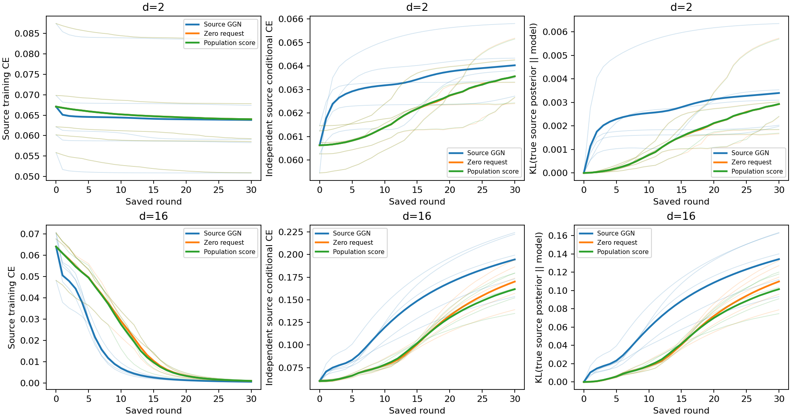
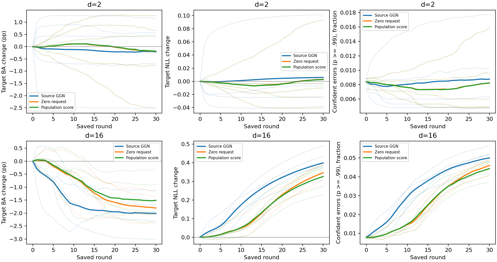
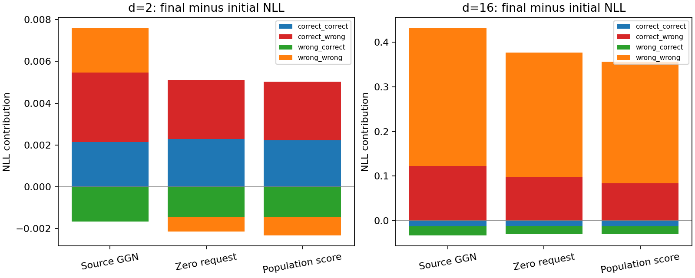
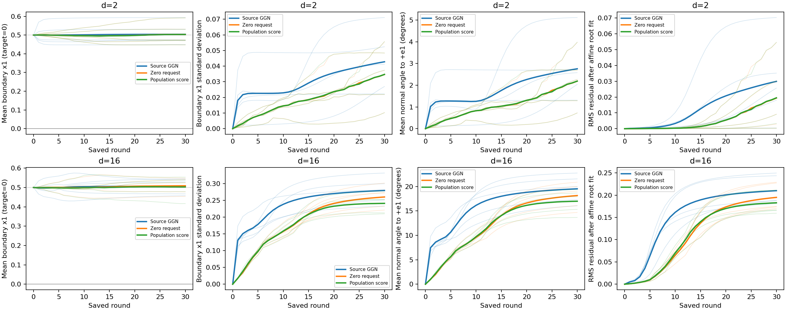

# 现有checkpoint回放诊断（2026-11-10）

后续已完成[解析源后验CE对照](../e2-source-posterior-20261110/report.md)：移除固定源输入上的硬标签拟合驱动力后，控制组保持初始化，总体真实score产生小幅正收益。以下保留回放诊断原结果。

三组全源512实验的初始化及30轮参数原样回放，没有重新训练、生成参数候选或选择checkpoint。每个维数/种子使用32768个独立源样本和256组固定边界探针；目标评价复用原10000个合成样本。

执行代码：[`37f03c9`](https://github.com/chx739/TQG-GDA/tree/37f03c94e18a8c222443e9a088673e324a6d09ac)；[执行前冻结协议](https://github.com/chx739/TQG-GDA/blob/37f03c94e18a8c222443e9a088673e324a6d09ac/docs/tsba/experiments/synthetic/replay-plan.json)；[前轮结果](../e2-full-source-20261110/report.md)。

## 诊断结论

**已经确认源过拟合，16维尤其明显。** 三组都把训练CE压到接近零，同时在独立源样本上偏离已知最优后验。16维纯源GGN的训练CE从0.063990降至0.000537，独立源条件CE却从0.060234升至0.194574；ζ=0和population分别升至0.170128、0.161724。三组最终源后验KL为0.134339、0.109894、0.101490，五个种子都大于零；独立源BA也从97.7623%降至95.9377%、96.1607%、96.3595%。这次下降同时伤害了源和目标的泛化，不能解释为成功拟合真实源规律后才与目标发生冲突。

初始化确实等于解析源Bayes后验：所有单元的最大log概率误差为7.11×10⁻¹⁵。源总体最优阈值0.5与目标最优阈值0不同，是原本就存在的域差异；本次进一步观察到的是，在这层差异之上又增加了有限源样本拟合造成的预测失真。回放没有量化两者对目标损失的独立因果贡献。

**目标NLL恶化不只来自新增错分，更主要来自原本就错的样本变得更自信。** 16维中，初末均错误样本对总ΔNLL的贡献分别为+0.309879、+0.278196、+0.272714，约占净增加量的77.7%、80.4%、83.7%。由对变错也有明显贡献，分别为+0.122792、+0.098525、+0.083736。错误预测的平均置信度从约80.3%升到90.9%–91.6%；置信度≥99%的错误占全部目标样本的比例从0.79%升到4.44%–5.01%。这里同时存在边界错误和概率过度自信。

**边界主要发生了倾斜和非平面变形，平均位置没有有效移向目标。** 16维三个臂最终边界根均值约为0.5075、0.5090、0.5026，仍接近源阈值0.5，目标阈值是0。相同干扰坐标下的根标准差由0增至0.2797、0.2604、0.2413；法向与正确方向的平均夹角由0°增至19.52°、18.14°、16.98°。扣除最佳平面后的RMS残差也达到0.2100、0.1950、0.1828；到目标阈值的根RMS由0.5升至0.5814、0.5731、0.5590。保持平均位置并没有保持边界形状。

**总体真实score的作用主要表现为减轻损害。** 相对ζ=0，它在16维五个种子中均减小源后验KL、根标准差、法向偏角和非平面残差；平均分别减少0.008404、0.019046、1.1623°、0.012160。目标BA仍是上一轮记录的+0.2965个百分点增量，NLL平均改善0.020182、4个种子改善1个恶化。与ζ=0相比，平均根位置更靠近目标约0.0064；相对初始化0.5，它仍没有净向目标方向移动，初始与目标阈值之间的0.5差距基本保留。它不是无效，但本配置下不足以形成整体改善。

2维的同类失真小得多：最终源KL约0.003，法向偏角约2°–3°；目标变化混合正负。不能用16维的置信度恶化概括2维，后者错误预测平均置信度略降。

## 退化出现的时间

16维逐种子的首次越线轮次如下，种子按0、1、2、3、4排列。纯源GGN从第1轮起就明显偏离源后验；几何控制延缓了目标退化，却没有阻止它。首次越线用于定位过程，不据此选取“最佳轮次”。

| 方法 | 目标BA首次低于初始化 | 目标NLL首次高于初始化 |
| --- | --- | --- |
| 纯源GGN | 8、1、1、1、1 | 5、1、1、1、1 |
| ζ=0 | 13、4、4、1、6 | 10、2、1、1、3 |
| 总体真实score | 14、4、4、1、6 | 10、2、1、1、3 |

本次回放完成了三个检查。第2步的score样本量/带宽诊断尚未执行，是否启动留待根据这些结果决定；它需要解决的估计误差，与本次已经确认的源过拟合及边界变形是两个问题。

## 源泛化

条件CE对每个源输入使用真实类别后验加权；KL衡量预测偏离真实源后验的程度。初始头就是源Bayes后验，故其源总体CE已经最优；KL是总体CE超额的Monte Carlo估计。以下跨5个种子取均值，单种子的MC标准误和逐种子值另存表格。

| 维度 | 方法 | 训练CE 初→终 | 独立源硬标签CE 初→终 | 独立源条件CE 初→终 | 最终KL均值±种子SD |
| --- | --- | --- | --- | --- | --- |
| 2 | source_ce_ggn | 0.067093 → 0.063837 | 0.060921 → 0.064434 | 0.060630 → 0.064029 | 0.003399 ± 0.001784 |
| 2 | zero_zeta_geometry | 0.067093 → 0.064016 | 0.060921 → 0.063942 | 0.060630 → 0.063559 | 0.002929 ± 0.001655 |
| 2 | population | 0.067093 → 0.064014 | 0.060921 → 0.063944 | 0.060630 → 0.063561 | 0.002931 ± 0.001629 |
| 16 | source_ce_ggn | 0.063990 → 0.000537 | 0.059575 → 0.196407 | 0.060234 → 0.194574 | 0.134339 ± 0.031103 |
| 16 | zero_zeta_geometry | 0.063990 → 0.000907 | 0.059575 → 0.171394 | 0.060234 → 0.170128 | 0.109894 ± 0.022320 |
| 16 | population | 0.063990 → 0.000944 | 0.059575 → 0.162724 | 0.060234 → 0.161724 | 0.101490 ± 0.019070 |

## 目标分类与置信度

| 维度 | 方法 | 目标NLL 初→终 | 错误预测平均置信度 初→终 | 置信度≥0.99的错误占全部样本 初→终 |
| --- | --- | --- | --- | --- |
| 2 | source_ce_ggn | 0.218301 → 0.224238 | 0.805820 → 0.802803 | 0.008400 → 0.008760 |
| 2 | zero_zeta_geometry | 0.218301 → 0.221286 | 0.805820 → 0.801285 | 0.008400 → 0.008240 |
| 2 | population | 0.218301 → 0.220998 | 0.805820 → 0.800926 | 0.008400 → 0.008220 |
| 16 | source_ce_ggn | 0.215904 → 0.614889 | 0.802835 → 0.915548 | 0.007900 → 0.050060 |
| 16 | zero_zeta_geometry | 0.215904 → 0.561920 | 0.802835 → 0.909452 | 0.007900 → 0.046000 |
| 16 | population | 0.215904 → 0.541738 | 0.802835 → 0.908876 | 0.007900 → 0.044400 |

下面四组根据每个样本的初始/当前正确性定义。贡献为该组样本NLL变化之和除以全部样本数；四项精确加和为总ΔNLL。组内样本的身份已固定在存档logits中，可重算。它是描述性分解。“初末均正确/错误”只约束两个端点，期间仍可能发生预测翻转。

| 维度 | 方法 | 初末均正确 | 由对变错 | 由错变对 | 初末均错误 |
| --- | --- | ---: | ---: | ---: | ---: |
| 2 | source_ce_ggn | 0.002131 | 0.003343 | -0.001671 | 0.002133 |
| 2 | zero_zeta_geometry | 0.002296 | 0.002817 | -0.001437 | -0.000691 |
| 2 | population | 0.002220 | 0.002806 | -0.001447 | -0.000883 |
| 16 | source_ce_ggn | -0.012683 | 0.122792 | -0.021003 | 0.309879 |
| 16 | zero_zeta_geometry | -0.012086 | 0.098525 | -0.018620 | 0.278196 |
| 16 | population | -0.013022 | 0.083736 | -0.017594 | 0.272714 |

## 固定探针上的边界

原始坐标中目标正确阈值为0，初始/源阈值为0.5；理想法向为+e1。根的标准差反映不同干扰坐标下的边界位置差异。非平面残差为扣除最佳仿射拟合后的RMS，不直接称为全局曲率。

| 维度 | 方法 | 最终根均值 | 根SD | 到目标阈值的RMS | 法向平均角度° | 非平面RMS |
| --- | --- | ---: | ---: | ---: | ---: | ---: |
| 2 | source_ce_ggn | 0.503846 | 0.042785 | 0.506054 | 2.756069 | 0.029905 |
| 2 | zero_zeta_geometry | 0.502982 | 0.034679 | 0.504495 | 2.187571 | 0.019388 |
| 2 | population | 0.502556 | 0.034712 | 0.504074 | 2.190616 | 0.019517 |
| 16 | source_ce_ggn | 0.507491 | 0.279740 | 0.581413 | 19.520237 | 0.210007 |
| 16 | zero_zeta_geometry | 0.508962 | 0.260396 | 0.573149 | 18.139062 | 0.194963 |
| 16 | population | 0.502553 | 0.241350 | 0.559036 | 16.976781 | 0.182803 |

有限区间和网格仅识别“唯一检测根”，不能证明全局唯一，也可能漏掉切触或网格内多次过零。无根、多根、非有限值均保留，不挑最靠近理想位置的根。完整逐轮覆盖在[trajectory.csv](trajectory.csv)。

## 记录与核验

完成状态评价930次；失败单元0个；耗时63.6秒。48项工程测试通过。930×256=238080次探针查询全部检测到单根，法向有效且与+e1点积均为正；没有删除失败查询。图中浅线为逐种子轨迹，粗线为5种子均值。

重放930组目标logits逐位一致；所有compact参数向量与原档案一致；原文件前后哈希一致。源初始化及终点指标复算60组；逐探针根残差/状态核验930组，最大根margin残差为3.59×10⁻¹¹。源最终KL的单种子MC标准误：2维约0.000026–0.000109，16维约0.001765–0.004205，明显小于本轮测得的KL偏离；它与表格中的跨种子SD含义不同。

研究单位为5个种子，轮次和探针不扩充独立重复。已知源Bayes初始化与先前结果使本诊断具有明确事后性质；不存在按目标评价选轮次。原样本、配置与checkpoint不覆盖，第2步score样本量/带宽实验没有运行。

逐轮指标：[trajectory.csv](trajectory.csv)；population减ζ=0的逐种子终点差：[paired.csv](paired.csv)；首次越过初始指标的轮次：[onsets.csv](onsets.csv)。首次越线不等于稳定变差或显著性结论。完整源输入/后验、checkpoint向量、目标logits、根/法向记录、日志与源代码见[归档索引](archive-index.json)。
