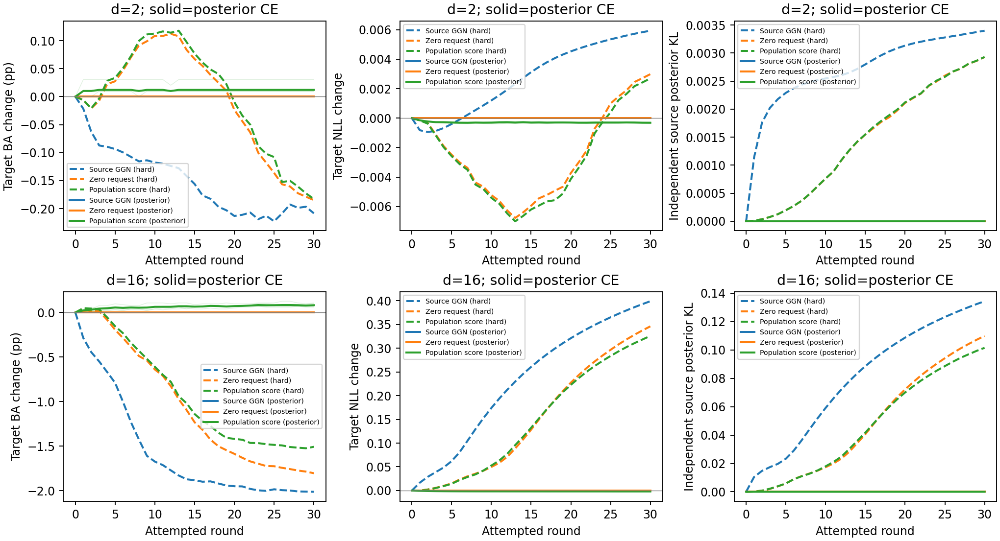
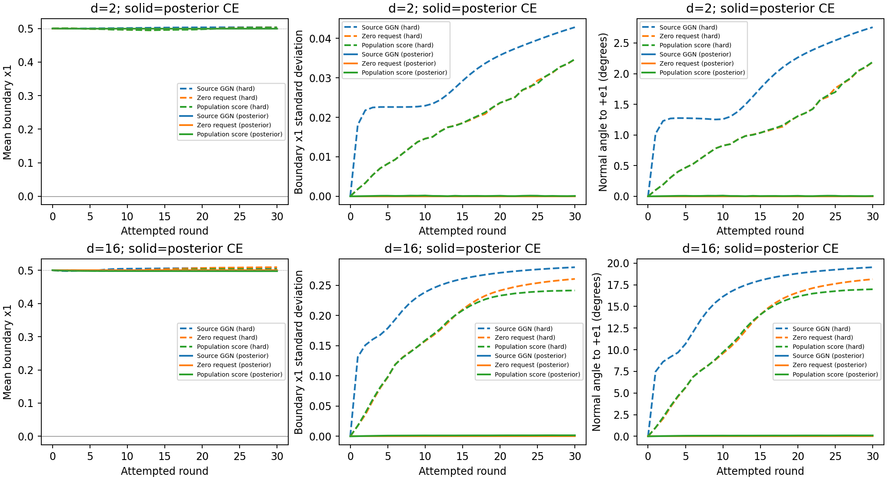

# 解析源后验CE对照（2026-11-10）

唯一干预：同一512个源输入上的硬标签CE，改为解析源后验加权的期望CE；候选梯度和真实验收同时替换。全部Config、初始头、源/目标ID、总体score、带宽及预算沿用全源实验。

执行代码：[`5b5e4be`](https://github.com/chx739/TQG-GDA/tree/5b5e4bef992fe34934183ba96bf37cade27992c7)；[执行前冻结协议](https://github.com/chx739/TQG-GDA/blob/5b5e4bef992fe34934183ba96bf37cade27992c7/docs/tsba/experiments/synthetic/source-posterior-plan.json)；[前轮回放](../e2-replay-20261110/report.md)。

## 主要结论

**替换源监督后，原来明显的负迁移和边界变形消失，总体真实score开始提供小幅正收益。** 16维总体score臂相对初始化的ΔBA为+0.081946±0.021177个百分点，5个种子全部提高；ΔNLL为−0.001901，5个种子全部改善。2维ΔBA为+0.012105±0.011196个百分点，4正1平；ΔNLL为−0.000314，5个种子均改善。

**纯源GGN和ζ=0控制符合预期：它们没有发生实质更新。** 两维数、五种子的20条控制轨迹，最终最大参数漂移为4.44×10⁻¹⁵，最大目标logit漂移为1.42×10⁻¹⁴，BA全部与初始化相同，NLL只差浮点舍入。没有人为强制停止；原求解与Armijo照常执行，接受的近零更新不等于有效学习。

这项配对干预进一步支持：在本合成设置中，继续拟合512个硬标签源样本是此前大幅退化的重要驱动力。源输入、头结构、初始化、总体score、批次、λ、τ与预算均保留，去掉条件标签抽样噪声后，对照组不再漂移，密度请求的效果也不再被大幅源过拟合覆盖。这里换掉的是给定512个源输入的标签目标，不是增加源样本或精确积分整个源输入分布。

**密度请求的方向有效，但作用幅度很小。** 16维总体score的平均边界位置从0.5移到0.497256，向正确阈值0移动了约0.002744，只相当于初始0.5间距的0.55%。2维只移动约0.000450。原来16维总体score臂的根SD为0.241350、法向偏角16.9768°、非平面RMS为0.182803；本轮分别为0.001693、0.1033°和0.000608。边界保持平整，同时只发生了微小迁移。

独立源KL由旧总体score臂的0.101490降至6.29×10⁻⁶（16维），2维由0.002931降至1.20×10⁻⁷。本轮总体score的源KL仍略大于零，代表为目标移动支付了小的源条件风险代价，并非源风险完全不变。16维置信度≥99%的目标错误占比从旧臂4.44%降至0.782%，略低于初始化的0.790%；原来的置信度恶化也已基本消除。

相对旧硬标签总体score臂，16维平均改善1.589984个百分点，但新模型相对初始化实际只提高0.081946个百分点。因此前一项大幅差值主要体现消除了旧臂的退化，不能当成1.59个百分点的净迁移收益。2维新臂相对旧臂只有2个种子改善、3个变差，平均差值为+0.194888个百分点；其逐种子优势并不一致。

**本轮回答了“消除源过拟合驱动力后，正确请求能否工作”：能产生正收益，但当前固定配置下收益很小。** 它没有达到既有实验设计的平均提升1个百分点扩展筛查门槛。原定第2步的score样本量/带宽诊断尚未启动，完成本报告后再决定；这组结果可作为下一步的oracle参照，不是理论性能上限。

## 相对初始化的最终结果

| 维度 | 源CE | 方法 | ΔBA均值±种子SD（百分点） | 胜/平/负 | ΔNLL均值 | 独立源KL均值 |
| --- | --- | --- | ---: | --- | ---: | ---: |
| 2 | hard | source_ce_ggn | -0.208422 ± 1.455376 | 3/0/2 | 0.005937 | 0.003399 |
| 2 | hard | zero_zeta_geometry | -0.184822 ± 1.482427 | 3/0/2 | 0.002985 | 0.002929 |
| 2 | hard | population | -0.182784 ± 1.481420 | 3/0/2 | 0.002697 | 0.002931 |
| 2 | posterior | source_ce_ggn | 0.000000 ± 0.000000 | 0/5/0 | 0.000000 | -0.000000 |
| 2 | posterior | zero_zeta_geometry | 0.000000 ± 0.000000 | 0/5/0 | 0.000000 | -0.000000 |
| 2 | posterior | population | 0.012105 ± 0.011196 | 4/1/0 | -0.000314 | 0.000000 |
| 16 | hard | source_ce_ggn | -2.013087 ± 0.706158 | 0/0/5 | 0.398984 | 0.134339 |
| 16 | hard | zero_zeta_geometry | -1.804560 ± 0.520426 | 0/0/5 | 0.346015 | 0.109894 |
| 16 | hard | population | -1.508038 ± 0.868176 | 0/0/5 | 0.325834 | 0.101490 |
| 16 | posterior | source_ce_ggn | 0.000000 ± 0.000000 | 0/5/0 | 0.000000 | -0.000000 |
| 16 | posterior | zero_zeta_geometry | 0.000000 ± 0.000000 | 0/5/0 | 0.000000 | -0.000000 |
| 16 | posterior | population | 0.081946 ± 0.021177 | 5/0/0 | -0.001901 | 0.000006 |

表格中hard为原硬标签CE，posterior为本轮解析源后验CE；BA正差较好，NLL负差较好。旧硬标签结果重用已封存轨迹，不重复训练。所有种子见[endpoints.csv](endpoints.csv)。

## 配对差

| 维度 | 比较 | ΔBA均值±配对SD（百分点） | 胜/平/负 | ΔNLL均值 |
| --- | --- | ---: | --- | ---: |
| 2 | source_ce_ggn_posterior_minus_hard | 0.208422 ± 1.455376 | 2/0/3 | -0.005937 |
| 2 | zero_zeta_geometry_posterior_minus_hard | 0.184822 ± 1.482427 | 2/0/3 | -0.002985 |
| 2 | population_posterior_minus_hard | 0.194888 ± 1.479651 | 2/0/3 | -0.003011 |
| 2 | posterior_population_minus_zero | 0.012105 ± 0.011196 | 4/1/0 | -0.000314 |
| 16 | source_ce_ggn_posterior_minus_hard | 2.013087 ± 0.706158 | 5/0/0 | -0.398984 |
| 16 | zero_zeta_geometry_posterior_minus_hard | 1.804560 ± 0.520426 | 5/0/0 | -0.346015 |
| 16 | population_posterior_minus_hard | 1.589984 ± 0.859838 | 5/0/0 | -0.327735 |
| 16 | posterior_population_minus_zero | 0.081946 ± 0.021177 | 5/0/0 | -0.001901 |

差值先按同一种子计算，再跨种子汇总；[paired.csv](paired.csv)包含全部逐种子差值。

## 边界与错误置信度

| 维度 | 源CE | 方法 | 根均值 | 根SD | 法向角度° | 非平面RMS | 置信度≥99%的错误占比 |
| --- | --- | --- | ---: | ---: | ---: | ---: | ---: |
| 2 | hard | source_ce_ggn | 0.503846 | 0.042785 | 2.756069 | 0.029905 | 0.008760 |
| 2 | hard | zero_zeta_geometry | 0.502982 | 0.034679 | 2.187571 | 0.019388 | 0.008240 |
| 2 | hard | population | 0.502556 | 0.034712 | 2.190616 | 0.019517 | 0.008220 |
| 2 | posterior | source_ce_ggn | 0.500000 | 0.000000 | 0.000000 | 0.000000 | 0.008400 |
| 2 | posterior | zero_zeta_geometry | 0.500000 | 0.000000 | 0.000000 | 0.000000 | 0.008400 |
| 2 | posterior | population | 0.499550 | 0.000100 | 0.005673 | 0.000009 | 0.008380 |
| 16 | hard | source_ce_ggn | 0.507491 | 0.279740 | 19.520237 | 0.210007 | 0.050060 |
| 16 | hard | zero_zeta_geometry | 0.508962 | 0.260396 | 18.139062 | 0.194963 | 0.046000 |
| 16 | hard | population | 0.502553 | 0.241350 | 16.976781 | 0.182803 | 0.044400 |
| 16 | posterior | source_ce_ggn | 0.500000 | 0.000000 | 0.000000 | 0.000000 | 0.007900 |
| 16 | posterior | zero_zeta_geometry | 0.500000 | 0.000000 | 0.000000 | 0.000000 | 0.007900 |
| 16 | posterior | population | 0.497256 | 0.001693 | 0.103312 | 0.000608 | 0.007820 |

原始坐标中的源/初始阈值是0.5，目标阈值是0。非平面RMS为固定探针上扣除最佳平面后的残差。有限网格仅报告唯一检测根，并保留缺根、多根及无效法向；逐轮覆盖见[trajectory.csv](trajectory.csv)。

## 控制组、验收与档案

| 维度 | 方法 | 平均接受轮数 | 最大参数漂移 | 最大目标logit漂移 | 最大源梯度范数 |
| --- | --- | ---: | ---: | ---: | ---: |
| 2 | source_ce_ggn | 30.0 | 4e-15 | 1.24e-14 | 1.52e-17 |
| 2 | zero_zeta_geometry | 29.6 | 4e-15 | 1.24e-14 | 1.52e-17 |
| 2 | population | 29.6 | 0.00201 | 0.00513 | 9.62e-05 |
| 16 | source_ce_ggn | 30.0 | 4.44e-15 | 1.42e-14 | 1.5e-17 |
| 16 | zero_zeta_geometry | 30.0 | 4.44e-15 | 1.42e-14 | 1.5e-17 |
| 16 | population | 30.0 | 0.0171 | 0.0605 | 0.000541 |

30条轨迹、900次尝试全部正常结束，896次接受、4次跳过。跳过均为2维seed1没有有效边界：ζ=0与总体score各2次；没有数值异常或执行失败。独立诊断完成930个状态、238080次探针查询，全部有唯一检测根和有效法向。运行与诊断合计574.0秒，适配进程峰值RSS约729 MiB。

没有新增梯度归零或stationary跳过阈值。近零梯度可能产生被原Armijo接受的浮点级更新；“接受次数”与“实际参数移动”分别报告。全部原因见[process.csv](process.csv)。

51项工程测试通过。逐轮核验900次参数状态与候选方程；独立复算965次回溯的后验CE，最大误差1.6e-16；源梯度最大复算差1.14e-18。930组诊断logits重载逐位一致，60组独立源初始化/终点指标复算一致。图中虚线为旧硬标签组均值，实线为新后验组均值，浅细线为新组逐种子轨迹。

后验期望在原512个源输入上计算，消除了给定输入的标签抽样噪声，但仍非源输入分布的精确积分。独立源评价样本及固定探针与上轮逐位相同。表内−0.000000是控制组KL的浮点舍入，不代表负的理论KL。全部适配预测封存后才评价目标标签，未改选checkpoint。正式TSBA未修改，第2步score样本量/带宽实验未运行。

完整日志、逐轮候选/梯度/参数、后验权重、最终checkpoint、诊断logits与几何、代码和环境保存在[独立档案](archive-index.json)。GitHub只含报告、代码、图、标量表和核验清单。
