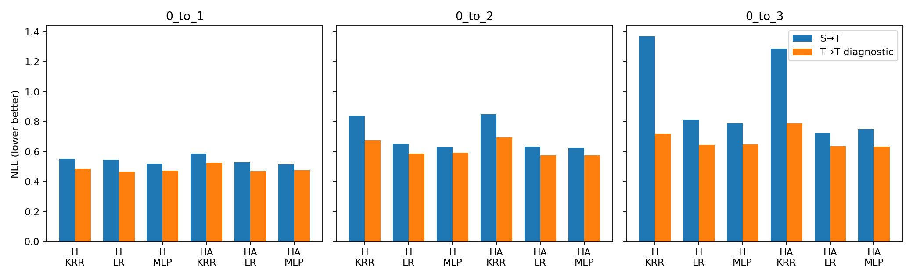

# §3.8条件诊断：A0／A1／A2-a结果解读

这是冻结特征探针实验，不是完整TQG适配准确率。源／目标训练各147张；源留出49张，目标B评价271张。四外折、三内折，五模型种子。NLL越低越好；目标训练探针只作诊断，不能当作UDA方法。H与HA分别报告，三探针分别选参数，没有在B上挑最优模型。

## 先看结论和下一步

**当前最值得优先处理的是“局部源经验覆盖＋核读取方式”，还不能说已经证明η_S与η_T不同。**

1. **签名里确实有任务信息。** H与HA的线性／小MLP探针，在源内和目标内都过了可学门槛；同样147张训练图，各目标任务的目标内探针都优于类比例和乱标签对照。不能再把失败笼统解释成“当前签名完全不含标签信息”。但这不证明保留了完整图的全部必要信息。
2. **源规律迁过去存在稳定缺口。** H和HA的线性／MLP在三个目标任务都通过缺口筛选。目标探针是在使用目标诊断标签，故是定位工具，不是可部署的UDA效果。缺口可能混合条件关系、覆盖、类比例和有限样本的拟合差异，不能单凭它唯一归因。
3. **H距离能定位更困难的目标区域。** 三种探针的三个任务均出现“较远区域迁移缺口更大”，通过预设支持筛选。HA只在0→3过支持筛选；0→1/2的最小分组仅27/28张，未满足30张门槛，不能解读成HA支持诊断完全无效。距离仍只是代理，不是已证明数学支持。
4. **原HA核读取值得单独改。** HA残差KRR连源内可学门槛也未通过，换同签名的LR／MLP后能通过。它支持“核／残差读出受限”的诊断候选，不能证明某个RKHS绝不包含真实函数。HA的线性探针S→T NLL在三个任务反而都优于H线性探针，不能说响应A完全没有信息；“可预测信息”也不等于“原梯度读取已有额外收益”。
5. **只在局部有相容线索。** H线性探针在0→2共同近邻114张图上的Gap约0.00010，90%描述性区间[−0.01484,0.01537]落入预设±0.02；其他任务／探针未获跨任务相容支持。这不是普遍条件稳定性的证明。

建议下一批先登记A2-b：n64／128下H近邻bank与同数量均匀bank比较，并保留全196、两种正则、乱标签／等幅反馈对照；再做A4-a的核带宽／正则留出曲线。暂不优先扩骨干或加长适配；若局部读取改善预测，还必须经过A6方向／独立单步验收。

这些是完成实验后的路线建议，**本轮未执行A2-b或A3—A6**。

## 同监督量的三角比较

| 任务 | 签名 | 探针 | S→S NLL | S→T NLL | T→T NLL | 迁移缺口 | 源内可学 | 目标内可学 | 缺口候选 |
|---|---|---|---:|---:|---:|---:|---|---|---|
| 0_to_1 | H | KRR | 0.6373 | 0.5525 | 0.4865 | +0.0660 | 是 | 是 | 是 |
| 0_to_1 | H | LR | 0.6520 | 0.5470 | 0.4679 | +0.0790 | 是 | 是 | 是 |
| 0_to_1 | H | MLP | 0.6334 | 0.5200 | 0.4750 | +0.0450 | 是 | 是 | 是 |
| 0_to_1 | HA | KRR | 0.6803 | 0.5862 | 0.5250 | +0.0613 | 否 | 是 | 是 |
| 0_to_1 | HA | LR | 0.6338 | 0.5278 | 0.4710 | +0.0568 | 是 | 是 | 是 |
| 0_to_1 | HA | MLP | 0.6328 | 0.5172 | 0.4763 | +0.0409 | 是 | 是 | 是 |
| 0_to_2 | H | KRR | 0.6373 | 0.8421 | 0.6750 | +0.1671 | 是 | 否 | 否 |
| 0_to_2 | H | LR | 0.6520 | 0.6558 | 0.5887 | +0.0671 | 是 | 是 | 是 |
| 0_to_2 | H | MLP | 0.6334 | 0.6327 | 0.5927 | +0.0400 | 是 | 是 | 是 |
| 0_to_2 | HA | KRR | 0.6773 | 0.8490 | 0.6956 | +0.1534 | 否 | 否 | 否 |
| 0_to_2 | HA | LR | 0.6410 | 0.6350 | 0.5744 | +0.0606 | 是 | 是 | 是 |
| 0_to_2 | HA | MLP | 0.6362 | 0.6264 | 0.5766 | +0.0498 | 是 | 是 | 是 |
| 0_to_3 | H | KRR | 0.6373 | 1.3710 | 0.7184 | +0.6526 | 是 | 否 | 否 |
| 0_to_3 | H | LR | 0.6520 | 0.8130 | 0.6465 | +0.1665 | 是 | 是 | 是 |
| 0_to_3 | H | MLP | 0.6334 | 0.7893 | 0.6477 | +0.1417 | 是 | 是 | 是 |
| 0_to_3 | HA | KRR | 0.6774 | 1.2873 | 0.7889 | +0.4984 | 否 | 否 | 否 |
| 0_to_3 | HA | LR | 0.6347 | 0.7251 | 0.6367 | +0.0884 | 是 | 是 | 是 |
| 0_to_3 | HA | MLP | 0.6322 | 0.7520 | 0.6354 | +0.1166 | 是 | 是 | 是 |

“可学”同时要求较训练类比例、三次乱标签均值的平均NLL改善≥0.02，以及至少4/5种子同向。缺口候选还要求目标内可学、源训练比目标训练的B池NLL高≥0.02、4/5种子同向。未过门槛不等于签名绝无标签信息。

## 跨任务路线筛选

| 候选 | 源内可学任务 | 目标内可学任务 | 迁移缺口候选任务 | 支持相关候选任务 | 局部相容候选任务 |
|---|---:|---:|---:|---:|---:|
| H_KRR | 3/3 | 1/3 | 1/3 | 3/3 | 0/3 |
| H_LR | 3/3 | 3/3 | 3/3 | 3/3 | 1/3 |
| H_MLP | 3/3 | 3/3 | 3/3 | 3/3 | 0/3 |
| HA_KRR | 0/3 | 1/3 | 1/3 | 1/3 | 0/3 |
| HA_LR | 3/3 | 3/3 | 3/3 | 1/3 | 0/3 |
| HA_MLP | 3/3 | 3/3 | 3/3 | 1/3 | 0/3 |

至少2/3任务同向才升级为跨任务路线建议，且仍限定这个探针／签名。迁移缺口是条件关系、支持、有限样本拟合的合并证据，不能直接宣布η_S≠η_T。局部相容只限输入支持代理覆盖区域，描述性区间不证明普遍相等。

## 支持分层

| 任务 | 签名 | 探针 | 最小分组图数 | Gap远−Gap近 | 同向种子 | 候选 |
|---|---|---|---:|---:|---:|---|
| 0_to_1 | H | KRR | 38 | +0.1228 | 4/5 | 是 |
| 0_to_1 | H | LR | 38 | +0.0549 | 4/5 | 是 |
| 0_to_1 | H | MLP | 38 | +0.0540 | 4/5 | 是 |
| 0_to_1 | HA | KRR | 27 | +0.0501 | 3/5 | 否 |
| 0_to_1 | HA | LR | 27 | +0.0500 | 3/5 | 否 |
| 0_to_1 | HA | MLP | 27 | +0.0410 | 3/5 | 否 |
| 0_to_2 | H | KRR | 41 | +0.6345 | 5/5 | 是 |
| 0_to_2 | H | LR | 41 | +0.1642 | 4/5 | 是 |
| 0_to_2 | H | MLP | 41 | +0.1705 | 5/5 | 是 |
| 0_to_2 | HA | KRR | 28 | +0.3643 | 5/5 | 否 |
| 0_to_2 | HA | LR | 28 | +0.1105 | 5/5 | 否 |
| 0_to_2 | HA | MLP | 28 | +0.0993 | 4/5 | 否 |
| 0_to_3 | H | KRR | 87 | +1.0444 | 5/5 | 是 |
| 0_to_3 | H | LR | 87 | +0.2768 | 5/5 | 是 |
| 0_to_3 | H | MLP | 87 | +0.2496 | 5/5 | 是 |
| 0_to_3 | HA | KRR | 68 | +0.6497 | 5/5 | 是 |
| 0_to_3 | HA | LR | 68 | +0.1366 | 5/5 | 是 |
| 0_to_3 | HA | MLP | 68 | +0.1902 | 5/5 | 是 |

分组阈值只看输入：源147留一最近邻距离90%分位数。每折每模型两组均须≥30张才满足支持候选筛选。图数不足记为证据不足，不因合并不同任务而过关。E、近邻、ESS是代理，不能当真实目标误差或充分覆盖证明。

## 数值与范围补充

- H源内NLL在三个任务相同，因为它们共享同一源模型、query池、划分和H签名；重复的任务引用不是三份独立源数据证据。HA的V随目标任务变化，源端签名也随之变化。
- 残差KRR恢复的原始概率可能越过[0,1]。S→T越界比例H约4.24%／6.00%／14.76%，HA约6.73%／6.85%／12.08%；NLL按预设裁到[1e−6,1−1e−6]，同时保留原始残差MSE。尤其0→3的高KRR NLL可能部分受过强纠错与裁剪影响，不能全解释成标签关系反转。
- 内层LR有1条数值未收敛：3406、0→1、外折0、H、目标训练、第二个乱标签、L2=10，L-BFGS-B第10次迭代ABNORMAL。没有删除这条对照或改变网格。主真实标签拟合没有该标志。
- 代理指标与A经验梯度误差的描述性相关表另见support_gradient_correlations.json；只有15个共享模型的任务引用，不能当独立因果检验。B投影外能量复用历史同快照标量，不重新读B标签算梯度。

## 工程、范围与限制

- A0的15个几何、30个H/HA读出回放通过。新探针10项单测通过。所有2880个选择单元、34560次拟合完成；内层LR未收敛记录1条，完整保留。MLP固定200步，不把固定步结束称为优化收敛。
- 无骨干更新、无final读取。目标A标签仅训练诊断探针；B在预测、模型、内层选择和支持分组封存后读取。开发集已被历史观察，不是新盲测。
- 本轮不执行A2-b、A3—A6，不因单个探针成功直接启动完整适配。没有逐图η真值，四项假设仍应分开按有限证据判断。
- 完整逐种子／逐折指标、内层选择、预测、模型参数、label_access和readout replay均保留。原始query196不混入骨干已见的fit779。

[逐模型指标](results.csv) · [三角汇总](triangle_summary.csv) · [支持汇总](support_summary.csv) · [完整JSON](results_summary.json) · [执行协议](execution_protocol.md)
