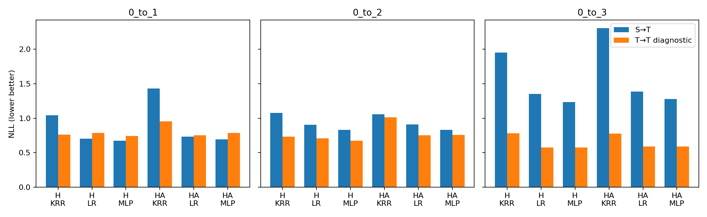

# §3.8条件诊断：A0／A1／A2-a结果解读

这是PROTEINS冻结特征探针实验，不是完整TQG适配准确率。PROTEINS：源／目标每折各训练38或39张；源留出13或12张，目标B评价70张（A池69张）。四外折、三内折，五模型种子。NLL越低越好；目标训练探针只作诊断，不能当作UDA方法。H与HA分别报告，三探针分别选参数，没有在B上挑最优模型。

## 先看本轮结论

**PROTEINS没有复现Mutagenicity上“源内／目标内稳定可学、同时有跨域读出缺口”的完整证据链。六个签名×探针组合的源内与目标内主门槛均为0/3。** 这是有限监督下的稳定增量未获支持，不是已证明签名无信息或四项数学条件全部不成立。

- 源query只有51张，42／9两类。H线性探针源内NLL约0.549，简单训练类比例基线约0.515，未稳定胜出；源内三个任务共用同一源数据／模型，不当三份独立源证据。
- 0→2的H-MLP目标内平均优于PRIOR约0.048 NLL，也优于乱标签，但只有3/5种子两项同向，未满足4/5。这是局部正信号，不应改写成完全没有信息。
- 虽然0→2／3存在较大的源→目标与目标→目标分数差，但目标内可学前提未过，不能按原判据宣称已定位条件失稳。0→1源训练LR／MLP平均还优于目标训练，不能只挑0→3讲故事。
- H／HA各任务支持分组的最小图数仅2～7，全部低于30。这里主要是分组证据不足，不能宣布“距离没有诊断价值”。共同近邻子集有局部信号，但相容区间无候选通过。
- 类别构成差异明显：源query的类别1比例9/51≈17.6%，目标B分别23/70、33/70、52/70≈32.9%／47.1%／74.3%。目标内参照也可能主要靠类比例获得较好NLL；均值类别差本身不等于同签名条件标签规律不同。
- 数学／执行验收通过：13项单测，Mutagenicity六组旧预测回归最大误差<1e−8，15份新几何的显式Jacobian／生产反馈／参数损失核验通过。真实PROTEINS的内层LR未收敛0条，MLP固定200步不声称优化收敛。工程通过不能代替研究门槛。

当前不依据PROTEINS单独推动局部bank或宣称跨域条件失稳。建议将其视为小样本／类别不平衡下的边界证据；先在Mutagenicity上验证既有局部支持与核读取候选。若继续解释PROTEINS，另登记分层划分敏感性、更简单／更强正则探针，或更多独立源监督；本轮不改阈值、不按标签重分折，也不补入骨干见过的fit图。

## 如何与Mutagenicity一起理解

这是同一套诊断的第二数据集复验，不是相同训练条件下仅替换数据集：PROTEINS的源query只有51张、探针每折38/39张；Mutagenicity为query196、每折147张。骨干GIN/GINE和源预训练预算也不同。因此，跨数据集差异不能单独归因于数据太少，门槛未过也不证明签名没有信息。

下表是满足各自原门槛的任务数，每列分母都是3。H源内重复三个任务共享同一源模型与数据，不当三份独立源证据。

| 候选 | PROTEINS源内／目标内可学 | Mutagenicity源内／目标内可学 | PROTEINS迁移缺口 | Mutagenicity迁移缺口 | PROTEINS支持候选 | Mutagenicity支持候选 |
|---|---|---|---|---|---|---|
| H_KRR | 0/3，0/3 | 3/3，1/3 | 0/3 | 1/3 | 0/3 | 3/3 |
| H_LR | 0/3，0/3 | 3/3，3/3 | 0/3 | 3/3 | 0/3 | 3/3 |
| H_MLP | 0/3，0/3 | 3/3，3/3 | 0/3 | 3/3 | 0/3 | 3/3 |
| HA_KRR | 0/3，0/3 | 0/3，1/3 | 0/3 | 1/3 | 0/3 | 1/3 |
| HA_LR | 0/3，0/3 | 3/3，3/3 | 0/3 | 3/3 | 0/3 | 1/3 |
| HA_MLP | 0/3，0/3 | 3/3，3/3 | 0/3 | 3/3 | 0/3 | 1/3 |

当前A16空间外的B经验梯度能量平均约12.63%／7.04%／3.18%。这是梯度能量比例，不是未覆盖图的比例；也不能直接解释为源监督支持不足。

支持候选要求每折近／远组均≥30张。PROTEINS的B只有70张，如果没有候选，先看分组数量是否充分，不能直接声称距离无用。目标内未通过可学门槛时，即使NLL有正差距，也不能跳过前置条件宣布迁移缺口候选成功。

## 同监督量的三角比较

| 任务 | 签名 | 探针 | S→S NLL | S→T NLL | T→T NLL | 迁移缺口 | 源内可学 | 目标内可学 | 缺口候选 |
|---|---|---|---:|---:|---:|---:|---|---|---|
| 0_to_1 | H | KRR | 0.7666 | 1.0410 | 0.7635 | +0.2775 | 否 | 否 | 否 |
| 0_to_1 | H | LR | 0.5493 | 0.7032 | 0.7855 | -0.0823 | 否 | 否 | 否 |
| 0_to_1 | H | MLP | 0.6768 | 0.6731 | 0.7443 | -0.0712 | 否 | 否 | 否 |
| 0_to_1 | HA | KRR | 0.6060 | 1.4333 | 0.9552 | +0.4781 | 否 | 否 | 否 |
| 0_to_1 | HA | LR | 0.5989 | 0.7317 | 0.7509 | -0.0192 | 否 | 否 | 否 |
| 0_to_1 | HA | MLP | 0.6467 | 0.6930 | 0.7863 | -0.0933 | 否 | 否 | 否 |
| 0_to_2 | H | KRR | 0.7666 | 1.0758 | 0.7342 | +0.3416 | 否 | 否 | 否 |
| 0_to_2 | H | LR | 0.5493 | 0.9042 | 0.7070 | +0.1972 | 否 | 否 | 否 |
| 0_to_2 | H | MLP | 0.6768 | 0.8299 | 0.6734 | +0.1565 | 否 | 否 | 否 |
| 0_to_2 | HA | KRR | 0.6341 | 1.0570 | 1.0118 | +0.0452 | 否 | 否 | 否 |
| 0_to_2 | HA | LR | 0.5869 | 0.9098 | 0.7517 | +0.1580 | 否 | 否 | 否 |
| 0_to_2 | HA | MLP | 0.6661 | 0.8337 | 0.7591 | +0.0746 | 否 | 否 | 否 |
| 0_to_3 | H | KRR | 0.7666 | 1.9511 | 0.7802 | +1.1709 | 否 | 否 | 否 |
| 0_to_3 | H | LR | 0.5493 | 1.3553 | 0.5761 | +0.7792 | 否 | 否 | 否 |
| 0_to_3 | H | MLP | 0.6768 | 1.2343 | 0.5742 | +0.6602 | 否 | 否 | 否 |
| 0_to_3 | HA | KRR | 0.5989 | 2.3079 | 0.7777 | +1.5302 | 否 | 否 | 否 |
| 0_to_3 | HA | LR | 0.6008 | 1.3865 | 0.5899 | +0.7965 | 否 | 否 | 否 |
| 0_to_3 | HA | MLP | 0.6680 | 1.2807 | 0.5910 | +0.6897 | 否 | 否 | 否 |

“可学”同时要求较训练类比例、三次乱标签均值的平均NLL改善≥0.02，以及至少4/5种子同向。缺口候选还要求目标内可学、源训练比目标训练的B池NLL高≥0.02、4/5种子同向。未过门槛不等于签名绝无标签信息。

## 跨任务路线筛选

| 候选 | 源内可学任务 | 目标内可学任务 | 迁移缺口候选任务 | 支持相关候选任务 | 局部相容候选任务 |
|---|---:|---:|---:|---:|---:|
| H_KRR | 0/3 | 0/3 | 0/3 | 0/3 | 0/3 |
| H_LR | 0/3 | 0/3 | 0/3 | 0/3 | 0/3 |
| H_MLP | 0/3 | 0/3 | 0/3 | 0/3 | 0/3 |
| HA_KRR | 0/3 | 0/3 | 0/3 | 0/3 | 0/3 |
| HA_LR | 0/3 | 0/3 | 0/3 | 0/3 | 0/3 |
| HA_MLP | 0/3 | 0/3 | 0/3 | 0/3 | 0/3 |

至少2/3任务同向才升级为跨任务路线建议，且仍限定这个探针／签名。迁移缺口是条件关系、支持、有限样本拟合的合并证据，不能直接宣布η_S≠η_T。局部相容只限输入支持代理覆盖区域，描述性区间不证明普遍相等。

## 支持分层

| 任务 | 签名 | 探针 | 最小分组图数 | Gap远−Gap近 | 同向种子 | 候选 |
|---|---|---|---:|---:|---:|---|
| 0_to_1 | H | KRR | 6 | -0.8059 | 0/5 | 否 |
| 0_to_1 | H | LR | 6 | -0.7171 | 0/5 | 否 |
| 0_to_1 | H | MLP | 6 | -0.6225 | 0/5 | 否 |
| 0_to_1 | HA | KRR | 7 | -0.5520 | 1/5 | 否 |
| 0_to_1 | HA | LR | 7 | -0.5940 | 1/5 | 否 |
| 0_to_1 | HA | MLP | 7 | -0.7817 | 2/5 | 否 |
| 0_to_2 | H | KRR | 2 | +0.0419 | 3/5 | 否 |
| 0_to_2 | H | LR | 2 | +0.2370 | 4/5 | 否 |
| 0_to_2 | H | MLP | 2 | +0.1996 | 3/5 | 否 |
| 0_to_2 | HA | KRR | 2 | -0.0179 | 2/5 | 否 |
| 0_to_2 | HA | LR | 2 | +0.1196 | 3/5 | 否 |
| 0_to_2 | HA | MLP | 2 | +0.0144 | 3/5 | 否 |
| 0_to_3 | H | KRR | 2 | -0.3485 | 2/5 | 否 |
| 0_to_3 | H | LR | 2 | +0.1667 | 2/5 | 否 |
| 0_to_3 | H | MLP | 2 | +0.5692 | 5/5 | 否 |
| 0_to_3 | HA | KRR | 5 | -1.4534 | 0/5 | 否 |
| 0_to_3 | HA | LR | 5 | +0.2423 | 4/5 | 否 |
| 0_to_3 | HA | MLP | 5 | +0.7460 | 5/5 | 否 |

分组阈值只看输入：源训练38或39张的留一最近邻距离90%分位数。每折每模型两组均须≥30张才满足支持候选筛选。图数不足记为证据不足，不因合并不同任务而过关。E、近邻、ESS是代理，不能当真实目标误差或充分覆盖证明。

## 工程、范围与限制

- A0的15个新几何、30个H/HA读出通过显式Jacobian、CE梯度、生产反馈、标签盲性、参数损失及序列化交叉核验；没有跨方向历史v2缓存，不称历史回放。单测结果见D0日志。所有2880个选择单元、34560次拟合完成；内层LR未收敛记录0条，完整保留。MLP固定200步，不把固定步结束称为优化收敛。
- 无骨干更新、无final读取。目标A标签仅训练诊断探针；B在预测、模型、内层选择和支持分组封存后读取。开发集已被历史观察，不是新盲测。
- 本轮不执行A2-b、A3—A6，不因单个探针成功直接启动完整适配。没有逐图η真值，四项假设仍应分开按有限证据判断。
- 完整逐种子／逐折指标、内层选择、预测、模型参数、label_access和readout replay均保留。源query51不混入骨干已见的fit199；51不能整除4，训练／留出数随外折变化，源与目标每折严格匹配。

[逐模型指标](results.csv) · [三角汇总](triangle_summary.csv) · [支持汇总](support_summary.csv) · [完整JSON](results_summary.json) · [执行协议](execution_protocol.md)
