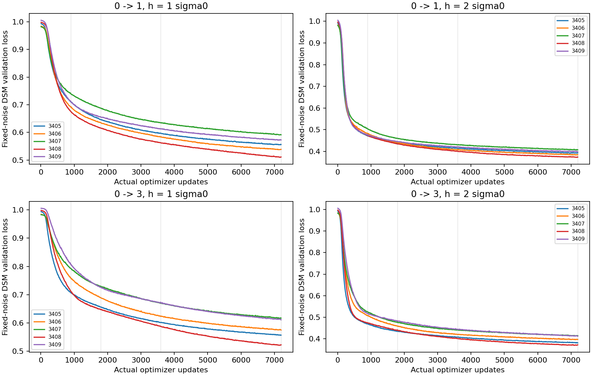
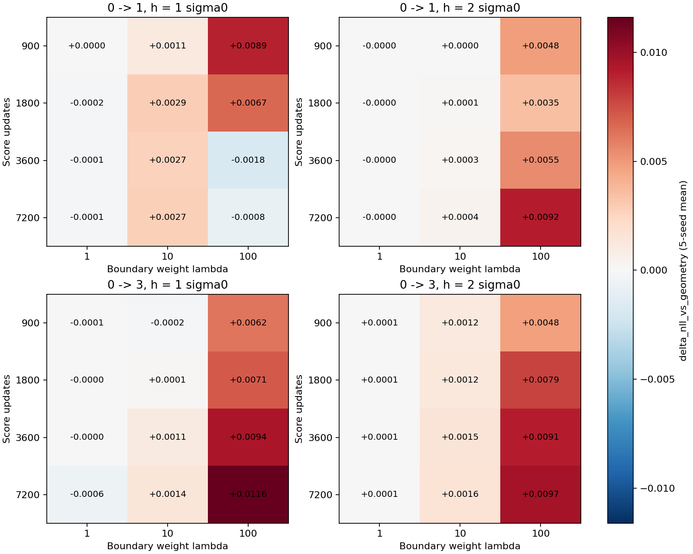
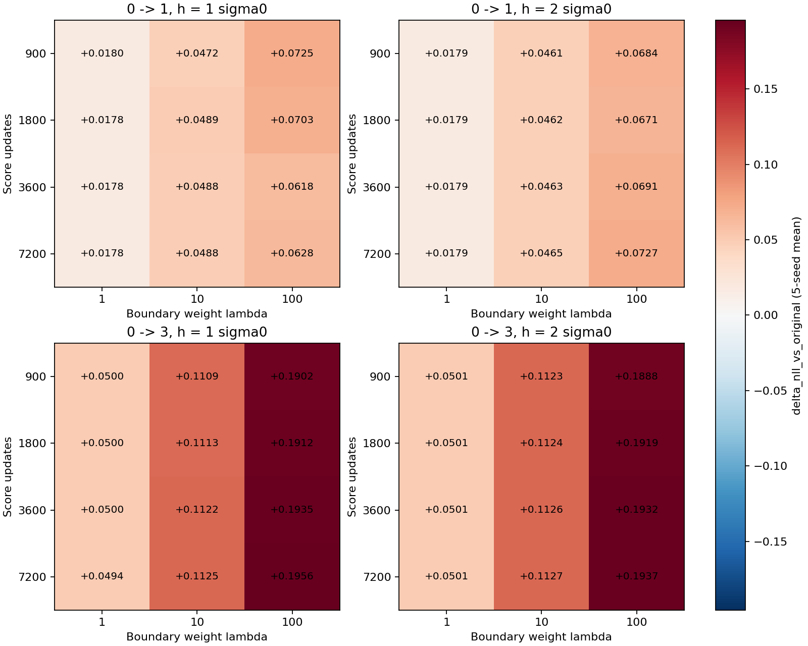
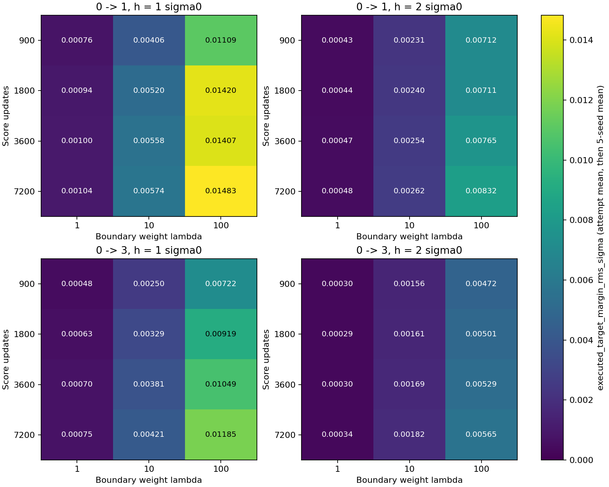
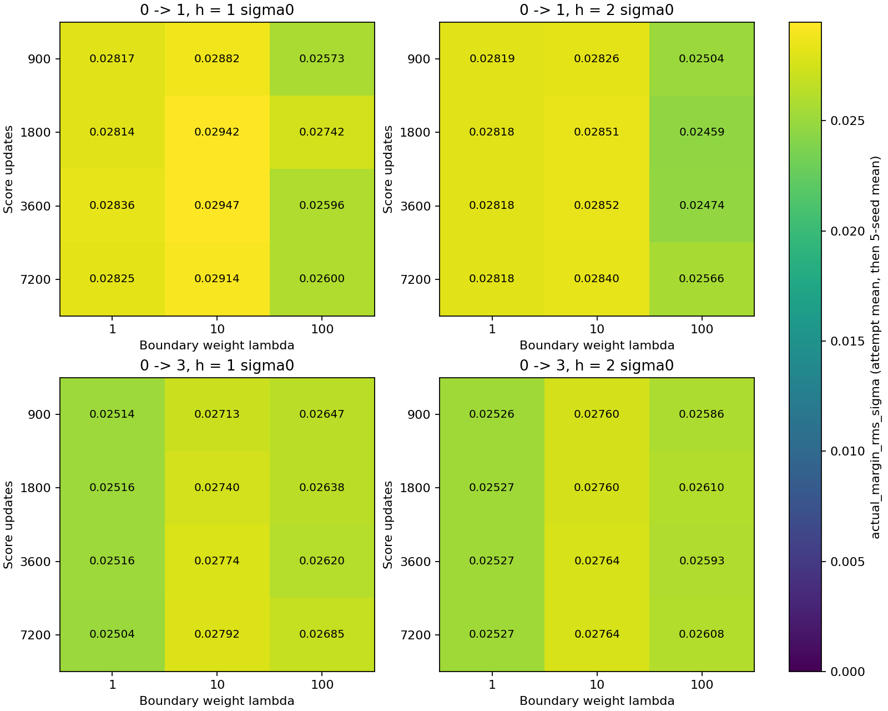

# Mutagenicity R2：完整30次适配结果

固定 R1 的五份16维 GNN 表示，比较 score 精确更新预算900/1800/3600/7200与边界权重1/10/100；两个任务、两个带宽全部执行。

主轨迹 **630条**，数值失败 **0条**；实际记录 **18900次尝试**。主终点为第30次尝试，主指标为目标 B271 的 NLL。所有均值±SD以五个种子为单位。

## 本轮结论

**本轮没有获得登记主指标上的整体收益。** 48个学习score配置和12个KDE配置的第30轮五种子平均B集NLL，全部高于原始源头。这里数的是配置，不是60个独立统计重复。

1. **score学得更充分了。** 900→7200步，四个任务/带宽面板的平均DSM与固定边界请求误差都下降；请求RMSE下降约9.2%–26.8%。最优DSM位置仍集中在6975–7200步，预算内尚未显示收敛。
2. **增大λ确实增强了密度分量。** 在7200步端点，λ从1增到100后，接受步长下的一阶密度分量RMS约增大14–17倍；真实总margin变化RMS仍约0.025–0.029σ0。增强密度分量没有转化为整体NLL收益。
3. **适配失效不只是score训练不足。** 去掉请求的几何源对照已经使B集NLL变差；使用精确有限池KDE也没有超过起点。λ≥10的全部32个学习score配置和8个KDE配置，正常方向的平均NLL都比对应反向组更高。

仍存在局部增量：学习score有14/48格、KDE有4/12格的平均NLL优于几何源对照；但没有一格超过原始源头。一个明确例子是0→3、h=σ0、7200步、λ=1：相对几何源对照ΔNLL=−0.000590，五个种子均为负；相对原始源头仍为+0.049444。

BA有升有降：学习score 21/48格、KDE 6/12格的平均BA高于原始源头；所有正常组相对起点的变化范围约为0→1的−0.12至+0.33个百分点、0→3的−0.59至+0.21个百分点。不能把NLL全变差说成每一项分类指标都下降，也不能据这些小幅BA变化把本轮判为主目标成功。

## 1. score 是否学得更好

经验 KDE 是相同有限目标池、相同带宽的精确平滑密度参考，不是总体真实 score。两个独立固定噪声上的DSM只用于诊断，分类适配使用精确端点。完整逐种子值见 [score-endpoints.csv](results/score-endpoints.csv)。 该表同时保留全点、近零、非近零分层与相邻端点请求变化。旧64次查询每个任务—种子的有效锚点为15–34个；本轮所有组合在预定 `abs(σ0*n·sKDE)≤1e-6` 阈值下的近零点数均为0，因此近零层指标为NA，非近零符号率与全点一致。

| 任务 | h/σ0 | 更新 | 主噪声DSM | 第二噪声DSM | 法向RMSE·σ0 | 请求RMSE/σ0 | 非近零符号一致率 |
|---|---:|---:|---:|---:|---:|---:|---:|
| 0→1 | 1 | 900 | 0.7059 ± 0.0241 | 0.7157 ± 0.0259 | 1.8775 ± 0.2235 | 0.0661 ± 0.0074 | 0.8281 ± 0.1311 |
| 0→1 | 1 | 1800 | 0.6479 ± 0.0266 | 0.6581 ± 0.0299 | 1.7778 ± 0.2165 | 0.0608 ± 0.0107 | 0.8253 ± 0.1380 |
| 0→1 | 1 | 3600 | 0.5982 ± 0.0274 | 0.6090 ± 0.0311 | 1.6963 ± 0.1935 | 0.0557 ± 0.0120 | 0.8815 ± 0.0737 |
| 0→1 | 1 | 7200 | 0.5540 ± 0.0310 | 0.5663 ± 0.0322 | 1.6387 ± 0.1717 | 0.0517 ± 0.0132 | 0.8892 ± 0.0852 |
| 0→1 | 2 | 900 | 0.4810 ± 0.0131 | 0.4898 ± 0.0187 | 0.3613 ± 0.0590 | 0.0361 ± 0.0059 | 0.7755 ± 0.1420 |
| 0→1 | 2 | 1800 | 0.4435 ± 0.0096 | 0.4525 ± 0.0161 | 0.3495 ± 0.0570 | 0.0349 ± 0.0057 | 0.8022 ± 0.1508 |
| 0→1 | 2 | 3600 | 0.4147 ± 0.0114 | 0.4232 ± 0.0158 | 0.3376 ± 0.0478 | 0.0338 ± 0.0048 | 0.8117 ± 0.1108 |
| 0→1 | 2 | 7200 | 0.3911 ± 0.0128 | 0.3997 ± 0.0157 | 0.3280 ± 0.0427 | 0.0328 ± 0.0043 | 0.8261 ± 0.1071 |
| 0→3 | 1 | 900 | 0.7554 ± 0.0453 | 0.7580 ± 0.0450 | 1.9454 ± 0.0915 | 0.0726 ± 0.0107 | 0.7869 ± 0.1426 |
| 0→3 | 1 | 1800 | 0.6897 ± 0.0379 | 0.6928 ± 0.0381 | 1.8273 ± 0.0813 | 0.0635 ± 0.0094 | 0.8995 ± 0.0746 |
| 0→3 | 1 | 3600 | 0.6307 ± 0.0388 | 0.6337 ± 0.0406 | 1.7405 ± 0.0845 | 0.0580 ± 0.0080 | 0.8732 ± 0.0654 |
| 0→3 | 1 | 7200 | 0.5765 ± 0.0392 | 0.5777 ± 0.0428 | 1.6473 ± 0.1062 | 0.0531 ± 0.0061 | 0.9050 ± 0.0478 |
| 0→3 | 2 | 900 | 0.4987 ± 0.0258 | 0.5006 ± 0.0281 | 0.3784 ± 0.0228 | 0.0378 ± 0.0023 | 0.7968 ± 0.0308 |
| 0→3 | 2 | 1800 | 0.4588 ± 0.0210 | 0.4600 ± 0.0246 | 0.3560 ± 0.0197 | 0.0356 ± 0.0020 | 0.8444 ± 0.0583 |
| 0→3 | 2 | 3600 | 0.4234 ± 0.0193 | 0.4236 ± 0.0235 | 0.3431 ± 0.0196 | 0.0343 ± 0.0020 | 0.8290 ± 0.0363 |
| 0→3 | 2 | 7200 | 0.3956 ± 0.0187 | 0.3957 ± 0.0235 | 0.3210 ± 0.0146 | 0.0321 ± 0.0015 | 0.8686 ± 0.0559 |

## 2. 完整30次尝试的目标分类结果

先列出[逐种子完整网格](docs/per-seed-grid.md)：300个正常配置×种子单元，含原始源/几何源/反向三个配对比较；下面再汇总五种子的均值与样本SD。全部六类组及0/1/10/30终点的绝对指标在[metrics.csv](results/metrics.csv)。

Δ均为正常组减对应对照。NLL差值<0表示改善；BA差值>0表示改善。优于几何源对照但仍差于原始源头，只表示增量，不能称整体改善。

| 任务 | 对照 | NLL | BA（%） |
|---|---|---:|---:|
| 0→1 | 原始源头 | 0.49521 ± 0.06920 | 77.28 ± 2.84 |
| 0→1 | 几何源 λ=1 | 0.51314 ± 0.08360 | 77.22 ± 3.00 |
| 0→1 | 几何源 λ=10 | 0.54128 ± 0.09278 | 77.24 ± 2.68 |
| 0→1 | 几何源 λ=100 | 0.55879 ± 0.10782 | 77.46 ± 2.66 |
| 0→3 | 原始源头 | 0.68451 ± 0.10007 | 66.59 ± 3.21 |
| 0→3 | 几何源 λ=1 | 0.73455 ± 0.16486 | 66.73 ± 3.29 |
| 0→3 | 几何源 λ=10 | 0.79564 ± 0.24194 | 66.08 ± 3.11 |
| 0→3 | 几何源 λ=100 | 0.86854 ± 0.31566 | 65.83 ± 3.93 |

### 0→1，h=1σ0

| 估计器/更新 | λ | NLL | ΔNLL vs 几何源 | ΔNLL vs 原始源 | ΔNLL vs 反向 | BA（%） |
|---|---:|---:|---:|---:|---:|---:|
| 900 | 1 | 0.51319 ± 0.08365 | 0.00005 ± 0.00019 | 0.01798 ± 0.02383 | 0.00010 ± 0.00035 | 77.27 ± 3.05 |
| 900 | 10 | 0.54239 ± 0.09167 | 0.00111 ± 0.00125 | 0.04718 ± 0.04579 | 0.00405 ± 0.00447 | 77.35 ± 2.71 |
| 900 | 100 | 0.56773 ± 0.11703 | 0.00893 ± 0.00928 | 0.07252 ± 0.07109 | 0.01606 ± 0.01191 | 77.40 ± 3.12 |
| 1800 | 1 | 0.51298 ± 0.08362 | -0.00016 ± 0.00041 | 0.01777 ± 0.02351 | -0.00010 ± 0.00053 | 77.16 ± 2.91 |
| 1800 | 10 | 0.54416 ± 0.09212 | 0.00288 ± 0.00456 | 0.04895 ± 0.04907 | 0.00650 ± 0.00883 | 77.40 ± 2.62 |
| 1800 | 100 | 0.56548 ± 0.10780 | 0.00669 ± 0.00851 | 0.07027 ± 0.06378 | 0.01374 ± 0.01278 | 77.50 ± 2.87 |
| 3600 | 1 | 0.51300 ± 0.08358 | -0.00014 ± 0.00044 | 0.01779 ± 0.02346 | -0.00013 ± 0.00060 | 77.16 ± 2.91 |
| 3600 | 10 | 0.54399 ± 0.09210 | 0.00271 ± 0.00439 | 0.04878 ± 0.04895 | 0.00681 ± 0.00838 | 77.40 ± 2.62 |
| 3600 | 100 | 0.55699 ± 0.10800 | -0.00180 ± 0.00720 | 0.06178 ± 0.06078 | 0.00494 ± 0.00992 | 77.40 ± 3.12 |
| 7200 | 1 | 0.51300 ± 0.08365 | -0.00014 ± 0.00043 | 0.01779 ± 0.02351 | -0.00007 ± 0.00052 | 77.16 ± 2.91 |
| 7200 | 10 | 0.54400 ± 0.09259 | 0.00273 ± 0.00412 | 0.04879 ± 0.04912 | 0.00707 ± 0.00791 | 77.40 ± 2.62 |
| 7200 | 100 | 0.55796 ± 0.10637 | -0.00083 ± 0.00972 | 0.06275 ± 0.05819 | 0.00764 ± 0.00672 | 77.51 ± 2.82 |
| KDE | 1 | 0.51271 ± 0.08369 | -0.00043 ± 0.00112 | 0.01750 ± 0.02308 | -0.00035 ± 0.00111 | 77.22 ± 3.00 |
| KDE | 10 | 0.54236 ± 0.09164 | 0.00109 ± 0.00206 | 0.04715 ± 0.04477 | 0.00662 ± 0.00461 | 77.61 ± 2.90 |
| KDE | 100 | 0.55540 ± 0.09949 | -0.00339 ± 0.01195 | 0.06019 ± 0.05430 | 0.00304 ± 0.01528 | 77.50 ± 2.78 |

### 0→1，h=2σ0

| 估计器/更新 | λ | NLL | ΔNLL vs 几何源 | ΔNLL vs 原始源 | ΔNLL vs 反向 | BA（%） |
|---|---:|---:|---:|---:|---:|---:|
| 900 | 1 | 0.51311 ± 0.08363 | -0.00003 ± 0.00014 | 0.01790 ± 0.02380 | -0.00006 ± 0.00035 | 77.27 ± 3.05 |
| 900 | 10 | 0.54129 ± 0.09175 | 0.00001 ± 0.00117 | 0.04608 ± 0.04593 | 0.00038 ± 0.00156 | 77.29 ± 2.74 |
| 900 | 100 | 0.56364 ± 0.11695 | 0.00485 ± 0.00971 | 0.06843 ± 0.07016 | 0.00641 ± 0.00838 | 77.24 ± 3.10 |
| 1800 | 1 | 0.51311 ± 0.08361 | -0.00003 ± 0.00013 | 0.01790 ± 0.02377 | -0.00006 ± 0.00040 | 77.27 ± 3.05 |
| 1800 | 10 | 0.54137 ± 0.09134 | 0.00010 ± 0.00150 | 0.04616 ± 0.04556 | 0.00043 ± 0.00235 | 77.29 ± 2.74 |
| 1800 | 100 | 0.56226 ± 0.11981 | 0.00347 ± 0.01392 | 0.06705 ± 0.07050 | 0.00129 ± 0.00847 | 77.19 ± 2.85 |
| 3600 | 1 | 0.51313 ± 0.08363 | -0.00001 ± 0.00014 | 0.01792 ± 0.02377 | -0.00002 ± 0.00036 | 77.22 ± 3.00 |
| 3600 | 10 | 0.54154 ± 0.09130 | 0.00027 ± 0.00166 | 0.04633 ± 0.04556 | 0.00189 ± 0.00266 | 77.34 ± 2.64 |
| 3600 | 100 | 0.56427 ± 0.12171 | 0.00547 ± 0.01656 | 0.06906 ± 0.07112 | 0.00316 ± 0.01207 | 77.35 ± 2.88 |
| 7200 | 1 | 0.51313 ± 0.08363 | -0.00001 ± 0.00013 | 0.01792 ± 0.02378 | -0.00001 ± 0.00035 | 77.27 ± 3.05 |
| 7200 | 10 | 0.54167 ± 0.09156 | 0.00039 ± 0.00146 | 0.04646 ± 0.04565 | 0.00175 ± 0.00238 | 77.45 ± 2.61 |
| 7200 | 100 | 0.56795 ± 0.12762 | 0.00915 ± 0.02266 | 0.07273 ± 0.07583 | 0.00759 ± 0.01808 | 77.24 ± 2.96 |
| KDE | 1 | 0.51319 ± 0.08365 | 0.00005 ± 0.00013 | 0.01798 ± 0.02380 | 0.00012 ± 0.00032 | 77.22 ± 3.00 |
| KDE | 10 | 0.54258 ± 0.09186 | 0.00130 ± 0.00141 | 0.04737 ± 0.04642 | 0.00399 ± 0.00300 | 77.34 ± 2.64 |
| KDE | 100 | 0.56222 ± 0.11166 | 0.00342 ± 0.00758 | 0.06701 ± 0.06415 | 0.01127 ± 0.00937 | 77.56 ± 2.99 |

### 0→3，h=1σ0

| 估计器/更新 | λ | NLL | ΔNLL vs 几何源 | ΔNLL vs 原始源 | ΔNLL vs 反向 | BA（%） |
|---|---:|---:|---:|---:|---:|---:|
| 900 | 1 | 0.73449 ± 0.16502 | -0.00006 ± 0.00053 | 0.04998 ± 0.07678 | 0.00026 ± 0.00084 | 66.80 ± 3.33 |
| 900 | 10 | 0.79541 ± 0.24232 | -0.00024 ± 0.00250 | 0.11089 ± 0.15896 | 0.00628 ± 0.00973 | 66.23 ± 3.10 |
| 900 | 100 | 0.87475 ± 0.31958 | 0.00621 ± 0.00745 | 0.19024 ± 0.23728 | 0.03222 ± 0.04130 | 66.00 ± 3.67 |
| 1800 | 1 | 0.73453 ± 0.16509 | -0.00002 ± 0.00050 | 0.05001 ± 0.07682 | 0.00034 ± 0.00093 | 66.73 ± 3.37 |
| 1800 | 10 | 0.79579 ± 0.24264 | 0.00015 ± 0.00269 | 0.11128 ± 0.15922 | 0.00890 ± 0.01288 | 66.30 ± 3.37 |
| 1800 | 100 | 0.87568 ± 0.31938 | 0.00714 ± 0.01230 | 0.19117 ± 0.23600 | 0.03543 ± 0.04508 | 66.31 ± 3.34 |
| 3600 | 1 | 0.73453 ± 0.16513 | -0.00002 ± 0.00055 | 0.05002 ± 0.07687 | 0.00034 ± 0.00103 | 66.80 ± 3.33 |
| 3600 | 10 | 0.79671 ± 0.24372 | 0.00107 ± 0.00460 | 0.11220 ± 0.15980 | 0.00962 ± 0.01406 | 66.38 ± 3.44 |
| 3600 | 100 | 0.87798 ± 0.32404 | 0.00943 ± 0.01334 | 0.19347 ± 0.24083 | 0.03874 ± 0.05347 | 66.30 ± 3.38 |
| 7200 | 1 | 0.73396 ± 0.16430 | -0.00059 ± 0.00082 | 0.04944 ± 0.07570 | -0.00015 ± 0.00070 | 66.73 ± 3.29 |
| 7200 | 10 | 0.79704 ± 0.24380 | 0.00140 ± 0.00468 | 0.11253 ± 0.15986 | 0.01094 ± 0.01463 | 66.30 ± 3.34 |
| 7200 | 100 | 0.88015 ± 0.32479 | 0.01160 ± 0.01430 | 0.19563 ± 0.24151 | 0.04509 ± 0.05880 | 66.16 ± 3.35 |
| KDE | 1 | 0.73410 ± 0.16452 | -0.00044 ± 0.00062 | 0.04959 ± 0.07593 | -0.00007 ± 0.00056 | 66.66 ± 3.32 |
| KDE | 10 | 0.79672 ± 0.24541 | 0.00108 ± 0.00402 | 0.11221 ± 0.16205 | 0.01320 ± 0.02314 | 66.37 ± 3.45 |
| KDE | 100 | 0.87947 ± 0.32615 | 0.01093 ± 0.02653 | 0.19496 ± 0.24027 | 0.05045 ± 0.07075 | 66.47 ± 3.14 |

### 0→3，h=2σ0

| 估计器/更新 | λ | NLL | ΔNLL vs 几何源 | ΔNLL vs 原始源 | ΔNLL vs 反向 | BA（%） |
|---|---:|---:|---:|---:|---:|---:|
| 900 | 1 | 0.73462 ± 0.16519 | 0.00007 ± 0.00039 | 0.05011 ± 0.07671 | 0.00018 ± 0.00070 | 66.66 ± 3.32 |
| 900 | 10 | 0.79681 ± 0.24414 | 0.00116 ± 0.00292 | 0.11229 ± 0.16085 | 0.00438 ± 0.00703 | 66.08 ± 3.11 |
| 900 | 100 | 0.87333 ± 0.31882 | 0.00479 ± 0.00564 | 0.18882 ± 0.23687 | 0.00869 ± 0.00923 | 66.15 ± 3.56 |
| 1800 | 1 | 0.73463 ± 0.16520 | 0.00009 ± 0.00040 | 0.05012 ± 0.07670 | 0.00021 ± 0.00072 | 66.73 ± 3.37 |
| 1800 | 10 | 0.79686 ± 0.24415 | 0.00122 ± 0.00299 | 0.11235 ± 0.16083 | 0.00454 ± 0.00622 | 66.01 ± 3.14 |
| 1800 | 100 | 0.87641 ± 0.32285 | 0.00786 ± 0.00820 | 0.19190 ± 0.24098 | 0.01368 ± 0.01423 | 66.23 ± 3.49 |
| 3600 | 1 | 0.73463 ± 0.16520 | 0.00008 ± 0.00041 | 0.05011 ± 0.07670 | 0.00022 ± 0.00075 | 66.80 ± 3.33 |
| 3600 | 10 | 0.79713 ± 0.24419 | 0.00148 ± 0.00287 | 0.11261 ± 0.16092 | 0.00519 ± 0.00699 | 66.15 ± 3.22 |
| 3600 | 100 | 0.87767 ± 0.32505 | 0.00913 ± 0.00955 | 0.19316 ± 0.24358 | 0.01758 ± 0.02079 | 66.23 ± 3.46 |
| 7200 | 1 | 0.73462 ± 0.16520 | 0.00007 ± 0.00039 | 0.05011 ± 0.07673 | 0.00020 ± 0.00072 | 66.73 ± 3.37 |
| 7200 | 10 | 0.79725 ± 0.24450 | 0.00161 ± 0.00286 | 0.11274 ± 0.16137 | 0.00520 ± 0.00740 | 66.15 ± 3.22 |
| 7200 | 100 | 0.87820 ± 0.32651 | 0.00966 ± 0.01086 | 0.19369 ± 0.24545 | 0.02012 ± 0.03134 | 66.15 ± 3.56 |
| KDE | 1 | 0.73416 ± 0.16455 | -0.00038 ± 0.00112 | 0.04965 ± 0.07573 | -0.00009 ± 0.00104 | 66.66 ± 3.32 |
| KDE | 10 | 0.79766 ± 0.24531 | 0.00201 ± 0.00340 | 0.11315 ± 0.16261 | 0.01074 ± 0.01674 | 66.15 ± 3.18 |
| KDE | 100 | 0.87851 ± 0.32494 | 0.00997 ± 0.01072 | 0.19400 ± 0.24277 | 0.02305 ± 0.03655 | 66.31 ± 3.52 |

## 3. 密度请求执行量与源侧稳定性

每条正常轨迹保存每轮 δS、δT、D、矩阵哈希、求解与回溯记录；δS+δT 与生产候选数值核验。参数范数比只是推动量描述，不是分类收益比例。

下图第一项为已接受步长下的密度分量 `αDδT/σ0` 的一阶RMS；第二项为真实前向计算的总归一化margin变化RMS。后者同时含源项、密度项和非线性效应，二者均不是重新定位后的精确边界距离。

完整逐轨迹统计见 [trajectory-mechanisms.csv](results/trajectory-mechanisms.csv)，逐轮值见 [mechanisms.csv](results/mechanisms.csv)。每个种子的尝试均值先单独计算，不能把18,900轮当作独立重复。源fit/validation/diagnostic的全部NLL、BA及差值见 [summary.csv](results/summary.csv) 和 [paired-comparisons.csv](results/paired-comparisons.csv)。

首轮共同小步是旁路，未接入任何主轨迹；共同α按同种子/任务/λ下所有估计器/带宽/预算和方向确定。对应全部评价见 [first-round.csv](results/first-round.csv)。

## 4. 源对照暴露的具体问题

原始源头的平均源fit/validation/diagnostic NLL分别为0.28703/0.40610/0.47400。下面只看ζ=0的几何源对照，列出第30轮减第0轮的配对差值；没有密度请求也出现了训练集改善、留出集NLL恶化。

| 任务 | λ | 源fit ΔNLL | 源validation ΔNLL | 源diagnostic ΔNLL | B ΔNLL |
|---|---:|---:|---:|---:|---:|
| 0→1 | 1 | -0.023589 | +0.008502 | +0.014314 | +0.017929 |
| 0→1 | 10 | -0.036360 | +0.037293 | +0.032119 | +0.046067 |
| 0→1 | 100 | -0.050184 | +0.071754 | +0.038291 | +0.063582 |
| 0→3 | 1 | -0.023328 | +0.006895 | +0.021744 | +0.050034 |
| 0→3 | 10 | -0.036745 | +0.031708 | +0.048722 | +0.111132 |
| 0→3 | 100 | -0.049213 | +0.068528 | +0.084637 | +0.184033 |

### 保存预测的事后置信度诊断

这部分在FINAL之后追加，只分析已有预测与已封存的评价标签，没有训练、选模或新增标签查询。对每个种子固定“原始源头判错/判对”的样本子集，将总体ΔNLL精确分解为两个子集的加权贡献，避免样本成员变化造成误判。两个贡献之和逐种子核验等于总体ΔNLL。

| 任务 | λ | 原始判错子集贡献 | 原始判对子集贡献 | 每种子改变预测类别的图数（均值/271） |
|---|---:|---:|---:|---:|
| 0→1 | 1 | +0.036902 | -0.018973 | 3.2 |
| 0→1 | 10 | +0.087692 | -0.041625 | 3.4 |
| 0→1 | 100 | +0.121188 | -0.057606 | 3.2 |
| 0→3 | 1 | +0.071724 | -0.021689 | 4.8 |
| 0→3 | 10 | +0.154884 | -0.043752 | 6.2 |
| 0→3 | 100 | +0.249282 | -0.065249 | 4.8 |

例如λ=100时，0→3几何源对照的平均预测置信度从0.716升到0.791，平均绝对logit margin从1.237升到2.303；每种子平均只有4.8/271张图改变预测类别。原始错误子集带来的+0.24928 NLL贡献超过正确子集的−0.06525改善，净变化为+0.18403。0→1也出现同样方向的现象。

这说明当前问题不只在“边界是否移动”：源CE继续拟合时，错误预测也可能变得更自信。边界移动惩罚和执行上限约束的是旧边界上的归一化margin变化，并不直接限制远离边界样本的置信度；同时放大输出logits可以保持零边界的位置。这是优先检查置信度自由度的依据，不把这份事后观察当作已完成的独立干预实验。

完整逐种子分解：[posthoc-source-control-confidence.csv](results/posthoc-source-control-confidence.csv)。

### λ如何改变执行：固定展示7200步端点

下表用于解释最大登记预算下的机制，所有900/1800/3600/7200预算仍完整保留在图和CSV中。密度分量列为每个种子先平均30轮，再取五种子均值。

| 任务 | h/σ0 | λ | 平均接受α | 一阶密度分量RMS/σ0 | 真实总margin变化RMS/σ0 |
|---|---:|---:|---:|---:|---:|
| 0→1 | 1 | 1 | 0.031458 | 0.001036 | 0.028252 |
| 0→1 | 1 | 10 | 0.112083 | 0.005738 | 0.029144 |
| 0→1 | 1 | 100 | 0.267083 | 0.014827 | 0.026002 |
| 0→1 | 2 | 1 | 0.031458 | 0.000482 | 0.028182 |
| 0→1 | 2 | 10 | 0.109792 | 0.002620 | 0.028400 |
| 0→1 | 2 | 100 | 0.296250 | 0.008316 | 0.025659 |
| 0→3 | 1 | 1 | 0.029219 | 0.000746 | 0.025036 |
| 0→3 | 1 | 10 | 0.090000 | 0.004208 | 0.027923 |
| 0→3 | 1 | 100 | 0.230417 | 0.011851 | 0.026847 |
| 0→3 | 2 | 1 | 0.029635 | 0.000339 | 0.025266 |
| 0→3 | 2 | 10 | 0.090208 | 0.001824 | 0.027645 |
| 0→3 | 2 | 100 | 0.244583 | 0.005654 | 0.026085 |

## 5. 既有参考与下一步

以下仅复制R1b已封存的参考：目标监督头每个种子先平均四折，再汇总五种子；原始源头每种子一份；沿用旧内部验证选模，不按本轮B重新选择。它们不是理论上限，本轮没有新增目标监督训练。

| 任务 | 既有参考 | 平均NLL | 平均BA（%） |
|---|---|---:|---:|
| 0→1 | 原始源头 | 0.495210 | 77.280 |
| 0→1 | 源头微调，lr=1e-3 | 0.469059 | 73.642 |
| 0→1 | 源头微调，lr=1e-4 | 0.470720 | 75.337 |
| 0→1 | 随机初始化线性参考 | 0.484906 | 72.757 |
| 0→1 | 随机初始化MLP参考 | 0.556158 | 72.265 |
| 0→3 | 原始源头 | 0.684512 | 66.594 |
| 0→3 | 源头微调，lr=1e-3 | 0.634979 | 66.263 |
| 0→3 | 源头微调，lr=1e-4 | 0.639071 | 65.972 |
| 0→3 | 随机初始化线性参考 | 0.632705 | 64.520 |
| 0→3 | 随机初始化MLP参考 | 0.629509 | 65.451 |

下一步优先级：先分析并限制源适配中的置信度膨胀，区分边界变化与概率尺度变化；再在受控的小实验中重查正常密度方向相对反向/零请求的任务价值。当前证据不支持继续扩大score预算或继续增大λ作为主要修复路线。本轮到此结束，没有自动启动新变体、额外训练预算或final评价。

旧目标监督参考说明固定表示中仍有可观察的NLL改善空间；它们的BA又低于原始源头，表明NLL与BA确实存在不同变化。后续若改变主指标或选出配置，须另行登记，不能追溯修改本轮的NLL主目标。

## 6. 解释边界与复现

- B是已有开发集；本轮没有用B挑选score端点、中间轮、种子或新增配置。final标签关闭。
- 本轮源/目标batch均为128，边界逐轮刷新；R1b为全源779、固定旧64查询单步，两轮差异不能归因于训练步数一个因素。
- 原始源头是共同起点。旧目标监督参考仅用于报告对照，见 [prior-target-reference.json](results/prior-target-reference.json)；没有新增目标监督训练。
- 所有模型、预测、无标签诊断先封OBS，再读取B。拒绝/跳过计入30次尝试；失败不替换种子。

执行代码：`71bb1a5607422714b498bdf6dcd7aa2143650608`。

完整档案：`/home/hxchen/experiments/tsba/mutagenicity-r2/attempt-002.tar.gz`；SHA256 `8fa42a51d4c79edda2a6cb76c36011e2bfd75e176c37eb46197891ed59fa609f`；逐成员核验35604个文件。

OBS：`645b4229f7d5e9ef9245cd98940fee9209a0d8d4d5ce9583651d5ac4684433b2`。

执行前协议：[r2-protocol.md](docs/r2-protocol.md)。原始结果：[metrics.csv](results/metrics.csv)；完整配对网格：[paired-comparisons.csv](results/paired-comparisons.csv)。

执行核验：全部18,900次尝试均被各自生产回溯接受；30组首轮共同状态/矩阵核验通过；3,150份checkpoint预测精确重载；真实小试中断恢复的31个状态逐位一致。目标A未新读，B只在OBS后读取，final访问为0。

资源记录：初始计划8个worker；固定小试之后、正式续训和网格之前，登记改为32个独立单线程CPU worker。没有改变科学设置。适配主体约21.1分钟。调度补充代码版本 `b0573a8`，原始训练实现与INPUT始终保持 `71bb1a5` 的文件哈希。

独立代码审查及修复：首轮数值失败按缺失结果保留；JSON/封存/评价恢复修复后执行。FINAL完成后又修复一个manifest自身临时硬链接的极窄中断恢复窗口，没有重训或重算评价。最终122项工程测试通过；这些工程检查不充当方法有效性证据。

`attempt-001` 仅做输入登记，未训练、未读取目标标签；因补齐评价恢复而在正式小试前登记为被替代，已另存完整压缩档。完整主实验是 `attempt-002`。见 [archive-index.json](results/archive-index.json)。
