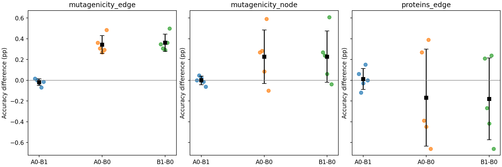

# R5 原始 TSBA 与密度请求价值：三设置完整结果

状态：已完成。以下分别呈现三个设置，不合并成一个跨设置总分。全部主终点为第 30 次尝试。

B0 是源模型；B1 是 M00 零请求，保留持续源 CE、边界响应矩阵与数值保护；A0 是原始 M00＋学习 score。

## 核心判断

**本轮没有建立原始 TSBA 的跨设置稳定收益，也没有建立学习 score 的额外分类价值。** Mutagenicity 两种划分中，A0 相对 B0 的 Accuracy 分别提高 0.343、0.226 个百分点，但零请求 B1 的提高分别为 0.361、0.227 个百分点；这些小幅收益无需学习 score 也能获得。PROTEINS 中，A0 相对 B0 下降 0.167 个百分点。

主比较 A0−B1 的 Accuracy 差依次为 **−0.01844、−0.00154、+0.01199 个百分点**，五个 seed 的胜/平/负为 2/0/3、3/0/2、2/1/2。PROTEINS 的微小正均值并不稳定，其配对 SD 为 0.10081 个百分点；三设置没有一致的 score 收益。BA 与 Macro-F1 也没有给出跨设置一致的支持。

**概率损失恶化是明确的问题。** A0−B0 的目标 NLL 分别增加 0.19397、0.13228、4.96539；A0−B1 仍分别增加 0.00144、0.00383、0.21027。PROTEINS 的目标 NLL 从 B0 的 2.47451 升至 B1 的 7.22962、A0 的 7.43989。与此同时，三设置源训练 NLL 降低、源验证 NLL 升高：持续源拟合没有转化为对应的泛化改善。B1 已出现大部分 NLL 恶化，因此不能把整项风险增加都归给 score；score 也没有修正它。固定 B0 概率缩放改善 NLL 而不改变类别，进一步说明 Accuracy 与概率质量必须分开评估。

**局部旁路没有为 Mutagenicity 的正常请求提供正向 NLL 证据。** 两种划分、两个时点上，正常请求相对零和反向请求的平均 NLL 差均为正；节点数设置四项比较的五个 seed 均为 NLL 退化。执行并非严格为零：可用块上的请求增量执行 RMS 约为 0.0022–0.0026σ，总执行 RMS 约为 0.018–0.023σ，但对应的类别预测变化很小。这里的两个均值不能解释成参数更新向量的严格加法占比。

PROTEINS 有 12/120 个旁路块因无有效边界不可用，来自 M3→M0/M1/M2、seed 3406/3409 的第 1/30 次尝试前。每个时点覆盖 54/60 个任务×seed，只有 3 个 seed 的 12 个方向完整，因此完整五种子旁路均值保持 **NA**；旁路表中的胜/平/负仅计这 3 个完整 seed，另 2 个保留缺失。不能删掉这些缺失项后声称得到完整方向平均。对应 6 个任务×seed 在 B1/A0 各有 180 次无有效边界尝试，仍全部计入 30 次预算及主终点评价。

本轮得到的是对当前 **冻结表示＋7200 步学习 score＋M00 更新** 组合的不利证据，不是“任意真实 score 或任意低密度分隔都无效”的证明。实验没有给出支持原样扩展该组合的稳定效果依据。

## 整体效果

先在每个 seed 内等权平均 12 个方向，再对 5 个 seed 求均值、样本 SD 和胜/平/负。表中 Accuracy、BA、F1 的差为百分点，NLL 保持原量纲。

| 设置 | B0 Accuracy (%) | B1 Accuracy (%) | A0 Accuracy (%) |
|---|---|---|---|
| Mutagenicity 边数（历史） | 69.65833 ± 0.98994 | 70.01961 ± 1.02969 | 70.00117 ± 1.03382 |
| Mutagenicity 节点数（新增） | 71.54957 ± 1.04077 | 71.77705 ± 0.96654 | 71.77551 ± 0.93079 |
| PROTEINS 边数（新增） | 54.91052 ± 1.66339 | 54.73114 ± 1.55574 | 54.74313 ± 1.53014 |

| 设置 | 配对 | Δ Accuracy | SD | 胜/平/负 | Δ BA | Δ Macro-F1 | Δ NLL |
|---|---|---|---|---|---|---|---|
| Mutagenicity 边数（历史） | A0−B1 | -0.01844 | 0.03197 | 2/0/3 | -0.02477 | -0.02379 | +0.00144 |
| Mutagenicity 边数（历史） | A0−B0 | +0.34283 | 0.08599 | 5/0/0 | +0.28002 | +0.33391 | +0.19397 |
| Mutagenicity 边数（历史） | B1−B0 | +0.36128 | 0.08219 | 5/0/0 | +0.30479 | +0.35770 | +0.19253 |
| Mutagenicity 节点数（新增） | A0−B1 | -0.00154 | 0.04082 | 3/0/2 | -0.00740 | -0.00394 | +0.00383 |
| Mutagenicity 节点数（新增） | A0−B0 | +0.22594 | 0.25754 | 4/0/1 | +0.16371 | +0.22823 | +0.13228 |
| Mutagenicity 节点数（新增） | B1−B0 | +0.22748 | 0.24713 | 4/0/1 | +0.17111 | +0.23217 | +0.12845 |
| PROTEINS 边数（新增） | A0−B1 | +0.01199 | 0.10081 | 2/1/2 | +0.03302 | -0.01568 | +0.21027 |
| PROTEINS 边数（新增） | A0−B0 | -0.16739 | 0.46642 | 2/0/3 | -0.21011 | -0.24717 | +4.96539 |
| PROTEINS 边数（新增） | B1−B0 | -0.17938 | 0.39423 | 2/0/3 | -0.24313 | -0.23149 | +4.75512 |

[全部逐方向表与曲线见各设置报告](#分设置材料)。[独立复算的总表](results/aggregate.csv)与[五个 seed 原始值](results/aggregate-seeds.csv)。

彩色点为五个 seed 各自的方向等权配对值，黑方块与误差条为均值±样本 SD。

## 同状态旁路：请求本身是否有价值

第 1/30 次尝试之前，在 A0 实际状态上使用相同边界、源批次、矩阵与共同步长；候选不提交。NLL 差小于零有利，Accuracy 差大于零有利。

| 设置 | 尝试前 | 配对 | Δ NLL | NLL 胜/平/负 | Δ Accuracy | 有效任务×seed |
|---|---|---|---|---|---|---|
| Mutagenicity 边数（历史） | 1 | 正常−零 | +0.00004198 | 1/0/4 | +0.00154 | 60/60 |
| Mutagenicity 边数（历史） | 1 | 正常−反向 | +0.00008390 | 1/0/4 | +0.00461 | 60/60 |
| Mutagenicity 边数（历史） | 30 | 正常−零 | +0.00016942 | 0/0/5 | -0.00308 | 60/60 |
| Mutagenicity 边数（历史） | 30 | 正常−反向 | +0.00033867 | 0/0/5 | -0.00615 | 60/60 |
| Mutagenicity 节点数（新增） | 1 | 正常−零 | +0.00003118 | 0/0/5 | +0.00000 | 60/60 |
| Mutagenicity 节点数（新增） | 1 | 正常−反向 | +0.00006232 | 0/0/5 | -0.00307 | 60/60 |
| Mutagenicity 节点数（新增） | 30 | 正常−零 | +0.00008734 | 0/0/5 | -0.00154 | 60/60 |
| Mutagenicity 节点数（新增） | 30 | 正常−反向 | +0.00017461 | 0/0/5 | -0.00154 | 60/60 |
| PROTEINS 边数（新增） | 1 | 正常−零 | NA | 1/0/2 | NA | 54/60 |
| PROTEINS 边数（新增） | 1 | 正常−反向 | NA | 1/0/2 | NA | 54/60 |
| PROTEINS 边数（新增） | 30 | 正常−零 | NA | 2/0/1 | NA | 54/60 |
| PROTEINS 边数（新增） | 30 | 正常−反向 | NA | 2/0/1 | NA | 54/60 |

旁路完整均值只在每个 seed 的 12 个方向均有可用配对时计算；不完整时保留 NA 和覆盖分母。

## 执行幅度与边界支持

以下为可用旁路块的描述性均值，不把锚点当独立重复。请求幅度为 RMS(ζ)/σ；请求增量执行量为 RMS(αD(δ+−δ0))/σ；总执行量为 RMS(αDδ+)/σ。

| 设置 | 尝试前 | 块数 | 共同 α | 请求 RMS/σ | 请求增量 RMS/σ | 总执行 RMS/σ | 单根/全部锚点 |
|---|---|---|---|---|---|---|---|
| Mutagenicity 边数（历史） | 1 | 60/60 | 0.0486979 | 0.0573899 | 0.0021798 | 0.0233141 | 2855/2855 |
| Mutagenicity 边数（历史） | 30 | 60/60 | 0.0539063 | 0.0608748 | 0.0025066 | 0.0231775 | 2942/2942 |
| Mutagenicity 节点数（新增） | 1 | 60/60 | 0.0471354 | 0.0608262 | 0.0023049 | 0.0222927 | 2924/2924 |
| Mutagenicity 节点数（新增） | 30 | 60/60 | 0.0489583 | 0.0625202 | 0.0024080 | 0.0205967 | 3135/3135 |
| PROTEINS 边数（新增） | 1 | 54/60 | 0.0392072 | 0.0671448 | 0.0022980 | 0.0188813 | 3472/3472 |
| PROTEINS 边数（新增） | 30 | 54/60 | 0.0477431 | 0.0678485 | 0.0026118 | 0.0178814 | 3444/3445 |

[更多几何字段](results/side-motion-summary.csv)。归一化 margin 变化不是精确边界距离；重定位误差只在单根上定义，失败锚点保留在分母中。

## 源域表现与固定概率缩放诊断

固定 B0 logit 倍率 0.5/0.75 仅作概率诊断，没有用于选模或调参。每个池内仍是方向等权、seed 等权。

| 设置 | 池 | B0 NLL | B1 NLL | A0 NLL | B0×0.5 NLL | B0×0.75 NLL |
|---|---|---|---|---|---|---|
| Mutagenicity 边数（历史） | target | 0.79821 | 0.99074 | 0.99218 | 0.63771 | 0.70583 |
| Mutagenicity 边数（历史） | source_fit | 0.29313 | 0.25997 | 0.25999 | 0.37183 | 0.31745 |
| Mutagenicity 边数（历史） | source_validation | 0.45168 | 0.48958 | 0.48894 | 0.45697 | 0.43985 |
| Mutagenicity 节点数（新增） | target | 0.69527 | 0.82372 | 0.82755 | 0.60196 | 0.63721 |
| Mutagenicity 节点数（新增） | source_fit | 0.34227 | 0.31131 | 0.31139 | 0.41811 | 0.36603 |
| Mutagenicity 节点数（新增） | source_validation | 0.46475 | 0.48429 | 0.48430 | 0.48213 | 0.45958 |
| PROTEINS 边数（新增） | target | 2.47451 | 7.22962 | 7.43989 | 1.48878 | 1.97349 |
| PROTEINS 边数（新增） | source_fit | 0.43708 | 0.35627 | 0.35711 | 0.48712 | 0.45164 |
| PROTEINS 边数（新增） | source_validation | 0.51670 | 0.67801 | 0.67341 | 0.53290 | 0.51517 |

## 完整性与存档

总计 360 条轨迹、10,800 次适配尝试，其中新增 240 条/7,200 次，历史复用 120 条/3,600 次。全部 11,160 个状态预测（含各轨迹起点）已重载核验；没有工程失败或数值失败任务被删除。

| 设置 | 源模型 | score | 轨迹 | 尝试 | 重载状态 | 可用旁路 | 重载候选 |
|---|---|---|---|---|---|---|---|
| Mutagenicity 边数（历史） | 20 | 60 | 120 | 3600 | 3720 | 120/120 | 360 |
| Mutagenicity 节点数（新增） | 20 | 60 | 120 | 3600 | 3720 | 120/120 | 360 |
| PROTEINS 边数（新增） | 20 | 60 | 120 | 3600 | 3720 | 108/120 | 324 |

执行代码：`5d46c9637729d4aac1114632528811abbc4644a5`。运行参数和方法没有在观察结果后改变。新增发布工具只读取封存后的记录，独立复算汇总并核验原文件哈希。

[证据记录](results/evidence.json) · [档案索引与封存摘要](results/archive-index.json) · [实际配置](configs/executed-configs.json) · [源选模与 score 完成记录](results/model-completion.json) · [最终事件](results/final-events.jsonl) · [启动时快照](results/startup.md)

完整日志、checkpoints、逐轮状态和预测保存在 `/home/hxchen/research/GDA/TSBA/experiments/r5/<setting>/attempt-001/`。仓库发布逐设置 CSV/图表、最终日志、封存清单和索引；旧 R4 档案没有覆盖。

## 分设置材料

- [Mutagenicity 边数（历史）](results/mutagenicity_edge/report.md)：[旁路种子值](results/mutagenicity_edge/side_seeds.csv)、[旁路分组配对](results/mutagenicity_edge/side_paired.csv)、[全部端点](results/mutagenicity_edge/endpoints.csv)、[源/目标域汇总](results/mutagenicity_edge/summary.csv)、[最终日志](results/final-logs/mutagenicity_edge.log)。
- [Mutagenicity 节点数（新增）](results/mutagenicity_node/report.md)：[旁路种子值](results/mutagenicity_node/side_seeds.csv)、[旁路分组配对](results/mutagenicity_node/side_paired.csv)、[全部端点](results/mutagenicity_node/endpoints.csv)、[源/目标域汇总](results/mutagenicity_node/summary.csv)、[最终日志](results/final-logs/mutagenicity_node.log)。
- [PROTEINS 边数（新增）](results/proteins_edge/report.md)：[旁路种子值](results/proteins_edge/side_seeds.csv)、[旁路分组配对](results/proteins_edge/side_paired.csv)、[全部端点](results/proteins_edge/endpoints.csv)、[源/目标域汇总](results/proteins_edge/summary.csv)、[最终日志](results/final-logs/proteins_edge.log)。

## 结论边界

完整目标域参与 score 拟合与适配，属于传导式开发评价。Mutagenicity 两种划分高度重合；PROTEINS 是另一数据设置，但本轮未登记为独立最终测试。五个 seed 描述固定域划分下的训练随机性，12 个方向共享图和源模型，不是 60 个独立域样本。KDE 仅为无标签诊断参照，不是真实总体 score；本轮结论针对当前表示、估计器、请求幅度和更新规则的组合。
