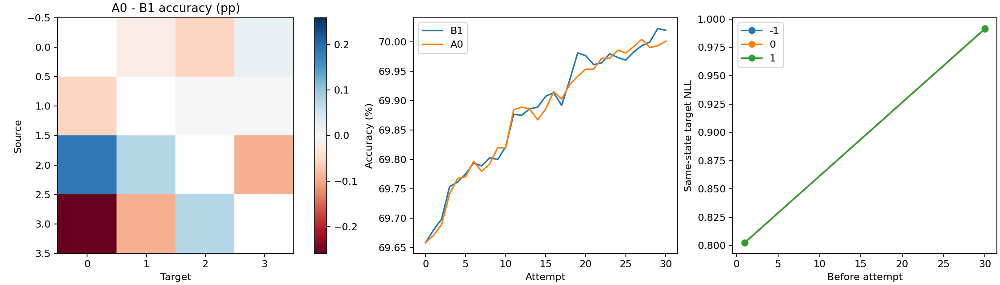
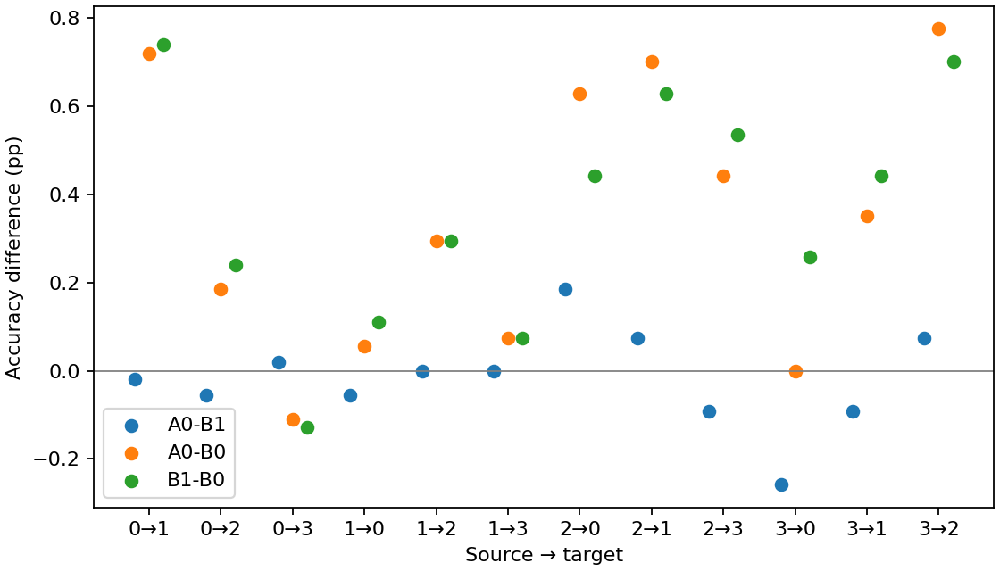

# R5 mutagenicity_edge

第 30 次尝试的完整目标域开发评价。主比较为 A0−B1。

| 配对 | Accuracy 差（百分点） | SD | 胜／平／负 | NLL 差 |
|---|---:|---:|---:|---:|
| A0−B1 | -0.01844 | 0.03197 | 2/0/3 | +0.001442 |
| A0−B0 | +0.34283 | 0.08599 | 5/0/0 | +0.193973 |
| B1−B0 | +0.36128 | 0.08219 | 5/0/0 | +0.192531 |

| 方向 | B0 Accuracy | B1 Accuracy | A0 Accuracy |
|---|---:|---:|---:|
| M0→M1 | 73.6900 ± 2.8616 | 74.4280 ± 1.9961 | 74.4096 ± 1.8935 |
| M0→M2 | 66.2915 ± 0.9466 | 66.5314 ± 0.7646 | 66.4760 ± 0.7817 |
| M0→M3 | 65.7696 ± 2.2116 | 65.6406 ± 2.2076 | 65.6590 ± 2.2231 |
| M1→M0 | 74.0406 ± 0.7455 | 74.1513 ± 1.0135 | 74.0959 ± 1.0093 |
| M1→M2 | 76.0886 ± 2.2163 | 76.3838 ± 1.6960 | 76.3838 ± 1.7345 |
| M1→M3 | 67.0046 ± 1.5116 | 67.0783 ± 1.2234 | 67.0783 ± 1.3122 |
| M2→M0 | 73.2841 ± 1.6536 | 73.7269 ± 1.6776 | 73.9114 ± 1.5428 |
| M2→M1 | 78.9668 ± 1.9537 | 79.5941 ± 1.6827 | 79.6679 ± 1.6368 |
| M2→M3 | 71.6129 ± 2.9058 | 72.1475 ± 2.5403 | 72.0553 ± 2.4948 |
| M3→M0 | 59.6125 ± 7.0563 | 59.8708 ± 6.8917 | 59.6125 ± 6.7631 |
| M3→M1 | 58.5978 ± 5.4473 | 59.0406 ± 5.3573 | 58.9483 ± 5.3422 |
| M3→M2 | 70.9410 ± 3.3037 | 71.6421 ± 3.2285 | 71.7159 ± 3.1787 |
| Avg | 69.6583 ± 0.9899 | 70.0196 ± 1.0297 | 70.0012 ± 1.0338 |

计划旁路 120 块，可用 120 块。

历史复用设置的新增几何字段属于历史状态新增分析；历史预测保持原值。

置信区间描述固定数据设置下五个种子的训练随机性。

CSV 中 accuracy/balanced_accuracy/macro_f1 为 0–1 比例，显式 *_pp 列为百分点；NLL 为原量纲。
旁路汇总保留全部计划 seed，缺少任一方向时完整均值记 NA；available_mean 仅表示注明覆盖的可用子集。

[逐方向配对](paired.csv) · [五种子原始均值](paired_seeds.csv) · [旁路配对](side_paired.csv) · [旁路种子汇总](side_seeds.csv) · [旁路覆盖及统计](side_summary.csv) · [完整端点](endpoints.csv)

