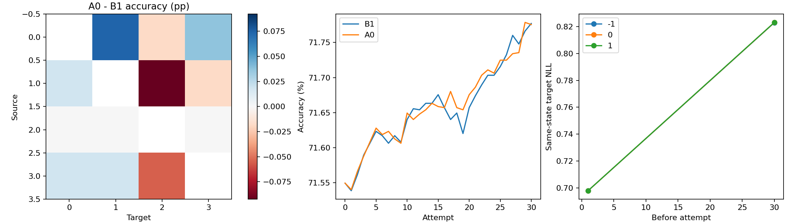
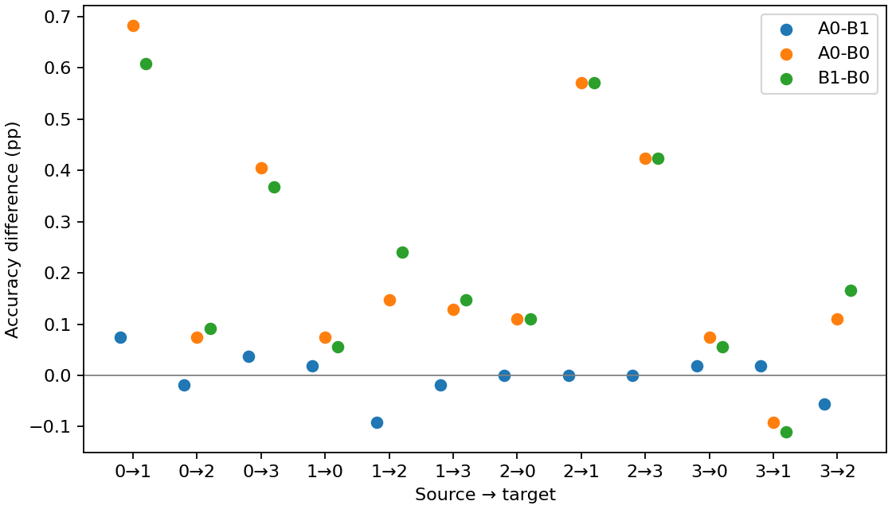

# R5 mutagenicity_node

第 30 次尝试的完整目标域开发评价。主比较为 A0−B1。

| 配对 | Accuracy 差（百分点） | SD | 胜／平／负 | NLL 差 |
|---|---:|---:|---:|---:|
| A0−B1 | -0.00154 | 0.04082 | 3/0/2 | +0.003833 |
| A0−B0 | +0.22594 | 0.25754 | 4/0/1 | +0.132285 |
| B1−B0 | +0.22748 | 0.24713 | 4/0/1 | +0.128452 |

| 方向 | B0 Accuracy | B1 Accuracy | A0 Accuracy |
|---|---:|---:|---:|
| M0→M1 | 77.3063 ± 2.6441 | 77.9151 ± 2.2461 | 77.9889 ± 2.3279 |
| M0→M2 | 69.4280 ± 1.1716 | 69.5203 ± 1.1662 | 69.5018 ± 1.2370 |
| M0→M3 | 66.3594 ± 0.6319 | 66.7281 ± 0.9600 | 66.7650 ± 1.0561 |
| M1→M0 | 72.7860 ± 2.9107 | 72.8413 ± 2.5637 | 72.8598 ± 2.6047 |
| M1→M2 | 78.0812 ± 1.0306 | 78.3210 ± 0.7989 | 78.2288 ± 0.8121 |
| M1→M3 | 67.2811 ± 2.7130 | 67.4286 ± 2.2106 | 67.4101 ± 2.1942 |
| M2→M0 | 71.2362 ± 1.9865 | 71.3469 ± 2.1778 | 71.3469 ± 2.0239 |
| M2→M1 | 82.1956 ± 1.1796 | 82.7675 ± 0.9507 | 82.7675 ± 0.9750 |
| M2→M3 | 69.5300 ± 1.3788 | 69.9539 ± 1.4876 | 69.9539 ± 1.5381 |
| M3→M0 | 65.4059 ± 3.2550 | 65.4613 ± 3.3546 | 65.4797 ± 3.3595 |
| M3→M1 | 66.1255 ± 8.4245 | 66.0148 ± 8.5270 | 66.0332 ± 8.4877 |
| M3→M2 | 72.8598 ± 2.5932 | 73.0258 ± 2.7833 | 72.9705 ± 2.7045 |
| Avg | 71.5496 ± 1.0408 | 71.7771 ± 0.9665 | 71.7755 ± 0.9308 |

计划旁路 120 块，可用 120 块。

本设置全部源模型、score 和适配轨迹为新运行。

置信区间描述固定数据设置下五个种子的训练随机性。

CSV 中 accuracy/balanced_accuracy/macro_f1 为 0–1 比例，显式 *_pp 列为百分点；NLL 为原量纲。
旁路汇总保留全部计划 seed，缺少任一方向时完整均值记 NA；available_mean 仅表示注明覆盖的可用子集。

[逐方向配对](paired.csv) · [五种子原始均值](paired_seeds.csv) · [旁路配对](side_paired.csv) · [旁路种子汇总](side_seeds.csv) · [旁路覆盖及统计](side_summary.csv) · [完整端点](endpoints.csv)

