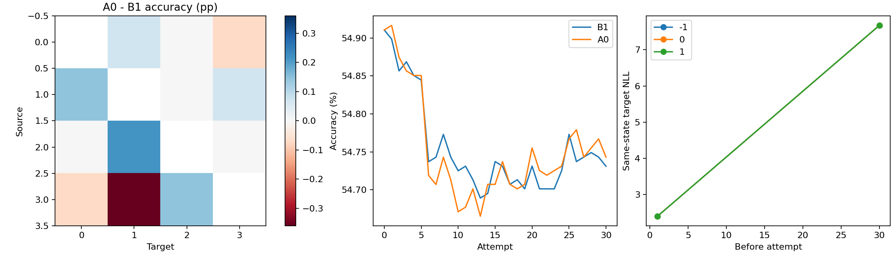
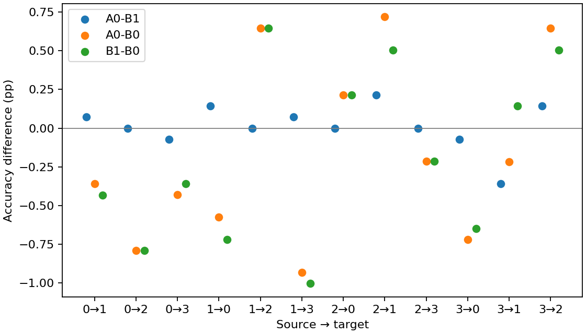

# R5 proteins_edge

第 30 次尝试的完整目标域开发评价。主比较为 A0−B1。

| 配对 | Accuracy 差（百分点） | SD | 胜／平／负 | NLL 差 |
|---|---:|---:|---:|---:|
| A0−B1 | +0.01199 | 0.10081 | 2/1/2 | +0.210270 |
| A0−B0 | -0.16739 | 0.46642 | 2/0/3 | +4.965388 |
| B1−B0 | -0.17938 | 0.39423 | 2/0/3 | +4.755119 |

| 方向 | B0 Accuracy | B1 Accuracy | A0 Accuracy |
|---|---:|---:|---:|
| M0→M1 | 72.0144 ± 1.9931 | 71.5827 ± 2.4791 | 71.6547 ± 2.4582 |
| M0→M2 | 63.0216 ± 2.7910 | 62.2302 ± 4.3908 | 62.2302 ± 4.3908 |
| M0→M3 | 43.4409 ± 9.1920 | 43.0824 ± 8.6965 | 43.0108 ± 8.8270 |
| M1→M0 | 82.3741 ± 2.2174 | 81.6547 ± 2.3996 | 81.7986 ± 2.5257 |
| M1→M2 | 63.0216 ± 2.0882 | 63.6691 ± 2.1432 | 63.6691 ± 1.9371 |
| M1→M3 | 38.7097 ± 8.2086 | 37.7061 ± 8.6965 | 37.7778 ± 8.7451 |
| M2→M0 | 68.0576 ± 10.7234 | 68.2734 ± 10.8315 | 68.2734 ± 10.8255 |
| M2→M1 | 67.9137 ± 3.3686 | 68.4173 ± 2.8255 | 68.6331 ± 2.5486 |
| M2→M3 | 56.3441 ± 8.2492 | 56.1290 ± 8.0888 | 56.1290 ± 8.0888 |
| M3→M0 | 19.7842 ± 3.3552 | 19.1367 ± 3.2113 | 19.0647 ± 2.9988 |
| M3→M1 | 33.3094 ± 6.6697 | 33.4532 ± 6.7007 | 33.0935 ± 6.5985 |
| M3→M2 | 50.9353 ± 7.9324 | 51.4388 ± 8.3821 | 51.5827 ± 8.5032 |
| Avg | 54.9105 ± 1.6634 | 54.7311 ± 1.5557 | 54.7431 ± 1.5301 |

计划旁路 120 块，可用 108 块。

本设置全部源模型、score 和适配轨迹为新运行。

置信区间描述固定数据设置下五个种子的训练随机性。

CSV 中 accuracy/balanced_accuracy/macro_f1 为 0–1 比例，显式 *_pp 列为百分点；NLL 为原量纲。
旁路汇总保留全部计划 seed，缺少任一方向时完整均值记 NA；available_mean 仅表示注明覆盖的可用子集。

[逐方向配对](paired.csv) · [五种子原始均值](paired_seeds.csv) · [旁路配对](side_paired.csv) · [旁路种子汇总](side_seeds.csv) · [旁路覆盖及统计](side_summary.csv) · [完整端点](endpoints.csv)

