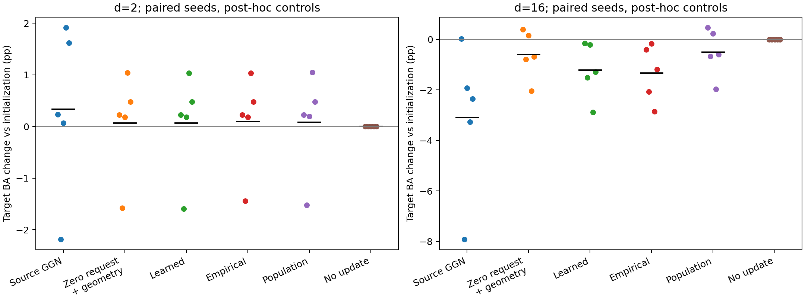
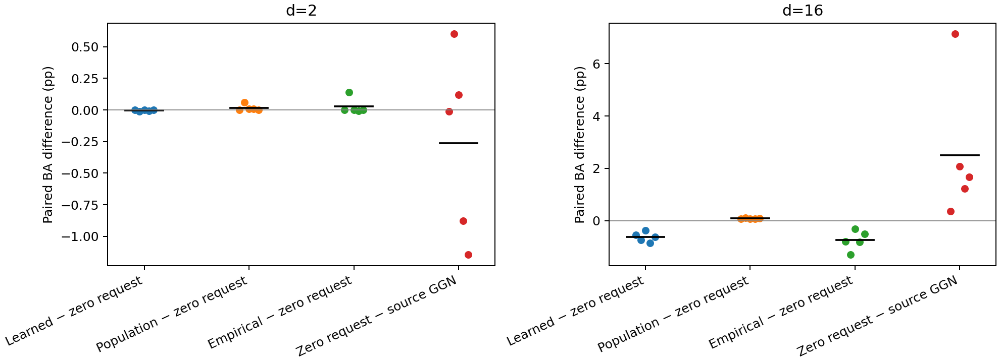

# E2 补充对照结果（2026-11-09）

后续已完成[全源512样本诊断](../e2_full_source_20261110/report.md)：消除全源CE上升后，16维目标退化仍存在。以下保留原128批次结果和当时判断。

**这是查看首轮结果后追加的诊断，不是新的盲测。** 原40条轨迹保留，新增Source-CE-GGN与zero_zeta_geometry各10条，共20条；输入、源初始化、坐标、带宽、种子、逐轮ID和30次尝试预算均与原档案匹配。真实图数据和标签没有读取。

执行代码：[`44b7498`](https://github.com/chx739/TQG-GDA/tree/44b74988d07cdd291bc7c21a34f252c21e8ebc78)。冻结协议见[controls-plan.json](controls-plan.json)；原报告见[首轮结果](../e1_e2_20261109/report.md)。

## 主要判断与对首轮解释的修正

**16维中，learned密度请求相对零请求几何控制的增量为−0.6194±0.1840个百分点，五个种子全部下降，NLL也全部变差。** empirical精确经验score的增量为−0.7405个百分点，同样五个种子全部下降。这个结果支持当前有限样本/带宽下的密度估计存在实际负面作用，不能只解释成“网络没有把DSM训练充分”。

**总体真实score的增量则为+0.0861±0.0158个百分点，五个种子全部提高，NLL全部改善。** 这收窄了首轮的解释：总体score臂相对初始化为−0.5050，并不表示正确密度请求本身无用；零请求几何控制已经为−0.5912，正确请求在此基础上产生小幅正增量，尚不足以扭转整体退化。以上是完整轨迹的配对差，不是逐轮梯度的独立加法分解，也不是真实任务有效性证明。

16维纯源GGN为−3.0859；零请求几何控制相对它改善2.4947个百分点（BA五个种子全部改善，NLL四改善一恶化）。因此完整learned TSBA虽然比纯源GGN好1.8753个百分点，仍不能把这项优势归给密度请求：不提供请求的几何控制反而更好。这里的“几何控制”同时包含DᵀD、位移损失与执行预算，尚未拆开每一项的作用。

2维的情况不同：learned与零请求几何控制只差−0.0040个百分点（3平2负），总体score增量+0.0159个百分点（3胜2平），均很小；纯源GGN相对初始化平均+0.3324，但标准差1.6261。因此不能把16维的现象推广成“继续源训练在所有情况下都会有害”。

## 纯源控制的局限必须同时披露

纯源GGN虽然每轮通过当前mini-batch的Armijo检查，最终**全源训练集CE**在16维平均仍上升0.02588（其中seed1上升0.18068）。零请求几何控制的全源CE平均下降0.02367。每轮批次目标不同，当前批次下降不保证全源CE下降；纯源对照存在步长/批次稳定性限制，不能将它当成调优后的最佳源继续训练基线，也不能简单把其目标退化全部称为过拟合。

本轮保持已登记的阻尼、30轮和源CE Armijo，未按结果追加预算或调整步长。最直接的请求效应比较是learned/population与零请求几何控制的比较；两者保留同样的边界更新规则和预算。真实图实验仍未启动。

## 两组对照的含义

- Source-CE-GGN：仅源CE，A=F_S+μI，rhs=−g_S；同阻尼和Armijo预算，没有位移损失或目标执行预算。
- zero_zeta_geometry：每轮在自己的当前头上重建锚点，保留DᵀD、位移平方损失和执行预算，强制ζ=0仍求解；空锚点跳过。它不是原zero-score跳过更新臂。
- 首轮参考、源批次和矩阵项逐项核验。轨迹分开后锚点/矩阵也随状态变化；长期配对结果是完整消融比较，不是每轮共享矩阵的单步因果分解。

## 六臂相对源初始化

| 维度 | 臂 | ΔBA均值±样本SD（百分点） | 胜/平/负 | ΔNLL均值 |
| --- | --- | ---: | --- | ---: |
| 2 | source_ce_ggn | 0.3324 ± 1.6261 | 4/0/1 | -0.011758 |
| 2 | zero_zeta_geometry | 0.0702 ± 0.9844 | 4/0/1 | -0.001568 |
| 2 | learned | 0.0662 ± 0.9862 | 4/0/1 | -0.001504 |
| 2 | empirical | 0.0963 ± 0.9234 | 4/0/1 | -0.002408 |
| 2 | population | 0.0861 ± 0.9620 | 4/0/1 | -0.001969 |
| 2 | zero | 0.0000 ± 0.0000 | 0/5/0 | 0.000000 |
| 16 | source_ce_ggn | -3.0859 ± 2.9542 | 1/0/4 | 0.165566 |
| 16 | zero_zeta_geometry | -0.5912 ± 0.9569 | 2/0/3 | 0.051209 |
| 16 | learned | -1.2106 ± 1.1220 | 0/0/5 | 0.073647 |
| 16 | empirical | -1.3316 ± 1.1311 | 0/0/5 | 0.074508 |
| 16 | population | -0.5050 ± 0.9599 | 2/0/3 | 0.047572 |
| 16 | zero | 0.0000 ± 0.0000 | 0/5/0 | 0.000000 |

BA正差较好，NLL负差较好。原四臂由封存logits重新计算，未重训或重跑适配。完整逐种子结果见[evaluation.csv](evaluation.csv)。

## 关键配对差

| 维度 | 左臂 − 右臂 | ΔBA均值±配对SD（百分点） | 胜/平/负 | ΔNLL均值 |
| --- | --- | ---: | --- | ---: |
| 2 | learned minus zero_zeta_geometry | -0.0040 ± 0.0054 | 0/3/2 | 0.000064 |
| 2 | population minus zero_zeta_geometry | 0.0159 ± 0.0251 | 3/2/0 | -0.000401 |
| 2 | empirical minus zero_zeta_geometry | 0.0261 ± 0.0639 | 1/3/1 | -0.000840 |
| 2 | zero_zeta_geometry minus source_ce_ggn | -0.2622 ± 0.7255 | 2/0/3 | 0.010190 |
| 2 | learned minus source_ce_ggn | -0.2662 ± 0.7247 | 2/0/3 | 0.010254 |
| 16 | learned minus zero_zeta_geometry | -0.6194 ± 0.1840 | 0/0/5 | 0.022438 |
| 16 | population minus zero_zeta_geometry | 0.0861 ± 0.0158 | 5/0/0 | -0.003637 |
| 16 | empirical minus zero_zeta_geometry | -0.7405 ± 0.3701 | 0/0/5 | 0.023299 |
| 16 | zero_zeta_geometry minus source_ce_ggn | 2.4947 ± 2.6687 | 5/0/0 | -0.114357 |
| 16 | learned minus source_ce_ggn | 1.8753 ± 2.6274 | 4/0/1 | -0.091919 |

差值先在同一种子内计算，再跨5个种子汇总；没有把轮次或锚点当作独立重复。完整配对数值见[paired.csv](paired.csv)。

## 过程与归档

| 维度 | 臂 | 平均接受轮数 | 平均源训练CE变化 | 平均锚点覆盖 | 平均回溯尝试次数/轮 |
| --- | --- | ---: | ---: | ---: | ---: |
| 2 | source_ce_ggn | 30.0 | 0.000472 | NA | 1.00 |
| 2 | zero_zeta_geometry | 30.0 | -0.001542 | 0.0424 | 4.69 |
| 16 | source_ce_ggn | 30.0 | 0.025876 | NA | 1.11 |
| 16 | zero_zeta_geometry | 30.0 | -0.023669 | 0.9997 | 3.37 |

42项工程测试通过。补充运行耗时328.7秒（约5.5分钟），进程峰值RSS约493 MiB。原三种非零score臂的10个单元全部具有30个活动轮，新对照也全部完成30次更新，因此本轮的差异不来自尝试次数不匹配。

执行失败记录：0。已复核235个文件、20个最终头、600轮状态链及批次，重载预测逐位相同。首轮矩阵/参考检查见[checkpoint-audit.json](checkpoint-audit.json)。

源GGN没有边界执行预算，不能称与TSBA等计算量或只差一个score。固定30轮也不代表各方法均已收敛。当前合成设置的结果不能推广为真实图GDA结论，也不用于挑选或改写首轮checkpoint。

本地run目录：`/home/hxchen/experiments/tsba/20261109-controls/run-001`。完整日志、逐轮参数/锚点和checkpoint保存在本地目录及独立压缩档案；GitHub发布报告、表格与[归档索引](archive-index.json)，不提交模型运行二进制。
