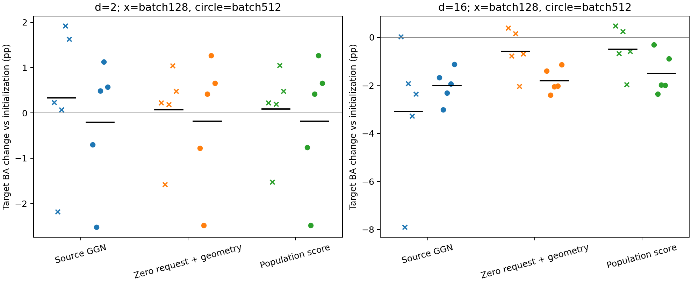
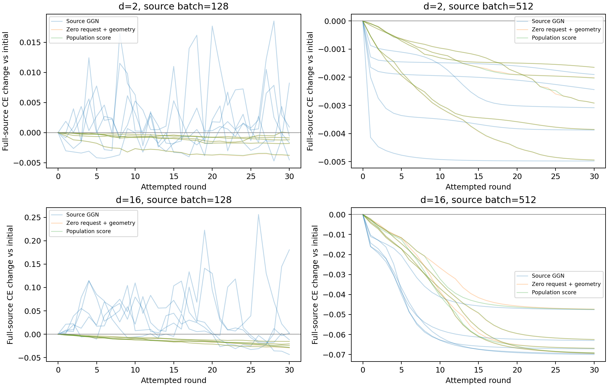

# 全源512样本诊断结果（2026-11-10）

后续已完成[现有checkpoint回放诊断](../e2_replay_20261110/report.md)：确认源过拟合，并测得目标错误置信度上升和边界变形。以下保留该轮原结果与当时判断。

本轮仅把源适配批次从128改为全部512个既有源样本。候选的源梯度/GGN和验收目标中的源CE都使用全源均值；没有增加硬性源风险约束。三组各自在原目标和预算下运行30轮。

执行代码：[`ee4326a`](https://github.com/chx739/TQG-GDA/tree/ee4326afafffe71930b7ee4464144c4f98ce3432)；[执行前冻结协议](https://github.com/chx739/TQG-GDA/blob/ee4326afafffe71930b7ee4464144c4f98ce3432/experiments/synthetic/e2_full_source_20261110/configs/full-source-plan.json)。复用原输入、初始化、源坐标、带宽、目标批次ID和全部数值配置，新增2维数×5种子×3臂=30条轨迹。原128批次结果由已有封存预测复用。

## 主要结论

**扩大源批次消除了全源CE上升，却没有解决目标退化。** 全部30条轨迹正常完成、900轮全部接受；三组全源CE均逐轮下降，没有上升轮次。16维三组的目标BA相对初始化却分别下降2.0131、1.8046、1.5080个百分点，五个种子全部下降；目标NLL也全部上升。此次退化不能再用“当前源批次下降、全源CE反而上升”解释。

**总体真实score仍有正的分类增量，但不能抵消整体退化。** 16维population相对同为全源的ζ=0，配对ΔBA为+0.2965±0.4518个百分点，五个种子均提高；目标NLL平均下降0.020182，四个种子改善、一个恶化。逐种子BA增量依次为+1.0899、+0.0400、+0.0791、+0.0298、+0.2438个百分点，均值明显受到seed0影响。它支持本设置下正确密度请求的正增量，不能把最终负迁移归为密度请求完全无用。

**更稳定、更充分地降低源训练CE，并不等于改善目标分类。** 16维纯源GGN的平均全源CE由0.063990降到0.000537，目标NLL却从0.215904升到0.614889。ζ=0与population的最终全源CE也低于0.001，目标NLL分别升到0.561920和0.541738。已观察到的是源经验目标与目标泛化的错配；“有限源样本拟合”和“源/目标总体最优边界不同”各贡献多少，还没有拆开。

与原128批次相比，16维纯源GGN的BA均值改善1.0728个百分点，但NLL进一步上升0.233419，不能称为各项指标改善。ζ=0的BA平均再降1.2134个百分点（4负1正），population平均再降1.0030个百分点（5负）；两者NLL均恶化。消除批次问题不是本轮方法效果的修复。

2维三组相对初始化的平均ΔBA均约−0.2个百分点，各有3正2负。population相对ζ=0仅+0.0020个百分点（1正4平），NLL平均改善0.000288；正确请求的额外分类收益在这里接近零。

下一项值得区分的问题是：全源继续训练造成的目标退化，主要来自拟合有限源样本，还是即使准确优化源总体风险也与目标边界冲突。可在固定本轮checkpoint的前提下，用独立源评价样本或解析源分布评估逐轮源总体风险，并结合已保存参数检查边界变化；本轮未执行这项扩展，也未据此改选模型。

## 三组的定义

- 纯源GGN：全源CE，矩阵F_S+μI，源CE Armijo，无目标位移项/执行预算。
- ζ=0几何控制：全源CE＋零请求位移平方损失，保留DᵀD与执行预算，每轮按自己的当前头重建边界。
- 总体真实score：生产TSBA目标与验收，仅源批次扩到512，使用同一个解析总体score。
- 仅改源排列的取用长度，原source-then-target随机调用不变；每轮完整源ID的前128项和全部目标ID均与旧档案一致。

## 相对初始化的结果

| 维度 | 源批次 | 方法 | ΔBA均值±样本SD（百分点） | 胜/平/负 | ΔNLL均值 |
| --- | ---: | --- | ---: | --- | ---: |
| 2 | 128 | source_ce_ggn | 0.3324 ± 1.6261 | 4/0/1 | -0.011758 |
| 2 | 128 | zero_zeta_geometry | 0.0702 ± 0.9844 | 4/0/1 | -0.001568 |
| 2 | 128 | population | 0.0861 ± 0.9620 | 4/0/1 | -0.001969 |
| 2 | 512 | source_ce_ggn | -0.2084 ± 1.4554 | 3/0/2 | 0.005937 |
| 2 | 512 | zero_zeta_geometry | -0.1848 ± 1.4824 | 3/0/2 | 0.002985 |
| 2 | 512 | population | -0.1828 ± 1.4814 | 3/0/2 | 0.002697 |
| 16 | 128 | source_ce_ggn | -3.0859 ± 2.9542 | 1/0/4 | 0.165566 |
| 16 | 128 | zero_zeta_geometry | -0.5912 ± 0.9569 | 2/0/3 | 0.051209 |
| 16 | 128 | population | -0.5050 ± 0.9599 | 2/0/3 | 0.047572 |
| 16 | 512 | source_ce_ggn | -2.0131 ± 0.7062 | 0/0/5 | 0.398984 |
| 16 | 512 | zero_zeta_geometry | -1.8046 ± 0.5204 | 0/0/5 | 0.346015 |
| 16 | 512 | population | -1.5080 ± 0.8682 | 0/0/5 | 0.325834 |

BA正差较好，NLL负差较好；全部逐种子结果见[evaluation.csv](results/evaluation.csv)。

## 配对比较

| 维度 | 比较 | ΔBA均值±配对SD（百分点） | 胜/平/负 | ΔNLL均值 |
| --- | --- | ---: | --- | ---: |
| 2 | population_vs_zero | 0.0020 ± 0.0046 | 1/4/0 | -0.000288 |
| 2 | zero_vs_source | 0.0236 ± 0.0925 | 3/0/2 | -0.002952 |
| 2 | source_ce_ggn_512_minus_128 | -0.5408 ± 0.5987 | 1/0/4 | 0.017695 |
| 2 | zero_zeta_geometry_512_minus_128 | -0.2550 ± 0.6356 | 3/0/2 | 0.004553 |
| 2 | population_512_minus_128 | -0.2689 ± 0.6447 | 3/0/2 | 0.004666 |
| 16 | population_vs_zero | 0.2965 ± 0.4518 | 5/0/0 | -0.020182 |
| 16 | zero_vs_source | 0.2085 ± 0.2789 | 3/0/2 | -0.052969 |
| 16 | source_ce_ggn_512_minus_128 | 1.0728 ± 2.4810 | 3/0/2 | 0.233419 |
| 16 | zero_zeta_geometry_512_minus_128 | -1.2134 ± 0.9444 | 1/0/4 | 0.294807 |
| 16 | population_512_minus_128 | -1.0030 ± 0.9263 | 0/0/5 | 0.278262 |

population_vs_zero与zero_vs_source均指512批次；其余为同一方法512减128。差值先在同种子内计算，再跨种子汇总。完整配对表见[paired.csv](results/paired.csv)。

## 全源CE与过程记录

| 维度 | 方法（512批次） | 平均接受轮数 | 平均全源CE变化 | 全源CE上升轮数 |
| --- | --- | ---: | ---: | ---: |
| 2 | source_ce_ggn | 30.0 | -0.003256 | 0 / 150 |
| 2 | zero_zeta_geometry | 30.0 | -0.003077 | 0 / 150 |
| 2 | population | 30.0 | -0.003079 | 0 / 150 |
| 16 | source_ce_ggn | 30.0 | -0.063453 | 0 / 150 |
| 16 | zero_zeta_geometry | 30.0 | -0.063082 | 0 / 150 |
| 16 | population | 30.0 | -0.063045 | 0 / 150 |

上升轮数以1e−10为数值容差；它是记录指标，没有加入接受条件。曲线每条细线对应一个种子；128批次的全源CE在封存后用旧参数快照重新计算。

文件校验263项；重载30个最终分类器，核对900轮状态链和全部源/目标ID；独立复算1380次回溯候选的全源CE，最大日志差异2.78e-17。预测重载要求逐位一致。

44项工程测试通过；运行耗时768.8秒（约12.8分钟），进程峰值RSS为755,044,352字节（约720 MiB），执行失败为0。全部30个旧128批次端点指标与已发布补充对照逐项相同。10个解析总体score状态也已重载核对。

统计与checkpoint核验代码：[c15f911](https://github.com/chx739/TQG-GDA/tree/c15f911)。[process.csv](results/process.csv)保存求解残差、回溯、覆盖、CE与耗时；[source_ce_curves.csv](results/source_ce_curves.csv)保存新旧共1800轮全源CE；[checkpoint-audit.json](results/checkpoint-audit.json)记录重载审计。逐种子NLL、准确率、每类召回和混淆矩阵均在评价表中。

## 范围与档案

这是根据前两轮结果追加的合成机制诊断。固定最终30轮状态，未依据目标指标选轮次或更改配置。失败/异常保留并与正常完成均值分开。源批次增加使每轮源计算量增大，本轮没有等计算量主张。未运行真实图实验。

运行目录：`/home/hxchen/experiments/tsba/20261110-full-source/run-001`。结果、完整逐轮日志、参数/锚点、checkpoint、代码快照和校验信息另存压缩档案，见[归档索引](results/archive-index.json)。原两轮档案不覆盖。
