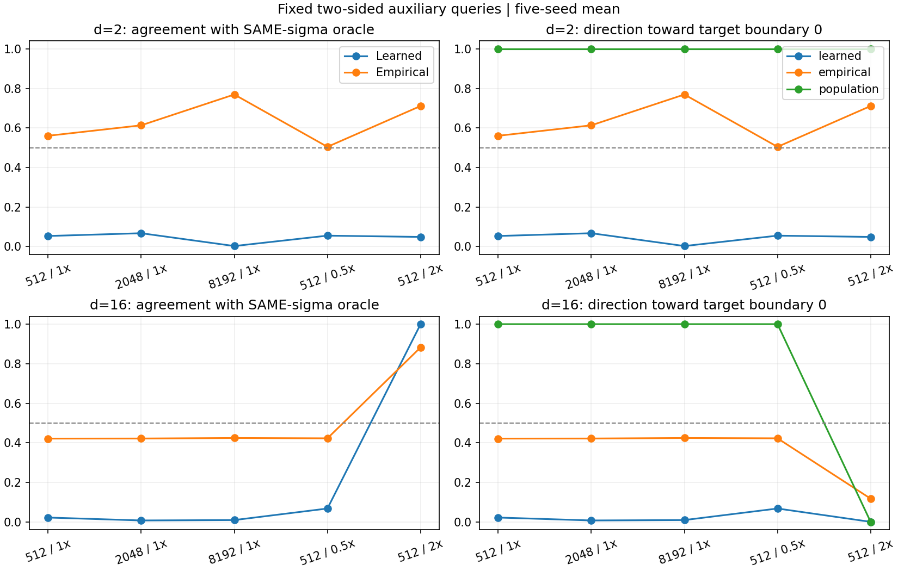
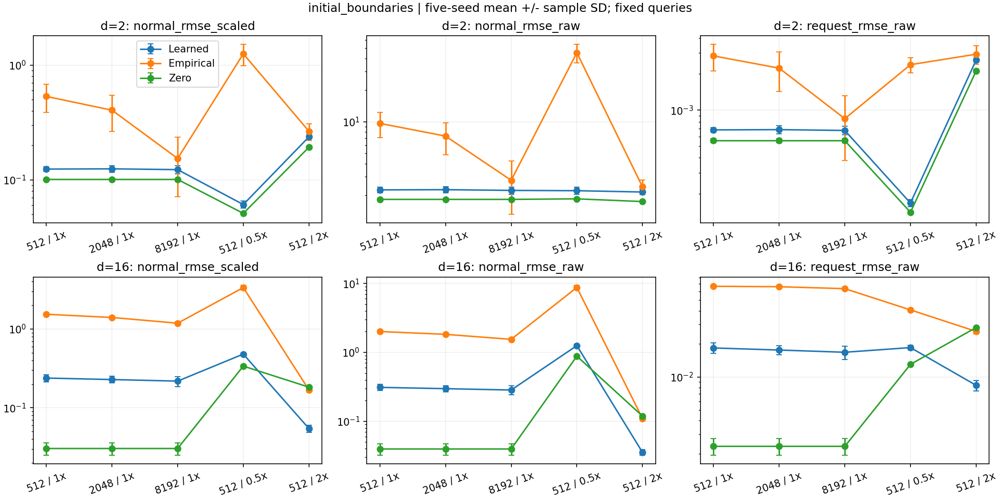
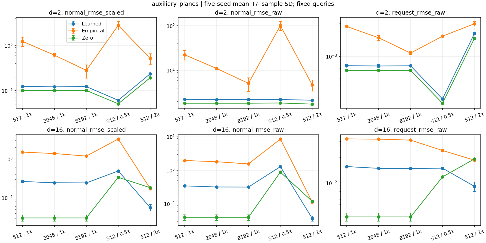

# 第2步：静态 score 样本量与带宽诊断

日期：2026-11-10。执行协议：[static-score-plan.json](https://github.com/chx739/TQG-GDA/blob/TSBA/experiments/synthetic/e2_static_score_20261110/configs/static-score-plan.json)。前序证据：[解析源后验对照](https://github.com/chx739/TQG-GDA/blob/TSBA/experiments/synthetic/e2_source_posterior_20261110/report.md)。

## 结论

**当前五组设置均不支持进入学习 score 的闭环适配。** 50组训练全部完成、没有失败，但在保持有用密度谷的设置下，学习 score 的边界法向方向仍然错误，法向和请求误差也没有优于零 score。16维的2倍带宽虽然使学习 score 几乎完全匹配同带宽总体 score，却把目标双峰平滑成单峰，总体 score 本身已把边界推向错误方向。

增加样本量确实降低了精确经验 score 的法向误差，不能说“加数据完全无效”；但8192样本仍未使16维经验方向可靠，也未使固定400更新的学习模型恢复有用方向。本轮定位出两个并存问题：有限样本密度估计误差，以及现有训练预算下学习模型未学到有用的局部法向结构。

本轮没有更新分类器，没有运行闭环适配，也没有新增分类BA/NLL结论。

## 固定项与唯一变化

| 项目 | 设置 |
| --- | --- |
| 数据 | 与旧合成实验相同的目标GMM；维度2/16，种子0–4 |
| 五组 | N=512/2048/8192且σ=σ₀；另在N=512比较0.5σ₀、2σ₀ |
| σ₀ | 旧512输入上的原带宽；增大N时不重算 |
| 分类器/坐标 | 旧初始分类头与源拟合坐标，全部固定；没有源损失或适配更新 |
| 数据池 | 保留旧512输入；独立追加7680个输入，2048/8192使用嵌套前缀 |
| 训练 | 相同64-64 SiLU网络、初始化、float64、Adam lr=0.001、batch128；均400次更新/51200次样本呈现 |
| 随机流 | 所有设置共用完整训练高斯噪声；N=512复现原打乱流；较大N使用独立固定打乱流 |
| 主checkpoint | 第400次更新，无选模；不是不同N使用相同epoch数 |
| 补充checkpoint | 每4次更新检查同一旧512输入和固定独立噪声的DSM，保存最小损失快照；不是独立样本验证 |
| 查询 | 完整复用旧初始边界、双侧辅助平面及两个1024点噪声查询集，不重投影、不随带宽移动 |

双侧辅助平面固定原始x1=−0.5/+0.5，各512个查询。初始边界在2维每个种子分别有10/3/6/6/7个有效点，在16维各128个。初始边界只有一种总体法向符号，因此不为其虚构“双侧平衡准确率”；主要双侧指标来自辅助平面。辅助平面的干扰坐标来自旧目标池，属于固定训练池相关诊断，不能称为独立样本泛化。

带宽变化时，噪声查询集仍是旧带宽下的固定位置，不能把它们称为各新平滑分布的重新抽样。全向量误差保留在表中，但核心判断使用边界法向和请求。

## 指标和符号

令γ=s(x)·n。法向误差报告`RMSE[σ(γ_est−γ_pop)]`，另给原始坐标的score误差（γ除以坐标scale）。请求严格使用文档公式`ζ=clip(0.1σ²γ, ±0.1σ)`，报告有符号请求误差以及幅值误差；实际边界位移方向为`−ζn`。原始位移误差为坐标scale乘以ζ差。

符号准确率排除`|σγ_ref|≤10⁻³`，同时保存三个带宽共同有效的查询掩码。**本轮两个法向查询集的共同掩码没有排除任何点**，两套口径的总体参考方向指标一致。平衡准确率是正/负两类符号召回的平均；零score的符号为0，记为未命中，而不是50%的随机猜测。

下面均为五种子均值±样本标准差；没有把单个查询当成独立实验重复。对比总体oracle时总是使用当前设置自己的σ。估计误差变小并不自动意味着方向对分类有用。

## 16维：样本量增加没有解决方向错误

双侧辅助查询，主checkpoint：

| N / 带宽 | 学习法向RMSE（σ单位） | 经验法向RMSE（σ单位） | 零score法向RMSE（σ单位） | 学习双侧方向准确率 | 经验双侧方向准确率 |
| --- | --- | --- | --- | --- | --- |
| 512 / 1σ₀ | 0.263946 ± 0.004458 | 1.505126 ± 0.028495 | 0.030438 ± 0.005590 | 2.21 ± 0.90% | 42.13 ± 0.58% |
| 2048 / 1σ₀ | 0.244581 ± 0.006462 | 1.385406 ± 0.022956 | 0.030438 ± 0.005590 | 0.74 ± 0.25% | 42.17 ± 0.65% |
| 8192 / 1σ₀ | 0.242867 ± 0.008270 | 1.190573 ± 0.021333 | 0.030438 ± 0.005590 | 0.94 ± 0.69% | 42.42 ± 0.86% |
| 512 / 0.5σ₀ | 0.492877 ± 0.006161 | 3.278811 ± 0.057707 | 0.338482 ± 0.001615 | 6.78 ± 2.02% | 42.27 ± 0.59% |
| 512 / 2σ₀ | 0.056476 ± 0.010650 | 0.174078 ± 0.004005 | 0.182907 ± 0.000492 | 99.96 ± 0.05% | 88.24 ± 1.21% |

在σ₀不变时，从512增至8192：经验法向误差从1.505126降至1.190573，五个种子均下降；但双侧方向准确率仅从42.13%到42.42%。学习法向误差从0.263946降至0.242867，五个种子也均下降；方向准确率反而从2.21%降至0.94%，五个种子均下降。其误差仍约为零score的8倍。不能用“RMSE有所下降”判断这一环节已经可用。

原始坐标中的有符号请求RMSE：

| N / 带宽 | 学习 vs 总体 | 经验 vs 总体 | 零 vs 总体 | 总体请求朝向正确边界的比例 | 学习请求朝向正确边界的比例 |
| --- | --- | --- | --- | --- | --- |
| 512 / 1σ₀ | 0.0202881 | 0.0665565 | 0.0023361 | 100.00% | 2.21% |
| 2048 / 1σ₀ | 0.0187961 | 0.0658684 | 0.0023361 | 100.00% | 0.74% |
| 8192 / 1σ₀ | 0.0186650 | 0.0631775 | 0.0023361 | 100.00% | 0.94% |
| 512 / 0.5σ₀ | 0.0189434 | 0.0404275 | 0.0130078 | 100.00% | 6.78% |
| 512 / 2σ₀ | 0.0086916 | 0.0267463 | 0.0281180 | 0.00% | 0.04% |

## 带宽效应：两种不同的失败

**0.5σ₀：真实信号更强，估计仍不可靠。** 16维总体法向信号RMS从0.030438升至0.338482（σ单位），总体方向仍全部指向正确边界。可是经验误差增至3.278811；学习误差0.492877仍高于零score，方向准确率只有6.78%。缩小带宽保住并增强了有用信号，同时加剧有限样本估计困难。

**2σ₀：估计容易了，但估计对象已经不合适。** 16维原始坐标平均σ₀约0.768626，翻倍约1.537252。原目标x1分布为均值±1、方差0.25的等权混合；平滑后每个分量方差是`v=0.25+σ_raw²`，其score为`(tanh(x1/v)−x1)/v`。当`v>1`时只有中心峰；这里2σ₀使所有种子都超过这一条件。x1=±0.5处的低密度方向于是朝外，远离正确分类边界0。

所以，99.96%的双侧符号准确率只表示学到了这个已经不合适的平滑密度方向；朝正确边界的比例只有0.04%。总体oracle自身在这组上的正确方向比例是0%。不能把它作为成功带宽带入闭环。

2维原始σ₀平均约0.055149，三个带宽均保留有用双峰方向。其带宽变化与16维不是相同的物理平滑尺度。



## 2维复核：经验方向改善，学习模型没有跟上

| N / 带宽 | 学习法向RMSE（σ单位） | 经验法向RMSE（σ单位） | 零score法向RMSE（σ单位） | 学习双侧方向准确率 | 经验双侧方向准确率 |
| --- | --- | --- | --- | --- | --- |
| 512 / 1σ₀ | 0.122846 ± 0.004024 | 1.229393 ± 0.286516 | 0.100751 ± 0.001929 | 5.37 ± 9.94% | 56.04 ± 6.72% |
| 2048 / 1σ₀ | 0.121298 ± 0.005538 | 0.610022 ± 0.057728 | 0.100751 ± 0.001929 | 6.78 ± 8.22% | 61.33 ± 7.53% |
| 8192 / 1σ₀ | 0.122303 ± 0.003956 | 0.280400 ± 0.091994 | 0.100751 ± 0.001929 | 0.29 ± 0.60% | 76.91 ± 4.66% |
| 512 / 0.5σ₀ | 0.061013 ± 0.001902 | 2.782123 ± 0.601316 | 0.050978 ± 0.001000 | 5.55 ± 8.03% | 50.45 ± 6.81% |
| 512 / 2σ₀ | 0.235227 ± 0.008005 | 0.517044 ± 0.136715 | 0.192193 ± 0.003321 | 4.90 ± 9.66% | 71.09 ± 9.18% |

8192样本时，经验方向准确率提升至76.91%，学习模型却只有0.29%。这说明不能把学习模型失败全部归因于“数据没有局部方向信息”；现有400更新的训练没有将改善的信息转化为有用方向。但经验法向幅值误差仍高于零score，不能据此断言只需把网络精确拟合到经验score就能解决全部问题。

## 初始边界与选模敏感性

初始边界法向RMSE（σ单位）：

| 维度 | N / 带宽 | 学习 vs 总体 | 经验 vs 总体 | 零 vs 总体 |
| --- | --- | --- | --- | --- |
| 2 | 512 / 1σ₀ | 0.124014 ± 0.006092 | 0.533055 ± 0.146517 | 0.100751 ± 0.001929 |
| 2 | 2048 / 1σ₀ | 0.124637 ± 0.008497 | 0.404396 ± 0.140772 | 0.100751 ± 0.001929 |
| 2 | 8192 / 1σ₀ | 0.122660 ± 0.009530 | 0.153454 ± 0.082413 | 0.100751 ± 0.001929 |
| 2 | 512 / 0.5σ₀ | 0.060890 ± 0.004299 | 1.253729 ± 0.262242 | 0.050978 ± 0.001000 |
| 2 | 512 / 2σ₀ | 0.236720 ± 0.009547 | 0.265010 ± 0.043949 | 0.192193 ± 0.003321 |
| 16 | 512 / 1σ₀ | 0.238611 ± 0.025163 | 1.539694 ± 0.074466 | 0.030438 ± 0.005590 |
| 16 | 2048 / 1σ₀ | 0.228473 ± 0.021937 | 1.402440 ± 0.047372 | 0.030438 ± 0.005590 |
| 16 | 8192 / 1σ₀ | 0.218246 ± 0.031436 | 1.185975 ± 0.047288 | 0.030438 ± 0.005590 |
| 16 | 512 / 0.5σ₀ | 0.480899 ± 0.020685 | 3.358792 ± 0.221984 | 0.338482 ± 0.001615 |
| 16 | 512 / 2σ₀ | 0.054541 ± 0.005641 | 0.168860 ± 0.008928 | 0.182907 ± 0.000492 |

初始边界与辅助平面的判断一致：保留正确总体方向的设置中，学习score均未获得低于零score的可靠法向误差；2σ₀在16维的估计改善仍对应错误总体方向。

补充选模结果没有扭转判断。十个基线的原规则选中状态均与历史checkpoint逐位一致；16维基线都选第400次更新，和本轮主结果相同。2维历史基线选中更新分别为400/384/192/220/216，所以其历史双侧准确率9.90%与本轮固定400更新的5.37%不同；本轮不把这个差别归因于样本量或带宽。2维8192样本选模后准确率也仅1.70%，16维2σ₀选模后仍是99.96%的错误密度方向匹配。全部补充值列在`selected_vs_population`记录中。





## 对工作条件的含义与下一步

- 文档§1.3的**局部梯度估计条件**：本轮在有用密度谷设置下仍不满足。增加N至8192与改变带宽未使学习法向信号可靠；16维精确经验score本身也有很大误差。
- **边界—分布条件**：在这个已知合成分布及固定查询上，σ₀和0.5σ₀的总体方向满足局部朝向；16维2σ₀明确破坏它。该结果说明平滑尺度也会决定此条件是否成立。
- **整图表示与类别语义条件**：本轮使用人为构造的固定表示与已知类别对应，没有训练或检验真实GNN表示；本轮也没有更新分类头，不能新增参数局部性、源约束或执行阶段结论。

预先冻结的进入闭环检查要求：学习法向/带符号请求误差优于零score、双侧两类召回均高于50%、总体方向仍正确，并在至少4/5种子保持。**两维数×五设置中，每组通过完整检查的种子都是0/5。** 分项检查见[gates.csv](results/gates.csv)。这是一项明确的实验筛查，不是定理。

下一步应继续静态定位训练问题，暂不做闭环：可优先固定2维、8192样本、σ₀及当前查询，仅增加训练更新预算，检查网络是否能学到经验score中已经改善的双侧结构，并继续同时看总体法向幅值误差。16维还需保留精确经验对照，因为其有限池密度误差尚未解决。不能把更多训练、更多数据、改架构和改带宽一起改变后再作单因素归因。本报告不启动这些后续实验。

## 核验、复现与存档

- 50次训练、20000次Adam更新、0失败；CPU单线程float64。运行约117.6秒，峰值RSS610775040字节。
- [56项工程测试日志](results/engineering-checks.txt)通过。新增检查覆盖原训练逐位复现、嵌套池/更新预算、KDE查询分块等价、方向与幅值区分、宽带平滑方向反转。
- [checkpoint审计](results/checkpoint-audit.json)：400次“最终/选中checkpoint × 查询集”输出重载逐位一致，200个查询集指标重新计算，3100个oracle探针通过独立对数混合密度的自动微分校验；10个历史基线checkpoint逐位一致。
- 运行清单358个文件通过哈希检查，旧实验476个文件复核未改动。固定头、查询点、嵌套池、初始化、噪声与训练步数均核验。没有读取目标评价标签；采样器内部生成的合成分量ID立即丢弃，不进入训练或选模。
- 执行代码提交`87fe50f`；分析代码提交`484cbac`。生产`tsba/`、SEGA参考快照、原始中文设计文档未修改。

可审查入口：[实验工具](https://github.com/chx739/TQG-GDA/blob/TSBA/experiments/synthetic/e2_static_score_20261110/src/estimation.py)、[运行器](https://github.com/chx739/TQG-GDA/blob/TSBA/experiments/synthetic/e2_static_score_20261110/src/run_static_score.py)、[回放分析](https://github.com/chx739/TQG-GDA/blob/TSBA/experiments/synthetic/e2_static_score_20261110/src/summarize_static_score.py)。

```bash
OMP_NUM_THREADS=1 MKL_NUM_THREADS=1 python -m scripts.synthetic.e2_static_score_20261110.run_static_score \
  --parent /absolute/path/completed-original-e1-e2-run \
  --output /absolute/path/new-static-score-run
OMP_NUM_THREADS=1 MKL_NUM_THREADS=1 python -m scripts.synthetic.e2_static_score_20261110.summarize_static_score \
  --run /absolute/path/completed-static-score-run \
  --output /absolute/path/new-static-score-analysis
```

本地完整目录：`/home/hxchen/experiments/tsba/20261110-static-score/`。完整压缩档案：`/home/hxchen/experiments/tsba/archives/20261110-static-score-run-001.tar.gz`；SHA256与成员校验信息见[存档索引](results/archive-index.json)及同名`.sha256`/`.json`旁文件。档案保留50份checkpoint文件中的初始/最终/选中权重与Adam状态、逐更新日志、全部批次ID/训练噪声、固定数据/查询、每查询score/γ/ζ、代码快照、环境、分析结果和失败清单；不覆写旧档案。GitHub只公开代码、报告、标量表、图、日志和清单，模型与逐查询张量留在完整本地档案。

公开表：[逐种子指标](results/metrics.csv)、[方向与信号](results/signals.csv)、[训练设置及选中更新](results/fits.csv)、[配对差](results/paired.csv)、[均值/标准差汇总](results/summary.json)、[运行日志](results/run.log)、[运行文件哈希](results/run-manifest.json)。`learned_vs_empirical`与`empirical_vs_population`分别反映拟合差异和有限池差异，两个RMSE不能直接相加当作总误差的因果分解。
