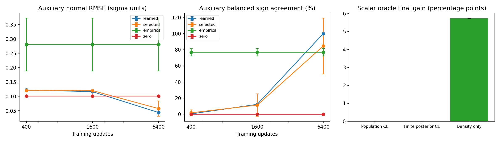

# P0：训练预算与简化 oracle 收益分析

日期：2026-11-10。分支：TSBA。执行协议与代码提交 `4a34240`；汇总和重载核验代码提交 `7fcb41c`。

## 1. 结论与下一步

**本次结果支持继续研究 score，但不支持直接启动学习 score 闭环。**

1. **上一轮400步的失败，不能归结为当前网络学不到有用score。** 固定2维、8192样本、原带宽、原查询点、初始化和Adam超参数，仅延长训练至6400步，双侧方向平衡准确率从0.293%升至99.980%，五种子全部通过原静态检查。1600步仍不够。
2. **学到方向没有消除整个方法的收益瓶颈。** 简化模型用总体真实score、精确边界和总体源后验CE，保留当前权重与位移尺度，平衡收益只有约+0.010785个百分点。其主因是源恢复力很快抵消小幅密度请求，而非score估计误差。
3. **原无标签DSM选模规则仍有问题。** 在6400步预算内，种子4选中第2616步，其双侧方向准确率只有22.754%，而第6400步为100%。验证损失最低不保证边界方向最好。

建议优先进行**已知分布上的oracle权衡分析**：比较请求尺度、边界拟合权重和源保留代价，明确什么范围能产生实质目标收益。当前结果不支持立刻替换score估计方法；也不支持只把训练步数加到6400就宣布TSBA可用。之后若继续检验score，可复用6400步快照做更密的固定阈值查询，检查从0.5到0之间的方向和幅值稳定性；这仍是静态诊断，无需学习score闭环。本轮未执行这些后续实验，也未改生产算法或方法设计正文。

## 2. 冻结设置与证据口径

[执行前协议](p0-plan.json)。种子0–4，维度2，目标样本8192，batch128、Adam学习率0.001、64–64 SiLU网络，CPU float64。每个种子的σ保持上一轮原值，原始坐标σ均值0.055149，范围0.053684–0.056736；没有重新估计或放大带宽。

- 400步checkpoint从上一轮逐字节复制，恢复模型和Adam状态后连续训练到6400步，在1600、6400步保存模型、优化器、完整训练/验证历史及验证选中状态。新增更新共30,000次，0失败。
- 6400步随机序列的前400步与旧批次/噪声逐位一致；旧8192样本、固定坐标、分类头、查询点、掩码和经验/总体score参照全部保持不变。两段长预算共享同一条训练轨迹，因此比较是逐种子配对的。8192样本、batch128时每个完整遍历需要64次更新；400/1600/6400步分别相当于6.25/25/100次遍历。原512样本的400步则是100次遍历：上一轮固定更新数的设计确实控制了计算量，但不能据此认为大样本池也已充分训练。
- **主结果是固定预算末尾模型**；同一旧512输入配独立固定噪声、每4步评估的最小DSM快照仅作补充。这不是独立样本泛化验证，也没有按oracle指标选模型。
- 保留全部四类查询：初始投影边界、双侧辅助平面、固定样本池加噪点、总体独立加噪点。双侧辅助平面每种子1024点；初始边界只有10/3/6/6/7点，且oracle法向符号单侧，不能当双侧验证。
- 表中为五种子等权均值±样本标准差。方向准确率与分类BA是不同指标；百分比表示方向比例，**百分点**表示分类BA差值。原静态检查是描述性筛选，不是统计显著性检验或真实图任务性能保证。

## 3. 静态 score 主结果

双侧辅助平面，比较同带宽总体真实score；法向RMSE以σ为单位，请求RMSE以原始坐标为单位，保留符号后计算。

| 更新次数 | 法向RMSE ↓ | 双侧方向平衡准确率 ↑ | 请求RMSE ↓ | 原静态检查通过 |
|---|---:|---:|---:|---:|
| 400 | 0.122303 ± 0.003956 | 0.293% ± 0.602% | 0.00067472 ± 0.00003224 | 0/5 |
| 1600 | 0.116353 ± 0.003273 | 12.168% ± 12.733% | 0.00064164 ± 0.00002085 | 0/5 |
| 6400 | **0.043689 ± 0.005285** | **99.980% ± 0.044%** | **0.00024088 ± 0.00002891** | **5/5** |
| 精确经验score（固定对照） | 0.280400 ± 0.091994 | 76.914% ± 4.664% | 0.00115015 ± 0.00006798 | — |
| 零score（固定对照） | 0.100751 ± 0.001929 | 0% | 0.00055580 ± 0.00002166 | — |

零score没有位移方向，此处零符号不匹配非零oracle，不能将其0%解释为反向移动。经验score是8192点加相同高斯核后的精确混合密度梯度；它不是总体真值。小带宽有限样本KDE梯度噪声较大，网络可以因平滑偏置而比精确经验score更接近总体score。

相对400步，6400步法向RMSE的配对变化为−0.078613 ± 0.007158，请求RMSE变化−0.00043384 ± 0.00004430，双侧方向比例提高99.6875 ± 0.5956个百分点。五个种子均改善，6400步的方向比例依次为100%、100%、100%、99.9023%、100%。其法向误差比零score均值低约56.6%，但仍非零，不能称为“准确恢复全部score”。

原检查要求：初始边界和双侧平面的法向/请求误差均优于零score；oracle全部朝目标边界，学习score多数朝目标边界；双侧两个符号的召回率都大于0.5。6400步五种子均满足。初始边界方向比例从0%→19.714%→100%；对应法向RMSE为0.122660→0.109576→0.042325。总体独立加噪查询的向量MSE（σ单位、按元素平均）从0.003191→0.002626→0.000523，也随预算降低。



图中误差线是跨种子样本标准差，不是置信区间；比例的均值±标准差可能超出0–100%。oracle两条保留源约束的柱非常小，具体数值见后表。

## 4. DSM选模没有同步变可靠

| 预算 | 固定末尾模型方向准确率 | 最小验证DSM模型方向准确率 |
|---|---:|---:|
| 400 | 0.293% | 1.699% |
| 1600 | 12.168% | 11.230% |
| 6400 | 99.980% | 84.531% |

6400预算内五种子的验证选中步数为5336、4516、6148、6140、2616。种子4是明确反例：第2616步辅助平面方向准确率22.754%、初始边界42.857%；固定第6400步两者均100%。其选中快照的辅助法向RMSE为0.103487，略差于该种子零score的0.100673。

末尾模型验证DSM的五种子均值为1.018316→1.018935→1.015453。整体损失变化很小，边界方向变化却很大。本次证据表明原选模指标与所需的边界方向质量并不充分一致；不能用验证损失接近稳定来证明400步足够。本轮保留原规则作为补充，没有事后替换停止标准。

## 5. 简化 oracle：收益在哪里被限制

采用固定斜率阈值分类器：原始坐标log odds为 `8(x1−b)`，初始 `b=0.5`，目标最优边界为0。仅移动阈值；查询就是精确边界，没有投影失败。目标为等权两高斯、第一维均值±1、标准差0.5；源均值为−0.5和1.5。

令原坐标带宽为h，源坐标缩放为a，优化参数β=(b−mean₁)/a。总体平滑score、原坐标请求与平衡条件为：

```text
s_h(b) = [tanh(b / (0.25 + h²)) − b] / (0.25 + h²)
ν_raw(b) = −clip(τ h² s_h(b), −0.1h, 0.1h)
F(b_new | b) = L_source(b_new) + λ/2 · [(b_new − b − ν_raw(b))/a]²
平衡：L_source'(b) − λ ν_raw(b)/a² = 0
Δb_GGN = [−a² L_source'(b) + λν_raw(b)] / [a² L_source''(b) + λ + μ]
```

保留τ=0.1、λ=1、μ=0.01及原回溯/执行预算。源损失分别使用总体解析后验CE积分和原512源输入上的解析后验CE。总体积分每类1024阶Gauss–Hermite，并用512阶交叉检查；工程测试另用自适应积分和autograd校验源CE及导数。

另做纯密度请求 `b←b+ν_raw(b)`，用于区分密度方向与源恢复力的作用。它移除了源约束，不是TSBA。所有BA都由已知分布解析计算，没有训练或读取真实任务目标标签。

| 简化模型 | 30步ΔBA（百分点） | 最终/平衡ΔBA（百分点） | 最终b | 最终源超额CE |
|---|---:|---:|---:|---:|
| 总体源后验CE + 总体score | +0.010785 | +0.010785 | 0.49954575 | 1.13×10⁻⁷ |
| 原512源输入后验CE + 总体score | +0.011018 | +0.011018 | 0.49953591 | 1.16×10⁻⁷ |
| 纯密度请求，无源约束 | +0.393622 | +5.725244 | 约2.82×10⁻¹⁰ | 0.157948 |

初始BA为91.999742%，目标Bayes BA为97.724987%。保留总体源CE的平衡收益仅占这5.725244个百分点可改善空间的约0.188%。有限512后验与总体积分结果接近，因此在这个简化例子里，消除源标签抽样噪声或增加源积分精度都不能解决小收益问题。

**停止原因如实保留：** 十条保留源约束的标量轨迹在16–25步因浮点精度附近回溯不再接受而停止，并非都达到了1e−12步长阈值；停止位置距独立求根平衡点最大3.94×10⁻⁹。求根残差最大约1.03×10⁻¹⁶，两者给出的收益结论一致。表中30步数值沿用停止状态。纯密度轨迹5944–6589步达到位移阈值，显示密度方向本身能通向正确边界，但原请求很小，且充分移动会付出明显源风险代价。

进一步只做代数计算：若其他项保留不变，使总体源CE平衡在b=0.4、0.25、0.1，所需λ均值约为199、543、1767，当前为1。这些是特定标量模型中的平衡权重，**没有执行这些权重的训练或调参，也不是建议直接把λ设置成这些数**。它说明当前源恢复力与每轮请求的量级失配，单纯解决score误差不会自动带来大收益。

该标量分析固定斜率、只允许平移边界，并使用解析源后验，不能当作完整非线性TSBA头的收益上界。它与上一轮2维后验对照约+0.012105个百分点的微小收益量级接近，但两者参数化不同，不能要求数值完全一致。

## 6. 本次改变了哪些判断

- **已确认：** 在这组2维、8192样本、原带宽设置，400步严重不足；6400步能恢复固定查询点上有用的双侧score方向。仅凭上一轮结果否定score网络方案是不成立的。
- **仍然存在：** 经验密度梯度的有限样本误差、DSM选模与边界质量不一致，以及当前源约束下的收益幅度问题。6400步结果说明网络可以绕开一部分经验梯度噪声，并不意味着它已收敛到经验DSM精确最优解。
- **尚未验证：** 16维在更长预算下的表现、0到0.5整个移动区间的score稳定性、真实图表示上的密度结构，以及完整学习score闭环的分类收益。6400步不是新的通用推荐预算。

优先级：先明确oracle收益—源代价权衡及可接受的设计取舍，再判断是否修改目标或请求规则；保留当前score网络作为有效候选。若修改权重或尺度，应单独冻结协议，避免把源标签噪声、score估计和源约束权衡重新混在一起。本轮到此停止，没有运行学习score闭环。

## 7. 核验、日志与存档

- 59项工程测试通过；15个预算checkpoint、最终/验证选中两种状态、4查询集，共120次重载查询逐位核验；15组Adam步数正确，60组指标复算通过，5组完整随机序列一致；5组oracle从存档输入复算。
- 400步模型直接复制旧文件，训练前后核验两个父实验的全部公开清单。原始设计、`tsba/`生产代码和SEGA参考快照未改。
- 训练约52.19秒，峰值RSS620,007,424字节；时间仅为当前CPU环境记录。
- 首轮工程测试发现积分精度和独立autograd检查的问题，均在协议冻结、实验运行之前修正。原失败测试日志与修正后日志都存档，详见[复现说明](reproduction.md)。训练和汇总各执行一次，没有丢弃失败实验或事后筛种子。

公开证据：[逐种子指标](metrics.csv)、[配对差值](paired.csv)、[选模记录](fits.csv)、[oracle标量结果](oracle.csv)、[逐项检查](gates.csv)、[汇总](summary.json)、[重载审计](audit.json)、[训练日志](run.log)、[测试日志](tests.log)、[执行来源](execution-provenance.json)、[运行文件清单](run-manifest.json)、[完整压缩档索引](archive.json)。CSV包含全部查询和对照，报告表格只摘出主要结果。

完整本地目录：`/home/hxchen/experiments/tsba/20261110-p0/`。完整压缩档：`/home/hxchen/experiments/tsba/archives/20261110-p0-run-001.tar.gz`，SHA256和逐成员校验记录见`archive.json`及同名`.sha256`。其中保留固定输入/查询/分类头、全部批次和高斯噪声、15个模型/Adam checkpoint、全部训练/验证损失、逐查询score/法向/请求，以及oracle完整轨迹、积分输入、源代码快照与环境。大体积张量和模型不进入Git；公开SVG仅移除行尾空白，原图留在不可覆写档案。
