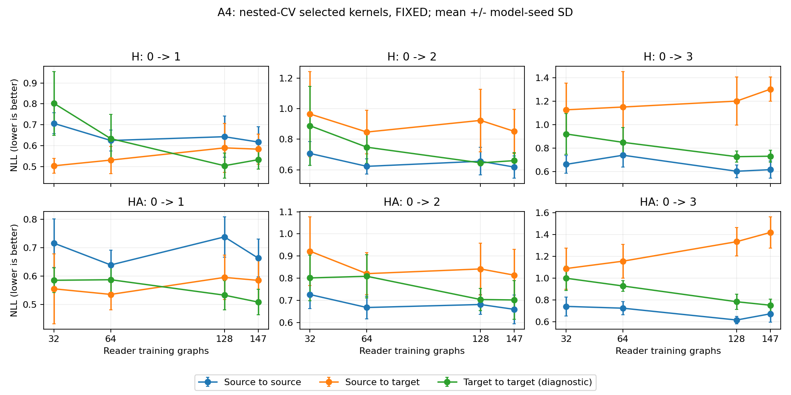
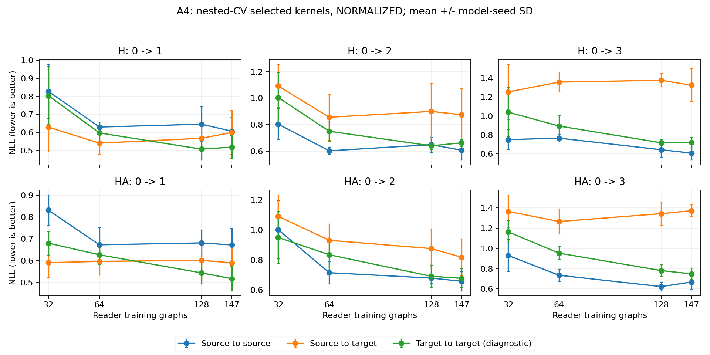

# A4-a核读取学习曲线：阶段结果

已完成三任务、五模型种子、四外折/三内折，368640次逻辑拟合。没有更新GNN。全部源端选择由源内CV完成；T→T是诊断，不能当UDA算法。
完整960份模型/预测、15次封存、276480条CV记录与230400条曲线指标通过独立回放。下表只摘录n147，不能替代全部学习曲线。

| 任务 | 签名 | 正则约定 | S→S NLL | S→T NLL | T→T NLL | S→T越界率 |
|---|---|---|---:|---:|---:|---:|
| 0_to_1 | H | FIXED | 0.6180 | 0.5840 | 0.5337 | 3.69% |
| 0_to_1 | H | NORMALIZED | 0.6067 | 0.5996 | 0.5184 | 3.67% |
| 0_to_1 | HA | FIXED | 0.6635 | 0.5852 | 0.5087 | 5.70% |
| 0_to_1 | HA | NORMALIZED | 0.6725 | 0.5905 | 0.5177 | 5.94% |
| 0_to_2 | H | FIXED | 0.6180 | 0.8517 | 0.6602 | 5.87% |
| 0_to_2 | H | NORMALIZED | 0.6067 | 0.8746 | 0.6628 | 5.63% |
| 0_to_2 | HA | FIXED | 0.6592 | 0.8135 | 0.7016 | 6.96% |
| 0_to_2 | HA | NORMALIZED | 0.6573 | 0.8178 | 0.6770 | 7.44% |
| 0_to_3 | H | FIXED | 0.6180 | 1.3029 | 0.7324 | 13.51% |
| 0_to_3 | H | NORMALIZED | 0.6067 | 1.3255 | 0.7194 | 13.43% |
| 0_to_3 | HA | FIXED | 0.6714 | 1.4185 | 0.7500 | 16.11% |
| 0_to_3 | HA | NORMALIZED | 0.6683 | 1.3724 | 0.7489 | 15.18% |

NLL越低越好。内层选参改变后的预测改善不直接等于反馈有效；下一步仍执行预登记LOCAL/KERNEL及A6。两种正则约定完整保留，不按B挑最好一列。
源H的n147数据/模型在三任务共享，不能当三份独立源证据；目标B历史已被观察，结论属于开发集研究。
JOINT读出观察器未收敛记录：1/7680；保留原标志。

详细指标见 results.csv、summary.csv；审计见 audit.json。A2-b、A6、连续适配和PROTEINS新复验尚未完成。

